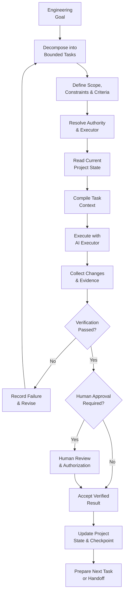

# Beyond Vibe Coding

### Open Engineering Patterns for AI-Assisted Software Development

> **AI is an executor. The project owns its knowledge, state, authority, and continuity.**
>
> **Prompting gets you a prototype. Engineering gets you to production.**

This repository explores a project-centric approach to building and maintaining real software with AI coding agents. It is the public engineering companion to **_BEYOND VIBE CODING: A Practical Guide to Building Real-World Software with AI_** by **Dong Hong**.

The goal is not to make prompts longer or to depend on one particular AI tool. The goal is to make engineering work more controlled, traceable, verifiable, and capable of continuing when models, providers, conversations, or execution environments change.

[**Read BEYOND VIBE CODING on Google Play Books →**](https://play.google.com/store/books/details?id=geQaEgAAQBAJ)

---

## The problem: generating code is not the same as finishing software

AI coding tools can turn ideas into working prototypes remarkably quickly. As a project grows, however, speed alone does not solve the harder engineering problems:

- **Unbounded tasks:** broad requests produce changes that are difficult to scope, review, and verify.
- **Context degradation:** relevant requirements, decisions, constraints, and project facts become fragmented across files and conversations.
- **State loss:** a new session, model, provider, or executor may not know what has actually changed or what remains incomplete.
- **Architectural drift:** locally plausible changes can violate system-wide decisions, interfaces, or constraints.
- **Unverified completion:** an AI response saying “done” is not evidence that the requirement has been met.
- **Unclear authority:** an executor may propose or perform changes beyond its intended scope.
- **Broken continuity:** work becomes dependent on one model, one provider, or one conversation instead of the project itself.

A prototype can run and still be far from a reliable product. This repository focuses on the engineering practices needed to manage that gap.

## The project-centric approach

The central principle is simple:

> **The AI performs a task. The project retains the truth.**

The project—not the conversation or the currently selected model—should remain the durable source of its requirements, accepted decisions, current state, authority rules, and evidence.

This leads to five connected engineering concerns:

| Concern | Engineering question | Intended outcome |
|---|---|---|
| **Task** | What exactly is the executor allowed and expected to do? | Bounded, reviewable work with explicit completion criteria |
| **Context** | What information is relevant, current, authoritative, permitted, and sufficient? | A task-specific working context rather than an indiscriminate dump of project data |
| **State** | What is true about the project now? | A durable, interpretable record of progress and unresolved work |
| **Authority** | Which actions and decisions are permitted, and who approves them? | Clear boundaries between proposing, executing, verifying, and authorizing |
| **Evidence** | How do we know the result is correct? | Verifiable support for completion, handoff, and release decisions |

These concerns work together. They are not a promise that every task requires a large process. The amount of control should be proportionate to the task's scope, risk, and impact.

## Core engineering principles

### 1. Decompose work before execution

Turn a broad engineering goal into bounded tasks with a clear objective, scope, inputs, constraints, dependencies, acceptance criteria, and verification requirements. Smaller tasks are not automatically better; tasks should be small enough to control while still preserving meaningful engineering context.

### 2. Compile the right context

Context Engineering is more than adding more files to a prompt. Select the information needed for the current task and consider its relevance, freshness, authority, scope, dependencies, conflicts, and access permissions.

The book develops the **Context Compiler** as a way to prepare a task-specific execution context. Its purpose is to select and organize project truth—not invent it.

### 3. Keep project state outside the executor

A project should be able to explain what has been completed, what has changed, what is blocked, which decisions are in force, and what must happen next without depending on an AI conversation's memory.

### 4. Make handoffs explicit

When an AI executor, model, provider, run, or environment changes, the next executor should receive a controlled handoff: task status, relevant context, current state, decisions, changes, evidence, and unresolved items.

### 5. Verify before declaring completion

Generated output is not proof of correctness. Define completion criteria before execution and collect appropriate evidence—such as tests, review results, checks, or explicit human approval—before accepting consequential changes.

### 6. Keep authority and responsibility clear

AI may analyze, propose, and execute within an assigned scope. The project must define which actions require review or human authorization, especially where security, data, architecture, production systems, or customer outcomes are involved.

## A reference workflow

The following diagram illustrates the intended engineering lifecycle. It is a conceptual workflow, not a claim that this repository already ships an executable orchestration engine.

The node labels are deliberately concise and manually line-broken so that the full text remains visible in GitHub's Mermaid renderer. Detailed meanings are listed beneath the diagram.



### Workflow step reference

| Step | Meaning |
|---|---|
| Engineering Goal | Establish the intended engineering outcome. |
| Decompose into Bounded Tasks | Break the goal into manageable, reviewable units of work. |
| Define Scope, Constraints & Criteria | Specify allowed work, constraints, dependencies, acceptance criteria, and verification requirements. |
| Resolve Authority & Executor | Determine who or what may perform the task and which actions require approval. |
| Read Current Project State | Load the authoritative current state before changing the project. |
| Compile Task Context | Select relevant, current, permitted, and sufficient information for this execution. |
| Execute with AI Executor | Perform the assigned task within its defined scope. |
| Collect Changes & Evidence | Record what changed and collect evidence needed to evaluate the result. |
| Verification Passed? | Check the result against acceptance criteria and required evidence. |
| Record Failure & Revise | Record the failure, correct the task or implementation, and retry or escalate. |
| Human Approval Required? | Determine whether policy or risk requires human authorization. |
| Human Review & Authorization | Review the evidence and authorize the consequential action when required. |
| Accept Verified Result | Accept the result only after the required checks and approvals. |
| Update Project State & Checkpoint | Record the new state and create a recoverable checkpoint. |
| Prepare Next Task or Handoff | Prepare the next bounded task or transfer work to another executor. |

## Patterns and concepts explored

The companion project is organized around the following areas. Specifications and implementation examples are published incrementally; see [Repository status](#repository-status) before treating an artifact as stable. The first machine-readable Core Specification is the Task Contract v0.1.0, currently Draft / Experimental.

| Area | What it addresses |
|---|---|
| **Task Decomposition** | Bounded tasks, explicit execution scope, dependencies, and acceptance criteria |
| **Task / Execution Contracts** | Structured agreements about objectives, permitted actions, expected outputs, and completion conditions |
| **Context Engineering** | Context selection, retrieval, provenance, minimization, freshness, and conflict handling |
| **Context Compiler** | Preparing a task-specific execution context from recognized project sources |
| **Project Knowledge and State** | Durable project information, current state, decisions, and source-of-truth rules |
| **Continuity and Handoff** | Checkpoints, change records, executor transitions, and recovery |
| **Workspace and Context Locks** | Controlling concurrent changes and preserving the context used for consequential work |
| **Verification and Evidence** | Acceptance criteria, test evidence, review, and release gates |
| **Authority and Governance** | Human responsibility, executor eligibility, permissions, and approval boundaries |

## Who this is for

- **CTOs and technology leaders** shaping how AI-assisted engineering is governed across teams.
- **Software and solution architects** protecting architecture integrity as AI-generated changes accumulate.
- **AI engineers** integrating models and coding agents into controlled software workflows.
- **Engineering managers and team leads** establishing repeatable task, review, handoff, and verification practices.
- **Senior software developers** working with AI coding tools on codebases that must remain maintainable.
- **Technical product managers** coordinating requirements, engineering work, acceptance, and delivery.

This is not intended to be a beginner's prompt collection or a guide to one specific coding assistant. It is aimed primarily at people who already build or lead software and need a more reliable way to work with AI.

## Enerix Fin (EFIN): an engineering case study

The book uses **EnerixFin** (the Enerix Fin project, **EFIN**) as a real-world engineering laboratory for exploring the ideas in this project. Its domain includes Solar and Battery Energy Storage System (BESS) engineering and investment workflows.

The case study follows a connected workflow from customer and site information through engineering analysis, Solar/BESS design, energy analysis, CAPEX and bill of quantities, financial modeling, and investment proposals. It illustrates why a real engineering product requires consistent data, dependencies, verification, and continuity—not just generated screens or isolated code changes.

Any public examples derived from Enerix Fin (EFIN) must be sanitized and published only where the relevant rights and permissions allow. This repository does not disclose customer data, credentials, confidential commercial information, or proprietary implementation details. The case study should not be read as a claim that every described workflow is a deployed production system.

## Documentation

Explore the framework foundation and its current technical specifications:

- [Documentation Index](docs/README.md) — reading order and document status.
- [Framework Overview](docs/framework-overview.md)
- [Conceptual Architecture](docs/architecture.md)
- [Engineering Glossary](docs/glossary.md)
- [Book Chapter Map](docs/book-chapter-map.md)
- [Task Contract Guide](docs/task-contract.md)

**First Core Specification:** [Task Contract v0.1.0](specifications/v0.1/task-contract.md), including its [JSON Schema](specifications/v0.1/task-contract.schema.json), [examples](specifications/v0.1/examples/), [validator](scripts/validate_task_contracts.py), and [automated tests](tests/test_task_contracts.py).

The Task Contract is Draft / Experimental, not a stable standard or runtime sandbox.

## How to use this repository

1. **Start with the problem and principles** in this README.
2. **Inspect the published specification and examples** and check their version and status before adopting them.
3. **Adapt the patterns to your project.** They are intended to support engineering judgment, not replace architecture review, security practices, testing, or human accountability.
4. **Discuss gaps and trade-offs.** Open a focused issue or discussion with a reproducible example and enough context for others to understand the problem.

### Illustrative task contract

The following is a small conceptual example to show the kind of information a bounded task should make explicit. It is **illustrative YAML and is not conformant with the published Task Contract v0.1.0 schema**. Use the [Task Contract Specification](specifications/v0.1/task-contract.md) and [JSON Schema](specifications/v0.1/task-contract.schema.json) for the machine-validatable draft contract.

```yaml
task:
  id: TASK-EXAMPLE-001
  objective: "Add an account export endpoint"
  scope:
    allowed_paths:
      - "src/api/export/**"
      - "tests/api/export/**"
    excluded_paths:
      - "infra/**"
      - "auth/**"
  constraints:
    - "Do not change the public authentication contract."
  acceptance_criteria:
    - id: AC-01
      statement: "An authorized user can export only their own account data."
      verification: "integration test and authorization review"
  completion:
    evidence_required: true
    human_approval_required: true
```

The repository separately publishes Task Contract v0.1.0 with a JSON Schema Draft 2020-12, examples, a reusable template, a Python validator, and automated tests. The simplified YAML above remains conceptual and is not schema-conformant. The validator performs structural and semantic checks and can inspect a supplied post-run diff inventory; it is not a runtime sandbox and does not prevent unauthorized writes during execution.

## Repository roadmap

The repository is being developed incrementally. Current and planned assets are:

- **Published — Draft / Experimental:** Task Contract v0.1.0, its JSON Schema, examples, reusable template, Python validator, and automated tests.
- **Next planned Core Specifications:** Context Manifest, Project State, Change Record, and Verification Evidence. Their schemas and compatibility rules are not yet published.
- **Planned practical patterns:** task decomposition, context compilation, context minimization, checkpoints, workspace locking, executor handoff, and verification gates.
- **Planned reference implementation:** a small, model-agnostic implementation beyond the current validation utility, with reproducible workflows and tests.
- **Planned case-study material:** sanitized Enerix Fin (EFIN) workflows and architecture explanations, subject to rights, confidentiality, and factual review.
- **Planned project governance assets:** contribution guidance, change history, release notes, and other community resources as the project matures.

Roadmap items are intentions, not claims that the corresponding files or implementations are already available. Please check the repository contents and artifact status before relying on them.

## Repository status

**Public framework foundation + first Core Specification: Task Contract v0.1.0 (Draft / Experimental).**

The repository contains the five Phase 1 framework documents, the Task Contract specification and JSON Schema Draft 2020-12, three YAML examples, a changed-files inventory example, a reusable template, a Python validator, and 17 automated unit tests. A GitHub Actions workflow validates the Task Contract examples and runs the unit tests on relevant pushes and pull requests.

These assets do not constitute a complete PAECS runtime or a production-ready reference implementation. The validator performs structural and semantic checks and can inspect a supplied post-run diff inventory. It does not sandbox an executor, enforce filesystem permissions during execution, or by itself prevent unauthorized writes. The workflow's passing checks demonstrate that the published examples and tests pass in that CI run; they do not prove that every possible Task Contract or project implementation is correct.

There is currently no stable API or compatibility guarantee. Task Contract v0.1.0 is Draft / Experimental; changes may be made as the method is reviewed and tested. Other planned specifications must not be treated as published contracts until their files, validation rules, examples, and tests are available.

## Model and tool neutrality

The approach is intended to be **model- and provider-agnostic**. It focuses on the project's task, context, state, authority, and evidence rather than depending on one model vendor or coding assistant.

Examples may refer to particular tools where useful, but no provider is endorsed by this repository. Tool-specific behavior must be verified against the relevant tool's current documentation.

## Contributing and discussion

Practical feedback is welcome—especially reproducible examples, schema reviews, implementation experiments, threat models, failure cases, and suggestions that improve clarity and interoperability.

When opening an issue, please include:

- The engineering problem and intended outcome.
- The relevant task or workflow context.
- A minimal reproducible example, where possible.
- Expected behavior versus observed behavior.
- Security, compatibility, or operational implications.

Please do not publish secrets, credentials, personal data, customer information, or proprietary code in issues or pull requests.

- [Open an issue](https://github.com/donghp/beyond-vibe-coding/issues)
- [Start a discussion](https://github.com/donghp/beyond-vibe-coding/discussions)

## Companion book

**_BEYOND VIBE CODING: A Practical Guide to Building Real-World Software with AI_** by **Dong Hong** develops the ideas behind this repository across 21 chapters, from Vibe Coding and task decomposition to context engineering, project continuity, verification, governance, and the EnerixFin case study.

The repository is intended to provide an open, practical companion. The book develops the broader reasoning, engineering method, trade-offs, and complete discussion behind the concepts.

[**Get the book on Google Play Books →**](https://play.google.com/store/books/details?id=geQaEgAAQBAJ)

## License and reuse

**No repository-wide license has been declared yet.** Until a license is added, the contents remain protected by their applicable copyright; do not assume that public visibility grants permission to reuse, redistribute, or commercially exploit the material.

Code, specifications, diagrams, and prose may require different licensing terms. A license will be added only after those rights and boundaries have been reviewed. Third-party materials, if any, remain subject to their own licenses.

## Author

**Dong Hong** began programming in 1999 and has worked in software development and outsourcing environments. This project reflects an ongoing effort to understand how software engineering practices should evolve when AI systems can participate directly in analysis, implementation, testing, and delivery.

The method is presented as an evolving body of practical work—not as the only way to build software. Its principles should be tested against real project constraints and revised when evidence shows a better approach.

---

**Beyond Vibe Coding** — from generating code to engineering software that can be understood, verified, and continued.
