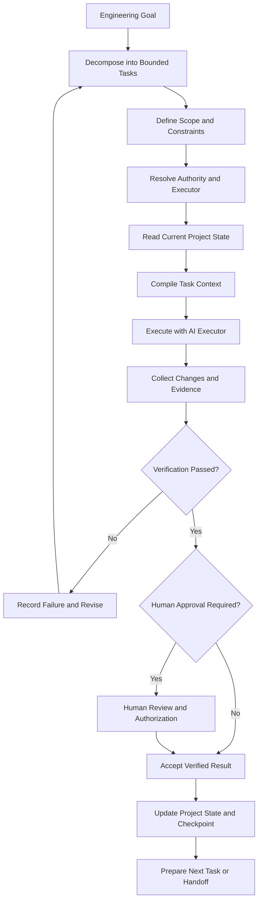

# Beyond Vibe Coding

### A Project-Centric Engineering Framework for AI-Assisted Software Development

> **AI is an executor. The project owns its knowledge, state, authority, and continuity.**
>
> **Prompting gets you a prototype. Engineering gets you to production.**

**Beyond Vibe Coding (BVC)** explores a more disciplined way to build and maintain real software with AI coding tools and agents.

This repository is the open engineering companion to **_BEYOND VIBE CODING: A Practical Guide to Building Real-World Software with AI_** by **Dong Hong**.

BVC does not aim to make prompts longer, build more autonomous agents, or depend on a particular AI provider. Its purpose is to help people build software that remains understandable, secure, controlled, verifiable, and maintainable as AI participates in engineering work.

[**Read BEYOND VIBE CODING on Google Play Books →**](https://play.google.com/store/books/details?id=geQaEgAAQBAJ)

---

## Start Here

BVC is built primarily for people who design, build, review, and lead software engineering work. It helps developers use AI coding tools and agents without giving up control of product decisions, architecture, code quality, security, or delivery.

You do not have to hand-write every line of code. You do need to understand the software being built, inspect what AI changes, verify important behavior, and remain accountable for the engineering outcome.

Through **Build & Learn**, readers can apply the method to practical projects and see how the ideas work beyond isolated prompts and prototypes.

**Recommended starting points:**

1. [Start Here — A 5-Minute Introduction](docs/00-start-here.md)
2. [Framework Overview](docs/framework-overview.md)
3. [Task Contract Guide](docs/task-contract.md)
4. [Core Specifications Index](specifications/v0.1/README.md)
5. [Build & Learn — BVC Task Management Product Definition v0.2.0](projects/task-management/product/BVC_TASK_MANAGEMENT_PRODUCT_DEFINITION_V0.2.0.md)
6. [GitHub Repository Verification Protocol](docs/continuity/GITHUB_REPOSITORY_VERIFICATION.md)

You can also explore the [Documentation Index](docs/README.md) for the complete reading path.

### Primary audience

| Audience | What BVC helps them do |
|---|---|
| **Programmers / Developers** | Decompose work, prepare context, direct AI coding tools, inspect generated changes, test behavior, and deliver maintainable software. |
| **Software Engineers** | Apply engineering judgment to AI-assisted implementation, architecture, verification, security, and long-term maintenance. |
| **Junior Developers** | Build sound habits for task definition, code review, testing, source control, and responsible AI collaboration. |
| **Tech Leads / CTOs** | Establish team-level boundaries for architecture, risk, authorization, quality, delivery, and continuity across AI executors. |

### Extended audience

| Audience | What BVC helps them do |
|---|---|
| **Technical Founders / Indie Hackers** | Turn product ideas into software while keeping scope, quality, cost, and technical risk visible. |
| **CEOs / Business Owners** | Understand what AI-assisted software work can deliver, what must be verified, and where human decisions remain essential. |
| **Beginners** | Start with guided practical work and progressively understand the product, tools, and engineering decisions involved. |
| **Non-programmers** | Work with AI to explore and shape useful software while recognizing the limits of prototypes and the need for engineering review. |

BVC does not lower engineering standards to make AI tools appear effortless. It makes the process understandable and progressively accessible: experienced practitioners can go deep into specifications, schemas, validators, tests, and architecture, while extended audiences can begin with guided product-focused work.

---

## The Problem: Generating Code Is Not the Same as Finishing Software

AI coding tools can turn ideas into working prototypes remarkably quickly.

But as a project grows, speed alone does not solve the harder engineering problems:

- **Unbounded tasks:** Broad requests produce changes that are difficult to scope, review, and verify.
- **Context degradation:** Requirements, decisions, constraints, and project knowledge become fragmented across files and conversations.
- **State loss:** A new session, model, provider, or executor may not know what has actually changed or what remains incomplete.
- **Architectural drift:** Locally plausible changes can violate system-wide decisions, interfaces, or constraints.
- **Unverified completion:** An AI response saying "done" is not evidence that the requirement has been met.
- **Unclear authority:** An executor may propose or perform changes beyond its intended scope.
- **Security exposure:** AI-generated code and tool actions can introduce risks that are not obvious from a successful build.
- **Broken continuity:** Engineering work becomes dependent on one model, one provider, or one conversation instead of the project itself.

A prototype can run and still be far from a reliable product.

The central challenge is not simply how to make AI write code faster. It is how to keep software understandable, secure, verifiable, and under human control throughout its development.

---

## The Project-Centric Approach

The central principle of Beyond Vibe Coding is:

> **The AI performs a task. The project retains the truth.**

The project—not the conversation or the currently selected AI model—must remain the durable source of its requirements, accepted decisions, current state, authority rules, and engineering evidence.

BVC organizes its initial engineering method around five connected concerns:

| Concern | Engineering question | Intended outcome |
|---|---|---|
| **Task** | What exactly is the executor allowed and expected to do? | Bounded work with explicit scope and completion criteria. |
| **Context** | What information is relevant, current, authoritative, permitted, and sufficient? | A controlled, task-specific working context. |
| **State** | What is true about the project now? | A durable record of progress, decisions, and unresolved work. |
| **Change** | What actually changed during execution? | Traceable changes and scope-integrity information. |
| **Evidence** | How do we know the result has been checked? | Verifiable support for completion and acceptance decisions. |

These concerns work together.

They are not intended to make every task complicated. The amount of control should be proportionate to the task's scope, risk, and impact.

---

## Core Engineering Principles

### 1. Decompose Work Before Execution

Turn broad engineering goals into bounded tasks with clear objectives, scope, inputs, constraints, dependencies, acceptance criteria, and verification requirements.

Tasks should be small enough to control while preserving meaningful engineering context.

### 2. Compile the Right Context

Context Engineering is more than adding more files to a prompt.

Select information according to its relevance, freshness, authority, scope, dependencies, conflicts, and access permissions.

The book develops the **Context Compiler** as a way to prepare task-specific execution context. Its purpose is to select and organize project truth—not invent it.

### 3. Keep Project State Outside the Executor

A project should be able to explain what has been completed, what has changed, what is blocked, which decisions are in force, and what must happen next without depending on an AI conversation's memory.

### 4. Keep Authority and Responsibility Clear

AI may analyze, propose, and execute within an assigned scope.

The project must define which actions are permitted and which require human authorization, especially where security, data, architecture, financial calculations, production systems, or customer outcomes are involved.

### 5. Preserve Scope Integrity

The ability of an AI executor to perform an action does not mean it has permission to perform that action.

CREATE, MODIFY, and DELETE permissions must be distinguishable. An executor must not silently expand its authorized scope.

### 6. Verify Before Declaring Completion

Generated output is not proof of correctness.

Define completion criteria before execution and collect appropriate evidence—such as tests, review results, checks, or explicit human approval—before accepting consequential changes.

### 7. Make Continuity Explicit

When an AI executor, model, provider, run, or environment changes, the next executor should receive a controlled handoff containing task status, relevant context, current state, decisions, changes, evidence, and unresolved items.

### 8. Keep the Method Technology-Neutral

The engineering method should not depend on one AI model, provider, IDE, programming language, or execution framework.

The project owns its method and records. Tools and executors operate within the project's defined boundaries.

---

## A Reference Engineering Workflow

The following diagram illustrates the intended BVC engineering lifecycle.

It is a conceptual workflow, not a claim that this repository already ships an executable orchestration engine.



### Workflow step reference

| Step | Meaning |
|---|---|
| Engineering Goal | Establish the intended engineering outcome. |
| Decompose into Bounded Tasks | Break the goal into manageable, reviewable units of work. |
| Define Scope and Constraints | Specify allowed work, constraints, dependencies, and acceptance criteria. |
| Resolve Authority and Executor | Determine who or what may perform the task and which actions require approval. |
| Read Current Project State | Load the authoritative current state before changing the project. |
| Compile Task Context | Select relevant, current, permitted, and sufficient information. |
| Execute with AI Executor | Perform the assigned task within its authorized scope. |
| Collect Changes and Evidence | Record what changed and collect evidence needed to evaluate the result. |
| Verification Passed? | Check the result against acceptance criteria and required evidence. |
| Record Failure and Revise | Record the failure, correct the task or implementation, and retry or escalate. |
| Human Review and Authorization | Review evidence and authorize consequential actions where required. |
| Accept Verified Result | Accept the result only after required checks and approvals. |
| Update Project State and Checkpoint | Record the new state and create a recoverable checkpoint. |
| Prepare Next Task or Handoff | Prepare the next task or transfer work to another executor. |

---

# Phase 1 — Framework Foundation

Phase 1 establishes the conceptual foundation of Beyond Vibe Coding.

The five foundation documents explain the problem, method, architecture, terminology, and relationship between the book and the companion repository.

| Document | Purpose |
|---|---|
| [Start Here](docs/00-start-here.md) | Introduction and recommended learning paths. |
| [Framework Overview](docs/framework-overview.md) | BVC philosophy, principles, problems, and capability areas. |
| [Conceptual Architecture](docs/architecture.md) | Project-centric engineering architecture and intended boundaries. |
| [Engineering Glossary](docs/glossary.md) | Shared terminology and technical definitions. |
| [Book Chapter Map](docs/book-chapter-map.md) | Mapping to the English edition's Introduction, 21 chapters, Conclusion, and end matter. |

These documents describe the intended method and architecture. They do not claim that every conceptual component has already been implemented.

---

# Phase 2 — Core Specifications

Phase 2 turns the central BVC engineering concepts into structured, machine-readable data contracts.

The five specifications form an initial traceable engineering control cycle.

All five are currently **Draft / Experimental v0.1.0** and use JSON Schema Draft 2020-12. Phase 2 integration was completed and merged through [Pull Request #2](https://github.com/donghp/beyond-vibe-coding/pull/2). Completion of the integration does not promote the specifications to Stable.

## The Five Core Specifications

### 1. Task Contract

**Question: What is the AI executor expected and authorized to do?**

Defines:

- Task identity and objective.
- Project baseline.
- Risk policy reference.
- Authorized scope.
- Separate CREATE, MODIFY, and DELETE permissions.
- Forbidden paths and constraints.
- Required context.
- Expected outputs.
- Acceptance criteria.
- Verification requirements.
- Change Budget.
- Authority and Human Approval.
- Stopping conditions.
- Reporting and continuity requirements.

Resources:

- [Task Contract Specification](specifications/v0.1/task-contract.md)
- [JSON Schema](specifications/v0.1/task-contract.schema.json)
- [Examples](specifications/v0.1/examples/)
- [Reusable Template](templates/task-contract.yaml)

### 2. Context Manifest

**Question: Which information is selected for the task, and why should it be used?**

Records:

- Context source identity.
- Provenance and references.
- Source authority and trust classification.
- Freshness and relevance.
- Included and excluded sources.
- Conflicts and unresolved issues.
- Context preparation status.

Resources:

- [Context Manifest Specification](specifications/v0.1/context-manifest.md)
- [JSON Schema](specifications/v0.1/context-manifest.schema.json)
- [Example](specifications/v0.1/core-examples/context-manifest.example.yaml)
- [Reusable Template](templates/context-manifest.yaml)

### 3. Project State

**Question: What is the durable, current state of the project?**

Records:

- Verified project facts.
- Assumptions.
- Accepted decisions.
- Active and completed tasks.
- Blockers.
- Risks.
- Next actions.
- Baseline and recovery references.

Resources:

- [Project State Specification](specifications/v0.1/project-state.md)
- [JSON Schema](specifications/v0.1/project-state.schema.json)
- [Example](specifications/v0.1/core-examples/project-state.example.yaml)
- [Reusable Template](templates/project-state.yaml)

### 4. Change Record

**Question: What actually changed during engineering execution?**

Records:

- Observed file changes.
- CREATE, MODIFY, and DELETE operations.
- Repository baseline references.
- Changed-file inventory.
- Scope-integrity results.
- Change Budget results.
- Deviations and unresolved issues.

Resources:

- [Change Record Specification](specifications/v0.1/change-record.md)
- [JSON Schema](specifications/v0.1/change-record.schema.json)
- [Example](specifications/v0.1/core-examples/change-record.example.yaml)
- [Reusable Template](templates/change-record.yaml)

### 5. Verification Evidence

**Question: Which checks were performed, what evidence resulted, and has the work been accepted?**

Records:

- Acceptance criteria references.
- Verification check definitions.
- Actual check results.
- Evidence references.
- Known limitations.
- Verification outcome.
- Separate human acceptance information.

Resources:

- [Verification Evidence Specification](specifications/v0.1/verification-evidence.md)
- [JSON Schema](specifications/v0.1/verification-evidence.schema.json)
- [Example](specifications/v0.1/core-examples/verification-evidence.example.yaml)
- [Reusable Template](templates/verification-evidence.yaml)

## How the Five Specifications Work Together

```text
             TASK CONTRACT
        Authorized task and scope
                 |
          +------+------+
          |             |
          v             v
    CONTEXT MANIFEST  PROJECT STATE
    Selected sources  Current project facts
          |             |
          +------+------+
                 |
          AI EXECUTION
                 |
                 v
           CHANGE RECORD
         Actual changes observed
                 |
                 v
       VERIFICATION EVIDENCE
         Checks and evidence
                 |
                 v
          HUMAN ACCEPTANCE
```

This is a conceptual traceability relationship, not a mandatory storage sequence for every operation.

The records must preserve their identities, revisions, source baselines, and references to one another.

**Important:** A valid data record does not automatically prove that a real-world action was authorized or correctly performed. Runtime enforcement and trusted evidence collection require additional implementation.

## Validate the Core Specifications

The repository currently provides:

- Five JSON Schemas.
- Three Task Contract YAML examples.
- Four companion Core Specification YAML examples.
- One changed-files inventory JSON example.
- Five reusable YAML templates.
- Two Python validation scripts.
- Automated unit tests.
- A GitHub Actions workflow.

See the [Core Specification Index](specifications/v0.1/README.md) for complete details.

---

## Run the Validation Tools Locally

The current validation tools use Python.

You can run them from the repository root.

### Requirements

- Python 3.12.
- Git.
- A terminal or integrated terminal in VS Code.

### Installation

```bash
python -m pip install -r requirements-dev.txt
```

### Validate Task Contracts

```bash
python scripts/validate_task_contracts.py
```

This checks the published Task Contract examples against the JSON Schema and additional semantic rules.

### Validate the Four Companion Specifications

```bash
python scripts/validate_core_specifications.py
```

This checks the four companion schemas and examples, together with selected relationships across the five-record example bundle.

### Run All Automated Tests

```bash
python -m unittest discover -s tests -v
```

The repository contains 17 Task Contract test cases and 27 companion Core Specification test cases, for a total of **44 automated test cases**.

The most recently reported local full-suite run completed with **44/44 tests PASS**. This is the latest reported local result, not a claim that this README update has already been tested. Check GitHub Actions for the result associated with the exact commit or pull request under review.

---

## Continuous Integration — GitHub Actions

The repository includes a GitHub Actions workflow:

[`.github/workflows/validate-task-contracts.yml`](.github/workflows/validate-task-contracts.yml)

For relevant changes on `main` and Pull Requests targeting `main`, the workflow is designed to:

1. Check out the repository.
2. Set up Python 3.12.
3. Install validation dependencies.
4. Validate Task Contract examples.
5. Validate all five Core Specifications and selected cross-record relationships.
6. Run the automated test suite.

The workflow helps identify invalid schemas, examples, semantic rules, and regressions before changes are accepted.

A passing CI run confirms only that the configured checks passed for the tested revision.

It does not prove that every possible Task Contract is safe, that an AI executor obeyed its permissions, or that a production system is correct.

[**View GitHub Actions →**](https://github.com/donghp/beyond-vibe-coding/actions)

---

## What This Repository Does — and Does Not — Provide

Transparency about implementation maturity is a core BVC principle.

### Currently Provided

- A documented project-centric engineering method.
- Five framework foundation documents.
- Five machine-readable Draft / Experimental Core Specifications.
- Five JSON Schemas using Draft 2020-12.
- YAML examples and reusable templates.
- Python validation utilities.
- Automated unit tests.
- GitHub Actions validation workflow.
- A documented relationship between the book and the technical companion repository.
- The Build & Learn direction and the current BVC Task Management Product Definition v0.2.0; v0.1.0 is retained as the historical product baseline.

### Not Yet Provided

- A complete PAECS runtime.
- A production-ready AI orchestration engine.
- A filesystem sandbox that prevents unauthorized writes during execution.
- A trusted Git diff collector connected to every AI execution.
- A service that authenticates human approvals.
- Automatic enforcement of all project-specific risk policies.
- A completed BVC Task Management application.
- Cloud synchronization or multi-user collaboration for BVC Task Management.
- A stable API or guaranteed backward compatibility.

The current Task Contract Validator performs structural and semantic checks and can inspect a supplied post-run changed-files inventory.

It does not independently collect all actual changes from a trusted execution environment or prevent an AI executor from writing outside its authorized scope.

These limitations are intentional to state clearly. A data specification and its validator are not the same as a complete runtime security system.

---

## Phase 3 — Build & Learn: Practical Projects and Hands-on Guides

**Build & Learn** is a practical learning space for readers who want to use AI to create useful products for real everyday needs. It welcomes beginners and experienced practitioners through simple projects and progressively deeper hands-on guides.

The guiding idea is:

> **Build something useful. Use it every day. Learn by doing.**

The goal is not to build software merely to practice coding. The goal is to start with a real need, build a useful tool with AI, use it in everyday work, and learn how to guide, control, and verify the development process.

### First project — BVC Task Management

**[BVC Task Management — A Simple Daily Work Manager](projects/task-management/product/BVC_TASK_MANAGEMENT_PRODUCT_DEFINITION_V0.2.0.md)** is the first Build & Learn project. Product Definition v0.2.0 was approved by the Product Owner on 2026-11-04 and published through the controlled merge of PR #5. It is the current product baseline on `main`; v0.1.0 remains available as a historical record of the original product direction.

For current project status, acceptance gates, and unresolved implementation decisions, see the [Task Management project guide](projects/task-management/README.md), the [Phase 3 Product / UX Decision Register](projects/task-management/governance/PHASE3_PRODUCT_UX_DECISION_REGISTER_V0.1.md), and the [Governance Reconciliation Execution Record](projects/task-management/governance/GOVERNANCE_RECONCILIATION_EXECUTION_RECORD_2026-11-04.md).

The product remains one practical personal work-management application. It is designed for people managing everyday responsibilities in contexts such as:

- Individual and personal work.
- Sales team leads.
- Marketing managers.
- Executives and business owners.
- Shop owners.
- Restaurant owners.
- Project managers.

Role Starter Kits provide editable starting configurations. They do not create separate products, account roles, access permissions, or specialist CRM/POS/ERP systems.

The product uses a progressive three-level learning and implementation model:

| Level | Learning environment | Persistence and capabilities |
|---|---|---|
| **Beginner — Build & Use** | Google AI Studio Build mode and application preview | No external database, sign-in, VS Code, or Localhost. A small versioned JSON workspace uses browser `localStorage`; users can export and restore a JSON backup. |
| **Intermediate — Build & Connect** | Google AI Studio + Supabase | Supabase PostgreSQL, Auth, SQL, CRUD, and Row Level Security (RLS). Each authenticated user owns a personal workspace. |
| **Advanced — Production Engineering** | Google AI Studio + GitHub + VS Code/Localhost + Supabase + compatible Web App Hosting | Source control, local development, migrations, CI/testing, Preview and live deployment, and operational verification. |

The same product and logical domain model progress through all three levels. The levels add engineering capability progressively; they are not three separate applications.

### Product experience

The application is organized around a small set of everyday work-management areas:

- **My Day:** Overdue, Due Today, Today's Focus, and Upcoming work, following the approved placement rules.
- **My Tasks:** task list, search, filters, sorting, and Kanban where the viewport supports it.
- **Projects:** optional groupings for related tasks; tasks may remain unassigned.
- **Templates:** preview and apply editable Role Starter Kits without silently replacing user data.
- **Settings & Backup:** preferences, versioned JSON export/import, and clear data-storage information.

### User experience direction

The application is intended to provide a simple, natural, responsive experience across:

- iPhone and Android phones.
- Tablets in portrait and landscape orientations.
- Laptops and desktop PCs.

The Phase 3.1 UX package remains the design reference for navigation, screen hierarchy, responsive behavior, interactions, and accessibility expectations. It is not being silently redesigned in Phase 3.2 or Phase 3.3. Its separate formal UX acceptance record remains **OPEN** and must be resolved before the applicable implementation and release gates are closed.

### Data, persistence, and synchronization boundaries

The three learning levels deliberately have different data behavior:

- **Beginner:** the small practice workspace is stored in the current browser profile using `localStorage`. It is not cloud storage, does not automatically synchronize between devices, and may be lost if browser data is cleared. Export and restore are the explicit portability mechanism.
- **Intermediate:** the application uses Supabase PostgreSQL and Supabase Auth. RLS must enforce that each authenticated user can access only their own records.
- **Advanced:** the same Supabase data model is managed with version-controlled migrations and a controlled source-to-deployment workflow.

Supabase Free is the reference database environment for the book's practical exercises. Hosting remains provider-neutral; a compatible free-tier service may be shown as an optional walkthrough example. Vercel is not a mandatory product or architecture dependency. Free-tier terms, eligibility, quotas, inactivity behavior, and backup limitations must be checked against current official provider documentation.

The exact frontend framework and build tool are not assumed. The actual GAIS-exported application scaffold must be inspected before build commands and hosting compatibility are finalized.

### Build & Learn and the five Core Specifications

Build & Learn also provides a way to learn how AI-assisted development can be controlled and verified.

The five Phase 2 Core Specifications remain the engineering control foundation:

1. **Task Contract** — define the engineering task, its authorized scope, and acceptance criteria.
2. **Context Manifest** — record the sources selected for the engineering task.
3. **Project State** — record the durable state of the project.
4. **Change Record** — record observed repository changes.
5. **Verification Evidence** — record checks performed and the evidence produced.

These specifications govern AI-assisted engineering work. They are not the same as the everyday Business Tasks that a person creates and manages inside BVC Task Management. The two concepts must remain separate. An application task may reference an engineering task where useful, but the application must not silently redefine or modify the five Core Specifications.

### Phase 3 status

- **3.0 — Product Baseline:** complete. Product Definition v0.2.0 is the current product baseline on `main`.
- **3.1 — UX & Product Design:** UX artifacts are published; formal UX acceptance remains OPEN.
- **3.2 — Application Architecture & Technical Design:** Product Owner accepted the Phase 3.2 design baseline on 2026-11-04; PR #5 is merged.
- **3.3 — Implementation, Verification, Learning Curriculum & Publication:** active phase. Implementation and verification must be evidenced through bounded tasks and actual test results.

No completed application runtime, Supabase resource, live hosting deployment, RLS test, or production test is claimed by this README unless a corresponding implementation artifact and evidence record is published.

---

## Project Case Study — Enerix Fin (EFIN)

The book uses **Enerix Fin (EFIN)**, also referred to by its product name **EnerixFin**, as a real-world engineering laboratory for exploring the ideas in this project.

Its domain includes Solar and Battery Energy Storage System (BESS) engineering and investment workflows.

The case study follows a connected engineering process:

- Customer and site information.
- Engineering analysis.
- Solar and BESS design.
- Energy analysis.
- CAPEX and bill of quantities.
- Financial modeling.
- Investment proposals.
- Verification and engineering continuity.

It illustrates why real engineering products require consistent data, dependencies, verification, security, and continuity—not just generated screens or isolated code changes.

BVC generalizes the applicable engineering principles. EFIN-specific repository paths, governance identifiers, policies, and operational arrangements are not automatically universal BVC requirements.

Any public examples derived from EFIN must be sanitized and published only where the relevant rights and permissions allow.

This repository does not disclose customer data, credentials, confidential commercial information, or proprietary implementation details. The case study must not be interpreted as a claim that every described workflow is a deployed production system.

---

## Technology, Model, and Provider Neutrality

BVC is intended to remain independent of a particular AI model, model provider, IDE, or coding assistant.

The project should own:

- Its requirements.
- Its authoritative knowledge.
- Its current state.
- Its engineering policies.
- Its task boundaries.
- Its verification evidence.
- Its continuity records.

AI models and coding tools are replaceable executors.

Examples may refer to specific technologies where useful, but no provider is endorsed by this repository. Tool-specific behavior should be verified against the relevant tool's current documentation.

---

## Prompt Engineering — Creative AI Video Labs

Explore practical prompt-engineering workflows for creating consistent, story-driven AI videos.

- [Prompt Engineering Lab Index](prompt-engineering/README.md)
- [Create a Personal Cinematic Music Video with AI — “Don't Ask Me Why”](prompt-engineering/dont-ask-me-why-ai-music-video/README.md)

The featured lab teaches avatar preparation, storyboarding, eight short video prompts, character continuity, output review, and CapCut post-production.

---

## Repository Roadmap

The project is developed incrementally. Each phase should produce reviewable, documented, and verifiable artifacts.

| Phase | Objective | Status |
|---|---|---|
| **Phase 1** | Framework Foundation and Conceptual Architecture | Published |
| **Phase 2** | Five Core Specifications and validation foundation | Integration completed and merged via PR #2; specifications remain Draft / Experimental v0.1.0 |
| **3.0** | Product Baseline — BVC Task Management | Complete; Product Definition v0.2.0 is the current baseline on `main` |
| **3.1** | UX & Product Design | UX package published; formal UX acceptance remains OPEN |
| **3.2** | Application Architecture & Technical Design | Product Owner accepted; PR #5 merged on 2026-11-04 |
| **3.3** | Implementation, Verification, Learning Curriculum & Publication | Active workstream; readiness and curriculum preparation underway; GAIS app implementation/runtime not yet evidenced |
| **Phase 4** | BVC Engineering Runtime & Platform | Proposed future phase; not yet approved as an implementation baseline |

Phase 3.3 progresses through Beginner (GAIS + browser storage), Intermediate (Supabase PostgreSQL/Auth/RLS), and Advanced (GitHub, VS Code/Localhost, CI/testing and compatible hosting). Phase 3 should not be declared complete until all required product, UX, implementation, security, learning-validation and publication acceptance criteria have been evidenced.

Advanced multi-agent orchestration, Router–Worker systems, and complex Harness implementations are not prerequisites for the beginner-friendly Build & Learn projects. They may be evaluated in the future when real use cases and validation evidence justify them.

The priority is a simple, secure, and useful learning experience—not unnecessary complexity.

---

## Repository Status and Maturity

**Current development focus: Phase 3.3 — BVC Task Management implementation, verification and learning publication.**

Phase 1 provides the framework foundation and conceptual architecture. Phase 2 provides five machine-readable Core Specifications, all **Draft / Experimental v0.1.0**, together with JSON Schemas, examples, templates, Python validators, automated tests, and a GitHub Actions workflow.

Phase 3 has a more specific status:

- Product Definition v0.2.0 is the current Product Owner-approved baseline on `main`, published through merged PR #5.
- Phase 3.1 UX artifacts remain available as the design reference, but the formal UX acceptance record remains OPEN.
- Phase 3.2 Application Architecture & Technical Design was accepted by the Product Owner on 2026-11-04 and published through merged PR #5.
- Phase 3.3 is the active implementation and learning-delivery workstream. Current work is in readiness and curriculum preparation; the GAIS application has not yet been evidenced as created/run in this repository. Browser persistence, Supabase integration, CI, hosting and runtime behaviors must be verified before being described as implemented or accepted.

The repository is an evolving engineering companion, not a claim that every described component is already a production runtime.

However:

- The specifications are not an internationally certified standard.
- Draft / Experimental status does not provide stable API or compatibility guarantees.
- The existing validators do not replace runtime security controls.
- Automated test success does not prove universal correctness.
- Human responsibility for architecture, security, acceptance, and release remains essential.

A future Stable specification should require broader valid and invalid examples, boundary and adversarial testing, compatibility rules, independent implementation experience, documented change control, and technical review.

Please check the repository's actual contents, version history, validation results, and known limitations before adopting an artifact.

---

## Contributing and Discussion

Practical feedback is welcome.

Useful contributions include:

- Reproducible engineering examples.
- Specification reviews.
- Schema improvements.
- Validation test cases.
- Implementation experiments.
- Security threat models.
- Failure cases.
- Architecture trade-offs.
- Documentation improvements.
- Suggestions that improve clarity and interoperability.
- Feedback on practical projects, starter kits, and hands-on guides.

When opening an issue, please include:

1. The engineering problem and intended outcome.
2. The relevant task or workflow context.
3. A minimal reproducible example, where possible.
4. Expected behavior versus observed behavior.
5. Security, compatibility, or operational implications.

Please do not publish secrets, credentials, personal data, customer information, or proprietary code in public issues or pull requests.

[**Open a GitHub Issue →**](https://github.com/donghp/beyond-vibe-coding/issues)

---

## Companion Book

**_BEYOND VIBE CODING: A Practical Guide to Building Real-World Software with AI_**

**Author: Dong Hong**

The book develops the ideas behind this repository across 21 chapters, from Vibe Coding and task decomposition to context engineering, project continuity, verification, governance, architecture, and real-world product outcomes.

The book provides the broader reasoning, engineering method, trade-offs, and deeper discussion.

This GitHub repository provides a free practical engineering companion with specifications, templates, examples, validation tools, practical projects, and hands-on guides.

**Read the book and explore the companion resources:**

[**BEYOND VIBE CODING on Google Play Books →**](https://play.google.com/store/books/details?id=geQaEgAAQBAJ)

---

## License and Reuse

**No repository-wide license has been declared yet.**

Until an applicable license is added, repository contents remain protected by their applicable copyright. Public visibility does not automatically grant permission to reuse, redistribute, or commercially exploit the material.

Code, specifications, diagrams, documentation, and book content may require different licensing terms.

Third-party materials, if any, remain subject to their own licenses.

Please check the applicable licensing terms before reusing or redistributing repository content.

---

## Author

**Dong Hong** began programming in 1999 and has worked in software development and outsourcing environments.

Beyond Vibe Coding reflects an ongoing effort to understand how software engineering should evolve when AI systems participate directly in analysis, implementation, testing, and delivery.

The method is presented as an evolving body of practical work—not as the only way to build software.

Its principles should be tested against real project constraints, reviewed by practitioners, and improved when evidence shows a better approach.

---

> **Security First. Human in Control. AI as Executor. Evidence before Acceptance.**

**Beyond Vibe Coding** — from generating code to engineering software that can be understood, secured, verified, and continued.

