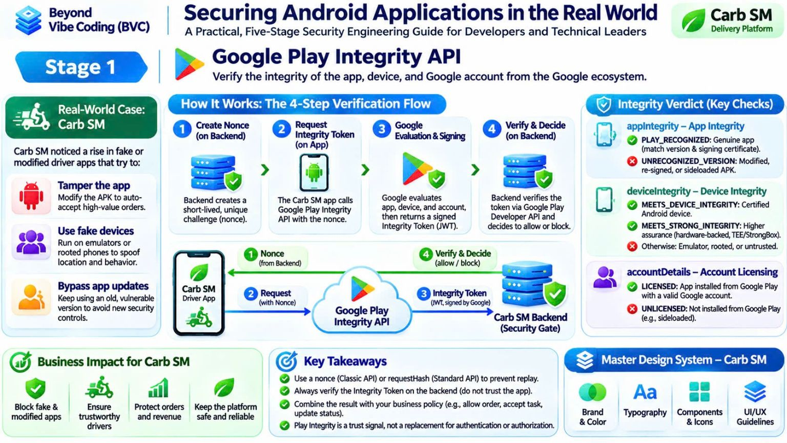
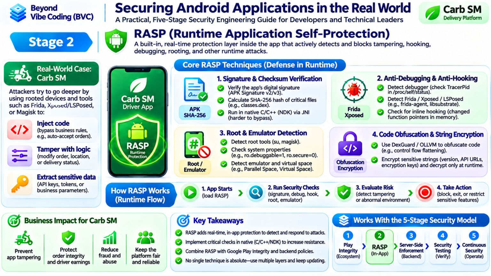
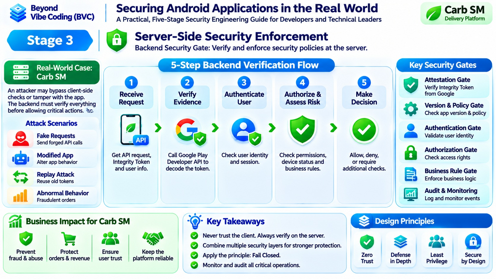
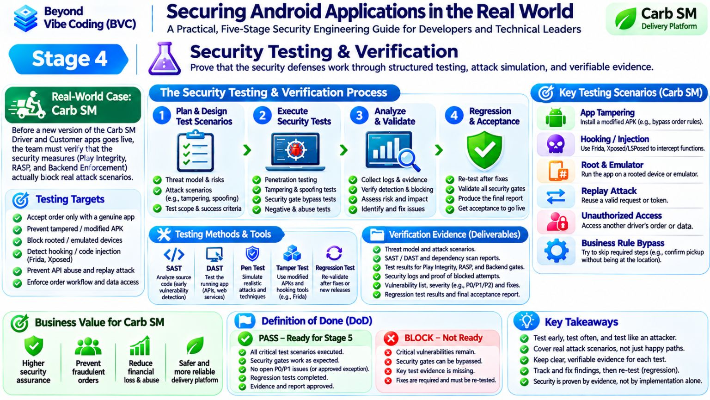

# Securing Android Applications in the Real World

## A practical five-stage Security Engineering guide

**Book connection:** [BEYOND VIBE CODING on Google Play Books](https://play.google.com/store/books/details?id=geQaEgAAQBAJ)

Security is not a single library, API, or checkbox. It is the combined result of architecture, implementation, verification, operations, and accountable engineering decisions.

This guide uses Carb SM, a fictional delivery platform, to explain securing a real Android app and backend.

## The scenario
Carb SM connects customers who place delivery orders, merchants who prepare them, and drivers who accept, collect, and deliver them. The app supports order creation, acceptance, pickup, delivery-status updates, proof of delivery, and related account or payment workflows.

An attacker may use a modified app, compromised device, automated requests, stolen credentials, replayed API calls, or weaknesses in server authorization. Security engineering makes attacks harder, detects abuse, and—most importantly—prevents unauthorized actions from succeeding on the server.

This scenario is fictional and is not a claim about any real delivery platform.

## Five stages at a glance

| Stage | Plain-English explanation | Contribution |
|---|---|---|
| **1. Play Integrity** | Google provides integrity signals about the app, device, and account/licensing context | Helps backend assess whether requests originate from an expected app/device environment |
| **2. RASP** | App checks itself while running for signs of tampering or instrumentation | Adds runtime detection and resistance |
| **3. Server Enforcement** | Server independently decides whether a request is authenticated, authorized, and valid | Prevents client claims becoming authority |
| **4. Testing & Verification** | Team deliberately tests defenses and proves expected outcomes | Evidence, findings, fixes, retests, release confidence |
| **5. Continuous Security** | Security remains active after launch | Monitoring, response, patching, governance, learning |

## Example: accepting a delivery order
A driver taps Accept Order. A secure design does not rely on the button being visible or the app's local code being unmodified.

The backend checks, as applicable:
- Driver identity and active session.
- Eligibility and authorization for the order.
- Order availability and valid state.
- Request freshness and duplicate/replay protection.
- Integrity or risk evidence valid under server policy.
- Business rules, limits, and transaction constraints.
- Atomic state transition to prevent competing acceptances.

If checks pass, the server performs the state transition. Otherwise it rejects, requires additional verification, or applies a policy-defined restriction.

## What each role should do

### Project Manager
- Include security outcomes in scope and acceptance criteria.
- Allocate time for threat modeling, testing, remediation, and release review.
- Track risk, dependencies, exceptions, and security readiness.
- Do not allow security scope to silently disappear.

### Team Leader
- Assign owners for client, backend, QA, security, and operations controls.
- Ensure reviews and evidence are completed.
- Coordinate remediation and escalate unresolved high-risk issues.

### Tech Lead / Architect
- Define trust boundaries and threat model.
- Design server-authoritative workflows, authorization, replay protection, and safe data handling.
- Select controls proportionate to risk and maintainability.

### Developer
- Implement secure defaults, validate input, avoid secret leakage, and use platform APIs correctly.
- Never implement authorization solely in the client.
- Add automated tests for security-sensitive behavior.

### Junior Developer
- Ask what the server trusts, what a user can change, and how behavior is tested.
- Distinguish UI state from authoritative business state.
- Follow secure coding and review requirements rather than copying code blindly.

## RACI — Responsibility Matrix Across the Five Security Stages

RACI clarifies who performs the work and who owns each stage-level outcome:

- **R — Responsible:** performs the work.
- **A — Accountable:** owns the outcome and final decision for that activity.
- **C — Consulted:** provides input before a decision.
- **I — Informed:** kept up to date.

| Role | Stage 1 — Play Integrity | Stage 2 — RASP | Stage 3 — Server Enforcement | Stage 4 — Testing & Verification | Stage 5 — Continuous Security |
|---|---|---|---|---|---|
| **Project Manager (PM)** | C | C | C | C | C |
| **Team Leader** | R | R | R | A | A |
| **Tech Lead / Architect** | A | A | A | C | R |
| **Developer** | R | R | R | R | R |
| **Junior Developer** | I | R* | R* | R* | I |

\* Junior Developers contribute under an assigned reviewer and the team's secure coding process; they do not approve security exceptions or release risk.

### Decision rights and role-specific responsibilities

| Role | Decision ownership and expected contribution |
|---|---|
| **PM — Business risk owner** | Defines business risk tolerance and accepts documented business/UX trade-offs. Example: decide whether a rooted-device signal should trigger a warning, step-up verification, or restriction for a sensitive workflow. The decision must be informed by the Tech Lead's threat assessment and recorded; it must not waive mandatory legal, contractual, or security policy requirements. |
| **Tech Lead — Technical authority** | Designs trust boundaries and Server-Side Security Gates; owns Play Integrity integration/configuration decisions with the Android and Backend engineers; defines technical security acceptance criteria and the Definition of Done, including P0/P1 handling and required evidence. |
| **Team Leader — Delivery and operations coordinator** | Enforces the Code Review and test workflow, ensures owners and evidence are assigned, coordinates remediation and incident response, and oversees operational KPI review and escalation. |
| **Developer — Implementation owner** | Implements server-authoritative checks and secure Android behavior; follows Zero-Trust Client principles; never hardcodes secrets; adds unit, integration, negative, tamper and regression tests as appropriate; documents limitations and evidence. |
| **Junior Developer — Supervised contributor** | Implements scoped tasks from approved designs, avoids secrets in code and logs, adds tests with guidance, reports suspicious behavior or uncertainty early, and requests review before changing security-sensitive logic. |

### How to use this matrix

RACI is a working agreement, not a substitute for named owners. Assign an individual to every **A** and **R** before a stage begins. A stage may contain multiple activities with different accountable decision-makers: for example, the Tech Lead owns technical integrity design, while the PM owns documented business-risk acceptance. The Team Leader coordinates delivery but cannot silently accept technical or business risk on behalf of those decision owners.

For P0/P1 findings, release decisions must follow the organization's approved severity and exception policy. A RACI assignment does not itself authorize a risk exception.

## Security architecture in one sentence
**The app can request; the server must independently verify and authorize; tests must prove; operations must monitor.**

## Stage 1 — Google Play Integrity API

Use Play Integrity to obtain signed integrity evidence and validate it on the backend. Standard requests can bind a verdict to a request using requestHash; Classic requests use a server-generated nonce. Follow current Google documentation and do not treat a verdict as a complete authorization decision.

[Stage 1 details](02-STAGE-1-PLAY-INTEGRITY.md)

## Stage 2 — RASP

Add proportionate runtime checks for app modification, suspicious hooking/debugging, root or virtualized environments, and other risk indicators. Treat detections as signals because client-side controls can be bypassed.

[Stage 2 details](03-STAGE-2-RASP.md)

## Stage 3 — Server-Side Security Enforcement

Backend verifies credentials, request evidence, resource ownership, permissions, workflow state, business rules, freshness, and abuse controls. The backend—not the app—owns the final decision.

[Stage 3 details](04-STAGE-3-SERVER-ENFORCEMENT.md)

## Stage 4 — Security Testing & Verification

Test the design with authorized penetration testing, tampering scenarios, negative tests, authorization checks, API abuse controls, static/dynamic analysis, dependency scanning, and regression tests. Capture reproducible evidence and retest fixes.

[Stage 4 details](05-STAGE-4-SECURITY-TESTING.md)

## Stage 5 — Continuous Security & Governance

Monitor, detect, respond, recover, patch, review exceptions, measure KPIs, and feed incident lessons into the next engineering cycle.

[Stage 5 details](06-STAGE-5-CONTINUOUS-SECURITY.md)

## Definition of a secure release
A release is not approved merely because security code exists. The team needs:
- Current threat model and risk assessment.
- Security requirements linked to implementation and tests.
- Server-side enforcement for sensitive actions.
- Verified integrity handling.
- Reviewed test evidence and remediated findings.
- Approved residual risks and operational readiness.
- Monitoring and incident-response ownership.

## Keep learning
Security engineering is a team discipline. Use BVC principles: keep project knowledge explicit, define authority and boundaries, ask AI to execute within constraints, review changes, test assumptions, and retain evidence.

[Read BEYOND VIBE CODING on Google Play Books](https://play.google.com/store/books/details?id=geQaEgAAQBAJ)
