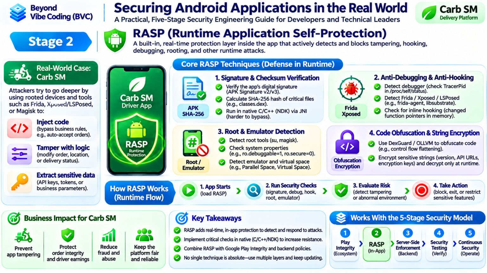

# Stage 2 — Runtime Application Self-Protection (RASP)

**Purpose:** Add runtime detection and response capabilities inside the Android app to raise the cost of tampering and provide risk signals.

## Carb SM scenario
A modified driver app may try to change local order logic, intercept functions, alter location checks, or inspect sensitive data. Runtime defenses can detect indicators and respond, but the client remains an attacker-controlled environment.

## Four technique groups

### 1. App signature and integrity checks
Validate signing identity and integrity of selected critical components. Use well-reviewed mechanisms and avoid brittle self-checks that are easy to patch. A checksum alone is not proof of authenticity; attackers may alter both code and checks. Prefer platform signing, Play Integrity, and backend verification as complementary controls.

### 2. Anti-debugging and anti-hooking signals
Detect suspicious debugger attachment, instrumentation, hooking frameworks, or unexpected runtime modification. Detection is imperfect and can produce false positives. Do not rely on a single process, port, filename, or memory indicator.

### 3. Root and virtualized-environment risk
Look for risk signals associated with rooted devices, emulators, or application virtualization. Use a risk-based response, considering false positives, accessibility, device diversity, and legitimate testing needs.

### 4. Obfuscation and sensitive-string handling
Use supported code shrinking and obfuscation to reduce reverse-engineering exposure. Protect sensitive configuration and avoid placing secrets in the APK. Obfuscation is not encryption of authority and is not a substitute for server-side controls.

## Runtime response model
- **Low risk:** Continue normal behavior.
- **Elevated risk:** Send minimized risk signals, increase monitoring, or require additional verification.
- **High risk:** Restrict sensitive actions, terminate an unsafe session, or block according to documented policy.
- **Unknown/error:** Use a policy-defined behavior; protect critical operations without unnecessarily locking out legitimate users.

## Engineering cautions
- Native code is not inherently tamper-proof.
- RASP is bypassable and must not be the sole security boundary.
- Avoid invasive monitoring that collects unnecessary personal data.
- Detection logic should be maintainable and tested across supported devices.
- Avoid random crashes or destructive responses; use predictable, user-supportable actions.
- Keep security checks and response policy separate from critical business authority.

## Implementation checklist
- [ ] Document runtime threats and expected signals.
- [ ] Select proportionate protection mechanisms and evaluate vendor claims.
- [ ] Integrate checks without destabilizing app or accessibility.
- [ ] Avoid embedding secrets or private keys.
- [ ] Define risk-based behavior and recovery path.
- [ ] Test false-positive, unsupported-device, offline, and update cases.
- [ ] Review privacy impact and data minimization.

## Acceptance evidence
Test matrix by device/environment, documented detection limitations, response-policy review, crash/stability results, privacy review, and backend correlation of risk signals.

## References
- [OWASP MASVS](https://mas.owasp.org/MASVS/)
- [OWASP MASTG](https://mas.owasp.org/MASTG/)
