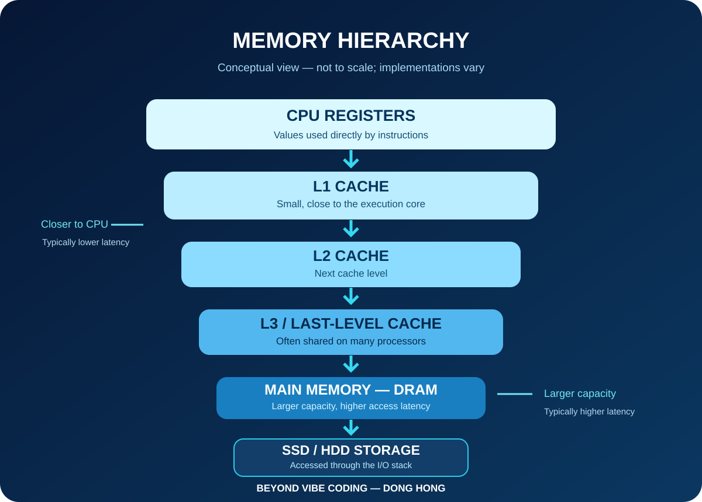
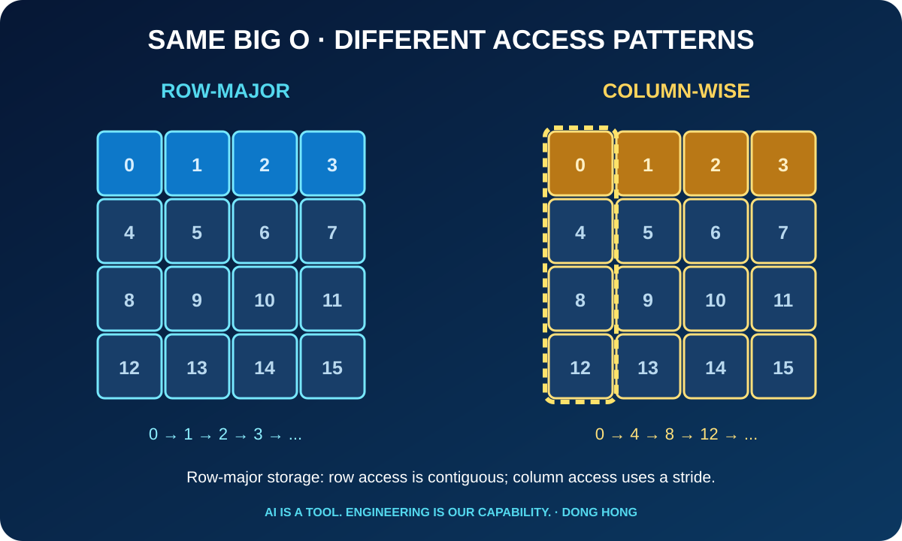

# Research #001 — Why Software Is Slow

## From Big O to CPU Cache and Memory Latency

**Series:** Beyond Vibe Coding · Computer Science Research  
**Author:** Dong Hong  
**Status:** Initial research draft  
**Research domains:** Computational Thinking · Computer Architecture · Memory Systems · Software Performance Engineering

> **Research deeply. Explain simply. Think like an engineer.**

## Abstract

A program can be logically correct and still perform poorly. Big O describes asymptotic growth, but it does not predict wall-clock runtime by itself. Actual performance also depends on constants, implementation, data layout, memory access patterns, cache behavior, processor execution, and workload.

This article connects three levels of performance reasoning:

1. **Algorithmic complexity:** how the amount of work grows.
2. **Memory behavior:** how data is arranged and accessed.
3. **Hardware execution:** how the processor obtains data and overlaps computation with waiting.

The central question is:

**Why can two implementations with the same Big O run at noticeably different speeds?**

## 1. Start with the symptom

Imagine processing a large collection of records. The program returns the correct result, but users wait several seconds.

It is tempting to rewrite a loop or switch programming languages immediately. That may help, but the slowdown could come from several places:

- too much algorithmic work;
- an unsuitable data structure;
- poor data locality;
- cache misses and memory stalls;
- allocation or copying;
- database, storage, or network I/O;
- synchronization or external dependencies.

A correct diagnosis begins with a question, not an optimization guess:

**Which resource is limiting this workload, and what evidence supports that explanation?**

## 2. Big O: growth, not a stopwatch

Big O describes an asymptotic upper bound on a function. In algorithm analysis, the function may represent time, space, or another resource as input size grows.

For non-negative functions f(n) and g(n), f(n) is in O(g(n)) if there are positive constants c and n₀ such that:

```text
0 ≤ f(n) ≤ c · g(n), for all n ≥ n₀
```

For example:

```text
T(n) = 3n² + 5n + 7
```

has an asymptotic growth rate of O(n²).

The lower-order terms and constant coefficient do not change the asymptotic class. They can still matter substantially for finite input sizes and real execution.

### Common growth classes

| Class | Typical interpretation | Example |
|---|---|---|
| O(1) | Constant with respect to input size | Array element access by index |
| O(log n) | Logarithmic growth | Binary search on a suitable sorted random-access structure |
| O(n) | Linear growth | One pass through an array |
| O(n log n) | Linearithmic growth | Merge sort |
| O(n²) | Quadratic growth | Comparing every pair in a simple nested-loop algorithm |
| O(2ⁿ) | Exponential growth | Enumerating all subsets |

These are representative examples, not rules inferred from syntax alone.

### Big O is not synonymous with worst case

Worst-case, average-case, and best-case analysis specify which inputs or distributions are being considered. Big O then describes an asymptotic upper bound for the relevant function. Worst-case analysis often uses Big O, but the concepts are not interchangeable.

### What Big O does not tell us

Big O alone does not tell us:
- exact runtime in milliseconds;
- constant factors;
- how the compiler optimizes code;
- whether data is in cache or DRAM;
- how many instructions execute;
- how much work overlaps;
- whether the workload is CPU-, memory-, I/O-, or synchronization-bound.

**Big O is essential for reasoning about scale. It is not a substitute for measurement.**

## 3. The processor needs data, not just instructions

A CPU executes instructions that operate on values. Those values must be available at the appropriate point in execution.

A useful intuition is a cook working at a counter. Ingredients used repeatedly are kept nearby; less frequently needed supplies remain farther away. Walking to a storeroom for every small ingredient would waste time even if the cook worked quickly.

Computers use a memory hierarchy for related reasons: storage technologies differ in capacity, cost per bit, and access latency.

### A simplified memory hierarchy



The diagram is conceptual, not to scale. Real processors differ in cache levels, sharing, inclusion policies, and topology. Persistent storage is accessed through the I/O and operating-system stack; it is not simply another CPU cache level.

In general, levels closer to the core offer lower access latency and smaller capacity. Main memory provides much larger capacity but has higher access latency than on-chip cache.

## 4. CPU cache and cache lines

A CPU cache stores copies of selected blocks of data from lower levels of the memory hierarchy.

- **Cache hit:** the requested data is found in the cache level being checked.
- **Cache miss:** the requested data is not found there, so the hierarchy must obtain it from another level.
- **Cache line:** the block-sized unit transferred and managed by the cache.

A cache line is not one byte or necessarily one application-level object. Its size is architecture-dependent. A miss may bring an entire line into the cache, making nearby data potentially useful soon afterwards.

This behavior connects directly to locality.

## 5. Locality: why access order matters

### Temporal locality

If a program accesses a memory location, it may access the same location again soon.

Examples include:
- a loop counter or accumulator used repeatedly;
- a frequently used lookup table;
- data reused across nearby operations.

### Spatial locality

If a program accesses one memory location, it may soon access nearby locations.

Examples include:
- iterating sequentially through an array;
- reading adjacent fields or elements;
- processing a contiguous block of records.

Caches and hardware prefetchers can exploit common locality patterns. The result depends on the processor, cache organization, working-set size, access stride, and competing activity.

## 6. Same Big O, different memory access patterns

Consider a matrix represented in row-major order, as in a C or C++ two-dimensional array. Elements in each row are contiguous.

### Row-wise traversal

```cpp
for (std::size_t i = 0; i < n; ++i) {
    for (std::size_t j = 0; j < n; ++j) {
        sum += matrix[i * n + j];
    }
}
```

### Column-wise traversal

```cpp
for (std::size_t j = 0; j < n; ++j) {
    for (std::size_t i = 0; i < n; ++i) {
        sum += matrix[i * n + j];
    }
}
```

Both traversals visit n² elements and perform n² additions. Both are O(n²).

Their access patterns differ:

- Row-wise traversal reads adjacent elements in memory.
- Column-wise traversal jumps by a stride equal to the row length.

For sufficiently large matrices, row-wise traversal often benefits from better spatial locality and more effective cache-line use. Column-wise traversal may touch more cache lines and place more pressure on the memory hierarchy.

This is a common performance pattern, not a universal timing guarantee. Compiler vectorization, hardware prefetching, cache size, matrix dimensions, page behavior, and system load all influence the result.

### Conceptual access pattern



The row-wise sequence is contiguous in row-major storage. The column-wise sequence advances by a row-sized stride.

## 7. Latency and bandwidth are different

**Memory latency** is the delay associated with an access or request becoming available to the consumer.

**Memory bandwidth** is the rate at which data can be transferred over time.

A system can have high bandwidth and still have significant latency for an individual dependent load. Conversely, a workload may have low total data volume but suffer when each next address depends on the previous load.

Examples:

- Sequential streaming through a large array can become bandwidth-sensitive.
- Pointer chasing through scattered linked nodes can become latency-sensitive because the next address may not be known until the current node is loaded.

These are useful workload models, not mutually exclusive categories. Real workloads can be limited by multiple resources.

### Why a cache miss is not a fixed runtime penalty

A cache miss does not translate directly into one fixed number of cycles added to total program time. Modern processors can overlap independent memory requests, execute other instructions, prefetch data, and use out-of-order execution. The impact depends on dependency chains, memory-level parallelism, queueing, and the memory hierarchy.

Therefore, multiplying a cache-miss count by a nominal memory latency is not generally a reliable estimate of total runtime.

## 8. Three classic cache-miss categories

In the classic 3C model:

1. **Compulsory misses:** first access to a block; it has not previously been in the cache.
2. **Capacity misses:** the working set or reuse distance exceeds what the cache can retain.
3. **Conflict misses:** multiple blocks compete for the same cache set or placement opportunities even though other cache capacity may remain unused.

The 3C model is a teaching and analysis model. Real processors have additional interactions, replacement policies, coherence traffic, prefetch behavior, and multiple cache levels.

### A related multicore issue: false sharing

Two threads may update different variables that happen to occupy the same cache line. Cache-coherence protocols operate at cache-line granularity, so the line may repeatedly move or be invalidated between cores even though the threads do not logically share the same variable.

This is called **false sharing**. It can reduce scalability in multithreaded programs. The right diagnosis requires measurement and knowledge of data layout.

## 9. A reproducible experiment

The accompanying C++ program compares row-wise and column-wise traversal of the same contiguous row-major matrix. It checks that both methods produce the same result and measures repeated execution.

It is a starting experiment, not a published benchmark result. Run it on your own machine and report the hardware and software environment before drawing conclusions.

### Build and run

```bash
g++ -O3 -std=c++20 matrix_walk.cpp -o matrix_walk
./matrix_walk
```

Optional Linux profiling:

```bash
perf stat -d ./matrix_walk
```

The availability and meaning of hardware counters depend on the CPU, kernel, permissions, and tooling version.

### How to make this a meaningful experiment

1. Record CPU model, core configuration, cache sizes, RAM, OS, compiler, and compiler flags.
2. State matrix size and total working-set size. With 32-bit int, a 4096 × 4096 matrix occupies 64 MiB.
3. Run warm-up iterations and multiple measured repetitions.
4. Alternate test order or use separate runs to reduce ordering bias.
5. Compare medians and spread, not one timing.
6. Verify result checksums.
7. Inspect cache and memory performance counters where available.
8. Repeat with different matrix sizes to explore working-set effects.

Potential limitations include compiler vectorization, hardware prefetching, cache residency, translation lookaside buffer behavior, page placement, thermal and frequency variation, background processes, and measurement overhead. Do not claim the experiment isolates cache behavior perfectly.

## 10. What this means for engineering

When software is slow, use a diagnostic sequence:

1. **Locate the bottleneck.** Is the workload CPU-bound, memory-bound, I/O-bound, network-bound, or blocked on synchronization?
2. **Analyze algorithmic work.** Is the amount of computation appropriate for the input size?
3. **Inspect data structures and layout.** Are access patterns contiguous, repeated, random, or pointer-dependent?
4. **Profile the actual workload.** Use suitable profilers and performance counters.
5. **Form a specific hypothesis.** Explain what you expect to change and why.
6. **Make one controlled change.** Avoid changing several variables at once.
7. **Measure and verify.** Check both performance and correctness.
8. **Record the conditions.** Make the result reproducible and avoid generalizing beyond the tested workload.

Do not optimize a piece of code merely because it looks inefficient. A database query, external API call, lock contention, or network round trip may dominate total response time.

## 11. Common misconceptions

| Misconception | More accurate view |
|---|---|
| Big O tells the exact runtime. | It describes asymptotic growth, not wall-clock time. |
| Big O always means worst case. | Input-case model and asymptotic notation are separate choices. |
| Same Big O means same speed. | Constants, data layout, locality, and hardware affect runtime. |
| More cache always makes code faster. | Cache behavior depends on workload, locality, and architecture. |
| Every cache miss costs the same number of cycles. | Miss cost depends on level, dependencies, concurrency, and overlap. |
| Cache miss count directly predicts runtime. | It is one signal; profiling and context are required. |
| Source code alone reveals the bottleneck. | Measurement is required to identify the limiting resource. |

## 12. The BVC perspective

AI can suggest a new algorithm or rewrite a loop. Engineering judgment is still needed to ask:

- Does the proposed algorithm preserve correctness?
- Does the change improve the actual workload?
- Is the performance claim supported by a reproducible measurement?
- What hardware and runtime assumptions does the result depend on?
- Did the optimization introduce complexity or regressions elsewhere?

The BVC principle is simple: understand the mechanism before accepting the implementation; measure before optimizing; verify before declaring success.

**AI may help write the code. The engineer must understand what the code does and what the evidence actually proves.**

## 13. Key takeaway

Big O helps us reason about how work grows. Memory hierarchy explains where data is served from. Locality explains why access patterns matter. Profiling helps identify which resource limits a real workload.

> **Fast software is not only about doing less work. It is also about organizing work and data so the computer can execute efficiently.**

**Research deeply. Explain simply. Think like an engineer.**

---

## References

1. Stanford University, CS106B — [Big-O Notation](https://web.stanford.edu/class/cs106b/lectures/07-bigo/). Introductory asymptotic analysis.
2. Carnegie Mellon University, 15-213 — [The Memory Hierarchy](https://www.cs.cmu.edu/afs/cs/academic/class/15213-m22/www/activities/213_lecture10.pdf). Cache, locality, and memory hierarchy.
3. Intel — [64 and IA-32 Architectures Optimization Reference Manual](https://www.intel.com/content/www/us/en/developer/articles/technical/intel-sdm.html). Processor-specific optimization, prefetching, and memory performance.
4. Linux kernel — [perf wiki](https://perf.wiki.kernel.org/). Performance analysis on Linux.
5. Intel — [VTune Profiler](https://www.intel.com/content/www/us/en/developer/tools/oneapi/vtune-profiler.html). Profiling and hardware performance analysis.

*Source note: Stanford and CMU materials are educational references; Intel guidance is architecture-specific. The experiment is a proposed reproducible exercise. No benchmark result is claimed here.*
