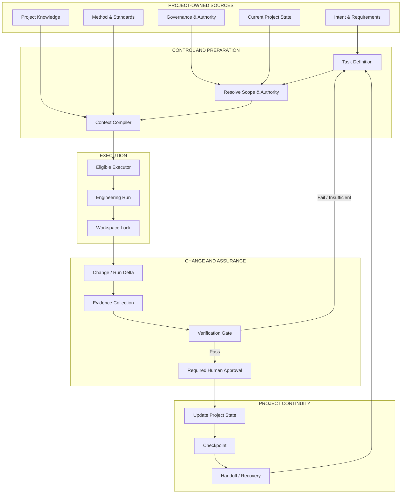
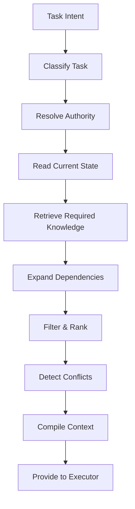
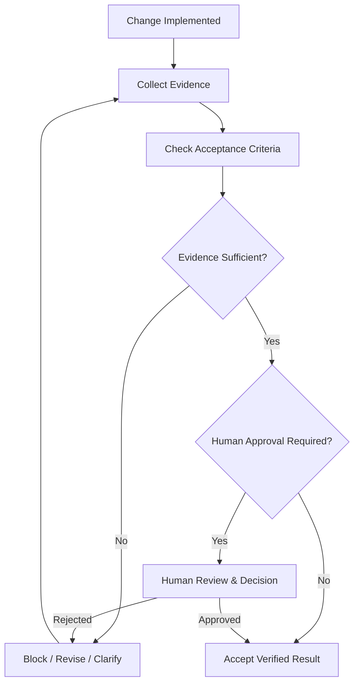
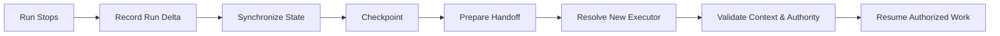

# Beyond Vibe Coding — Conceptual Architecture

**Document status:** Draft v0.1  
**Document role:** Conceptual architecture  
**Related:** [Framework Overview](./framework-overview.md) · [Glossary](./glossary.md)

## 1. Architecture objective

The architecture described here organizes the engineering concerns in the book into a project-centric lifecycle. Its objective is to allow AI executors and developers to perform bounded work while the project retains recognized knowledge, current state, authority rules, material change history, evidence, and continuity artifacts.

This is a **conceptual architecture**, not a deployed implementation diagram. The repository currently documents the method and intended boundaries; it does not yet ship the engines or orchestration runtime shown conceptually below.

## 2. Architectural invariants

The design is guided by these invariants:

1. The project—not an AI conversation—owns canonical Project Knowledge and Project State.
2. A task is defined before an executor is selected and authorized.
3. Context is selected from recognized project sources and checked for relevance, authority, validity, freshness, scope, dependencies, and conflict.
4. An executor operates within a defined scope; capability does not grant authority.
5. Material changes are recorded and evaluated against acceptance criteria.
6. A completion claim does not become verified state without sufficient evidence and required approval.
7. A handoff requires synchronized changes, state, evidence, checkpoint, and next action.
8. If critical state or authority cannot be established, the workflow blocks rather than guesses (Fail Closed).
9. Unless coordinated concurrency is explicitly designed, only one authorized writer changes the canonical workspace at a time (Workspace Lock principle).
10. Git and other repositories can store project artifacts and history, but repository storage alone does not establish engineering authority or verification.

## 3. System context

The project has durable sources and records. A task-specific working context is compiled from those sources before execution. The executor receives the authorized context, performs a bounded task, and returns proposed changes and evidence to the project-controlled workflow.

The diagram shows logical responsibilities and information flow. It does not prescribe a mandatory deployment topology, database, programming language, agent framework, or provider integration.

## 4. Control and context preparation

The book's Context Compiler pipeline is described as a way to transform task requirements and recognized project truth into a sufficient information package for a particular execution. The sequence below reflects that pipeline.

### 4.1 Task definition

The task describes the intended outcome and the conditions for completion. The book discusses task boundaries, decomposition, atomic engineering tasks, stopping conditions, and acceptance criteria. A task should also identify relevant inputs, constraints, dependencies, expected outputs, and any actions requiring approval.

### 4.2 Authority resolution

Before execution, determine whether the proposed action is permitted, who or what may perform it, which method and constraints apply, and whether human approval is required. The book distinguishes discovery, proposal, and execution: the ability to discover or propose a change does not automatically authorize execution.

### 4.3 Current state and knowledge retrieval

The context preparation process reads the recognized current state and retrieves required knowledge. Relevance alone is insufficient. Retrieved information may be stale, superseded, conflicting, or lack authority. The system should preserve source and provenance information where needed to judge whether an item is suitable for the task.

### 4.4 Minimum sufficient context

The objective is not to send the entire project to the executor. It is to compile the authorized working set that is sufficient for the task. If a critical conflict or missing authority prevents a reliable context from being established, the workflow should block or request clarification rather than silently choose an assumption.

## 5. Execution and workspace control

### 5.1 AI Executor

An AI Executor is selected for a specific task based on task requirements, capability, context needs, risk, state compatibility, verification, availability, quota, and practical cost. The book's task-first position is that the best executor is not necessarily the strongest model; it is an eligible executor suitable for the task.

### 5.2 Engineering Run

An Engineering Run is a controlled period during which an AI executor or a developer performs authorized work on the project. A run is temporary; the project persists beyond it. A run record should summarize material engineering activity rather than reproduce every token or chat message.

### 5.3 Workspace Lock

The book uses the rule **ONE ACTIVE WRITER** for canonical workspace changes unless the system has been explicitly designed for coordinated concurrency. Multiple AI systems can discover, review, or propose in parallel, but the canonical write path must remain controlled so that the project does not acquire competing versions of the truth.

### 5.4 Provider and method adapters

Provider-specific behavior belongs behind adapters. The method, project state, authority rules, and acceptance evidence should not silently change just because a model or provider changes. A Semantic Contract is intended to preserve task meaning across different executors; it does not mean every provider has identical capabilities.

## 6. Change records and project state

The book distinguishes material engineering events from transient conversation content. Examples of material events include task creation, a decision, a file or knowledge change, a state transition, test results, evidence creation, a blocker, checkpoint, handoff, and task completion.

The architecture should keep these concepts distinct:

| Artifact | Question it answers | Important distinction |
|---|---|---|
| Project Knowledge | What does the project know? | Architecture, standards, rules, terminology, decisions, and recognized sources. |
| Project State | Where does the project stand now? | Active work, blockers, accepted state, current versions, and verification status. |
| Change Record | What material change occurred and why? | More informative than saying only that a file was edited. |
| Run Record | What happened during this Engineering Run? | A compact engineering record, not a chat transcript. |
| Run Delta | What changed during this run? | Summarizes material differences between the before and after states. |
| Snapshot | What did the project state look like at a point in time? | A snapshot is not necessarily the current state. |
| Event Log | Which material events occurred? | Complements snapshots by recording changes and transitions. |
| Checkpoint | From which saved point can work continue or recover? | A checkpoint is a recovery point, not automatically the latest state. |

The repository has not yet published normative schemas for these artifacts. Their field names, validation rules, versioning, and compatibility guarantees must be specified and tested before an implementation treats them as stable contracts.

## 7. Evidence and verification

The book distinguishes an AI Claim from Engineering Evidence and an implemented change from a verified state. Verification should be planned in relation to acceptance criteria, task risk, impact, uncertainty, evidence strength, and reversibility.

A conceptual transition is:

Evidence should identify what was checked, how it was checked, which requirement or acceptance criterion was used, when and where it was checked, the result, and remaining limitations. Evidence may become stale if code, configuration, dependencies, environment, or requirements change. A material change may invalidate earlier evidence and require re-verification.

Verification does not mean running every possible test for every task. It means collecting evidence appropriate to the requirement and risk. An executor must not claim to have verified a production system, external service, physical device, or customer environment that it could not access.

## 8. Continuity, handoff, and recovery

A handoff is more than telling another executor to “continue.” The book states:

> **No handoff without state synchronization.**

Before handoff, synchronize:

1. material changes and Run Delta;
2. current Project State;
3. evidence and verification status;
4. latest checkpoint and recovery information;
5. active task, remaining work, blockers, and next action.

A continuity artifact may identify the current state, latest run, latest checkpoint, latest handoff, knowledge version, governance version, method version, evidence summary, active work, and recovery status. The project should be able to validate, compare, back up, restore, and audit this artifact.

If a provider quota is exhausted or a run ends unexpectedly, the conceptual recovery sequence is:

If State cannot be established or required records conflict, the safe outcome is to block and resolve the conflict—not to infer the likely state.

## 9. Repository and storage adapters

The book distinguishes the engineering system's authority from the repository that stores source files and history. GitHub, local Git, GitLab, Gitea, or a private server may serve as repository adapters. A repository is important, but it does not by itself determine whether a task was authorized, a requirement was verified, or a release was approved.

This distinction must remain visible in implementation design:

- source-control history is useful evidence about code changes;
- Project State records the recognized engineering position;
- governance defines authority and approval rules;
- verification evaluates evidence against requirements;
- continuity artifacts help a later run reconstruct what to do next.

## 10. Release and product boundary

The later chapters extend the method beyond task execution. Build, deploy, and release are different states. A deployable artifact is not automatically authorized for release. Release requires relevant state, compatibility, rollback, evidence, and approval according to the project's governance.

The project is also not complete merely because code exists or a local prototype runs. The book distinguishes code progress from product progress and asks whether the result solves the customer's problem. EnerixFin is used as an engineering laboratory to explore this transition in Solar and BESS engineering and investment workflows.

## 11. Failure modes and design responses

| Failure mode | Architectural response described by the method |
|---|---|
| Task is too broad | Decompose it; define scope, constraints, stopping conditions, and acceptance criteria. |
| Context is incomplete or stale | Retrieve from recognized sources; evaluate authority, freshness, dependencies, and conflicts. |
| AI memory conflicts with project record | Use the canonical project record; AI memory does not override it. |
| Executor is capable but unauthorized | Resolve authority before execution; block unauthorized actions. |
| Multiple executors write competing changes | Use a controlled canonical write path and Workspace Lock unless coordinated concurrency is designed. |
| AI says “done” without evidence | Keep the task unverified; collect evidence against acceptance criteria. |
| Run ends or quota is exhausted | Synchronize state, record the Run Delta, create a checkpoint, and prepare a handoff. |
| State or handoff is inconsistent | Fail closed; resolve the conflict before continuing. |
| Local build is mistaken for product readiness | Evaluate deployment, production environment, operations, security, and customer outcome. |
| Release is treated as a side effect of deployment | Apply release authority, state, evidence, compatibility, and rollback controls. |

## 12. Implementation boundaries and open design questions

The conceptual architecture does not prescribe a database, event store, schema format, CLI, agent runtime, message protocol, deployment topology, or security product. Those are implementation decisions for later, separately reviewed specifications.

Before declaring a component stable, the project should define:

- its input and output contracts;
- authoritative sources and precedence rules;
- validation and failure behavior;
- security and permission boundaries;
- versioning and compatibility rules;
- evidence and test requirements;
- recovery and migration behavior;
- known limitations and non-goals.

Until then, diagrams and terminology describe the intended method, not shipped functionality.
