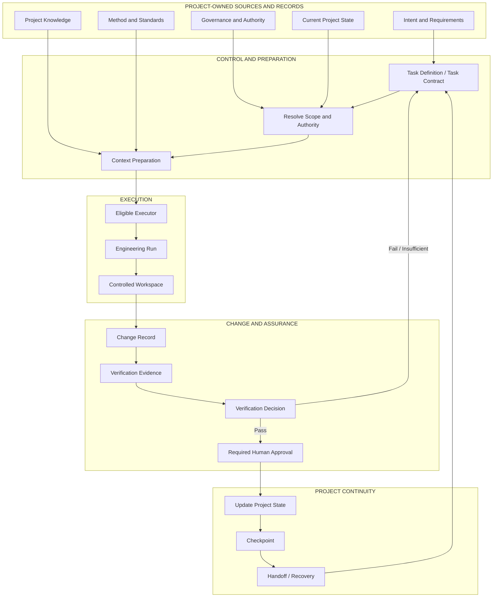
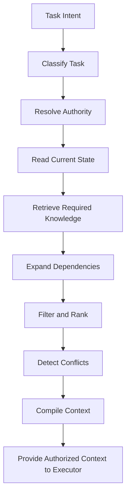
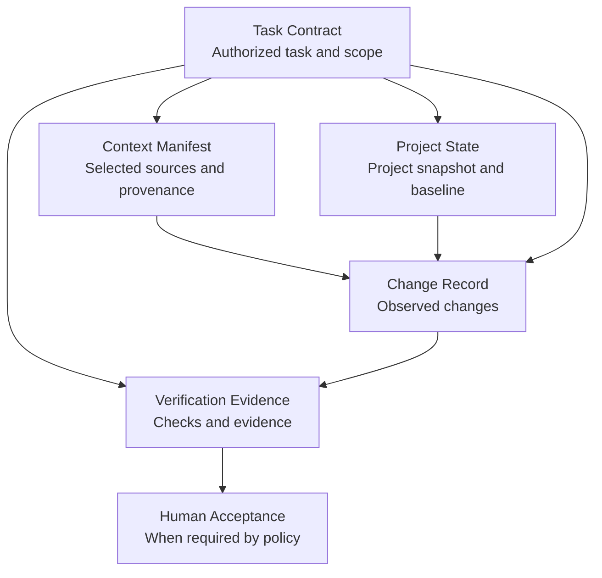
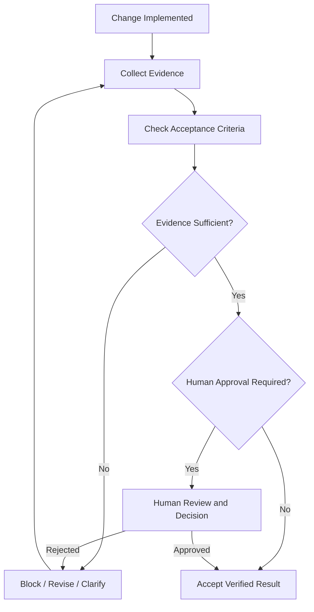
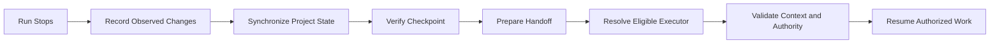

# Beyond Vibe Coding — Conceptual Architecture

**Document status:** Draft — synchronized with BVC Core Specifications v0.1.0  
**Document role:** Conceptual architecture  
**Phase:** Phase 1 foundation, updated for Phase 2 Core Specifications  
**Related:** [Framework Overview](./framework-overview.md) · [Engineering Glossary](./glossary.md) · [Book Chapter Map](./book-chapter-map.md) · [Core Specification Index](../specifications/v0.1/README.md)

---

## 1. Architecture objective

The architecture described here organizes the engineering concerns in *BEYOND VIBE CODING* into a project-centric lifecycle. Its objective is to allow AI executors and developers to perform bounded work while the project retains recognized knowledge, current state, authority rules, material change history, verification evidence, and continuity information.

The central distinction is:

> **AI is an executor. The project owns its knowledge, state, authority, and continuity.**

This document describes logical responsibilities, information relationships, and intended control boundaries. It is a **conceptual architecture**, not a deployed implementation diagram. The repository currently provides framework documentation, five Draft / Experimental Core Specifications, JSON Schemas, examples, templates, Python validation utilities, automated tests, and GitHub Actions integration. It does not yet ship the complete engines, runtime enforcement, or orchestration runtime represented conceptually below.

## 2. Architectural invariants

The design is guided by these invariants:

1. **Project-owned truth:** the project—not an AI conversation—owns canonical Project Knowledge and Project State.
2. **Task before executor:** a task is defined before an executor is selected and authorized.
3. **Controlled context:** context is selected from recognized project sources and checked for relevance, authority, validity, freshness, scope, dependencies, and conflict.
4. **Capability is not authority:** an executor operates within a defined scope; its ability to perform an action does not grant permission to perform it.
5. **Traceable change:** material changes are recorded and evaluated against the applicable task contract and acceptance criteria.
6. **Evidence before acceptance:** a completion claim does not become verified state without sufficient evidence and required approval.
7. **Synchronized handoff:** a handoff requires synchronized changes, state, evidence, checkpoint information, and next action.
8. **Fail closed:** if critical state, authority, or required context cannot be established, the workflow blocks rather than guesses.
9. **Controlled canonical writes:** unless coordinated concurrency is explicitly designed and enforced, only one authorized writer changes the canonical workspace at a time (Workspace Lock principle).
10. **Storage is not authority:** Git and other repositories can store project artifacts and history, but repository storage alone does not establish engineering authority, correctness, or verification.
11. **Technology neutrality:** the meaning of the engineering records must not depend on one programming language, database, AI model, provider, IDE, or agent framework.
12. **Proportionate control:** controls should reflect the scope, risk, impact, and reversibility of the work.

## 3. System context

A project has durable sources and records. A task-specific working context is compiled from those sources before execution. The executor receives an authorized task and the context required for that task, performs bounded work, and returns proposed changes and evidence to the project-controlled workflow.

The diagram shows logical responsibilities and information flow. It does not prescribe a mandatory deployment topology, database, programming language, agent framework, provider integration, or runtime architecture.

## 4. Control and context preparation

The book describes the **Context Compiler** as a way to transform task requirements and recognized project truth into a sufficient information package for a particular execution. The sequence below represents that conceptual preparation process.

### 4.1 Task definition

The task describes the intended outcome and the conditions for completion. The method includes task boundaries, decomposition, atomic engineering tasks, stopping conditions, and acceptance criteria. A task should also identify relevant inputs, constraints, dependencies, expected outputs, verification requirements, and actions requiring approval.

The **Task Contract** is the current machine-readable representation of this task-level agreement. It states what the executor is expected and authorized to do and where it must stop. It is not merely a prompt, a project-wide policy, or proof that an executor actually complied.

### 4.2 Authority resolution

Before execution, determine whether the proposed action is permitted, who or what may perform it, which method and constraints apply, and whether human approval is required. The book distinguishes discovery, proposal, and execution: the ability to discover or propose a change does not automatically authorize its execution.

Authority must come from the project's approved governance and the task's valid authorization. An executor must not grant itself additional permissions by editing its own instructions, interpreting a user comment as approval, or changing the contract without an authorized process.

### 4.3 Current state and knowledge retrieval

Context preparation reads the recognized current state and retrieves required knowledge. Relevance alone is insufficient. Retrieved information may be stale, superseded, conflicting, incomplete, or lack authority. The source identity and provenance should be preserved where needed to judge whether an item is suitable for the task.

### 4.4 Minimum sufficient context

The objective is not to send the entire project to the executor. It is to compile the authorized working set sufficient for the task and its verification. If a critical conflict, missing source, stale required input, or missing authority prevents reliable context from being established, the workflow should block or request clarification rather than silently choose an assumption.

### 4.5 Context Manifest

The **Context Manifest** records which information sources were selected for a task, why they were selected, what authority and trust classifications they carry, how freshness was assessed, and what conflicts or limitations remain.

A Context Manifest records context assembly. It does not itself fetch sources, prove that a source was read, authorize access, or guarantee that source content is correct. A `READY` manifest is not an execution authorization; the Task Contract and project policy remain authoritative for permission to execute.

## 5. The five Core Specifications

Phase 2 formalizes five connected, technology-neutral records. Each specification is Draft / Experimental v0.1.0 and uses JSON Schema Draft 2020-12.

| Core Specification | Architectural responsibility | Key boundary |
|---|---|---|
| [Task Contract](../specifications/v0.1/task-contract.md) | Defines task identity, objective, authorized scope, constraints, outputs, acceptance criteria, verification requirements, change budget, authority, and stopping conditions. | Declares the task-level agreement; it does not enforce filesystem permissions by itself. |
| [Context Manifest](../specifications/v0.1/context-manifest.md) | Records selected context sources, authority, provenance, trust, freshness, inclusion/exclusion, conflicts, and limitations. | Records context assembly; it does not fetch or authenticate sources. |
| [Project State](../specifications/v0.1/project-state.md) | Records a durable, versioned snapshot of project facts, assumptions, decisions, active work, blockers, risks, next actions, and recovery references. | Represents a project snapshot; it is not an event log, database, or AI memory. |
| [Change Record](../specifications/v0.1/change-record.md) | Records observed repository changes, CREATE/MODIFY/DELETE operations, baseline, inventory, scope-integrity result, and change-budget result. | Requires trustworthy inventory input; the current repository does not yet include a trusted Git diff collector. |
| [Verification Evidence](../specifications/v0.1/verification-evidence.md) | Records checks actually performed, outcomes, acceptance-criteria links, evidence references, environment, and limitations. | Verification PASS is separate from human acceptance and release approval. |

The [Core Specification Index](../specifications/v0.1/README.md) provides the schemas, guides, examples, templates, validation commands, and limitations.

### 5.1 How the records relate

The five records form a traceable relationship from authorized task to context, project baseline, observed change, and verification result.

This is a conceptual traceability relationship, not a mandatory storage sequence or a complete runtime workflow. Records must preserve their identities, revisions, source baselines, and references to one another.

A valid record does not automatically prove that a real-world action was authorized or correctly performed. Trusted runtime enforcement, source authentication, and evidence collection require additional implementation.

## 6. Execution and workspace control

### 6.1 AI Executor

An **AI Executor** is selected for a specific task based on task requirements, capability, context needs, risk, state compatibility, verification needs, availability, quota, and practical cost. The task-first position is that the best executor is not necessarily the strongest model; it is an eligible executor suitable for the task.

An executor performs assigned work. It does not own the project's canonical knowledge, authority, or release decision. Model or provider changes must not silently change the task's meaning or permissions.

### 6.2 Engineering Run

An **Engineering Run** is a controlled period during which an AI executor or a developer performs authorized work on the project. A run is temporary; the project persists beyond it. A future Run Record may summarize material engineering activity, but it should not reproduce every token or chat message.

The current five Core Specifications provide task, context, state, change, and evidence records. They do not yet define a complete Engineering Run lifecycle schema or execution ledger.

### 6.3 Workspace control

The book uses the rule **ONE ACTIVE WRITER** for canonical workspace changes unless the system has been explicitly designed for coordinated concurrency. Multiple AI systems or developers may discover, review, or propose in parallel, but the canonical write path must remain controlled so that the project does not acquire competing versions of the truth.

Git branches and worktrees can support isolated workspaces, but a separate directory or branch is not, by itself, an operating-system security sandbox. Runtime permissions, credentials, process isolation, and filesystem restrictions require separate controls.

### 6.4 Provider and method adapters

Provider-specific behavior belongs behind adapters. The method, project state, authority rules, and acceptance evidence should not silently change just because a model or provider changes. A **Semantic Contract** is intended to preserve task meaning across different executors; it does not mean all providers have identical capabilities or behavior.

The current Phase 2 specifications are technology-neutral data contracts. Python is used for the repository's initial validators. Future TypeScript application logic, Tailwind CSS presentation, or PostgreSQL persistence should implement the same contract meanings rather than redefine them.

## 7. Change records and project state

The method distinguishes material engineering events from transient conversation content. Examples of material events include task creation, a decision, a file or knowledge change, a state transition, test results, evidence creation, a blocker, checkpoint, handoff, and task completion.

The architecture keeps the following concepts distinct:

| Artifact | Question it answers | Current BVC representation and boundary |
|---|---|---|
| Project Knowledge | What does the project know? | Recognized requirements, architecture, standards, rules, terminology, decisions, and authoritative sources. It is not one of the five Phase 2 records as a single aggregate. |
| Project State | Where does the project stand now? | A versioned project snapshot formalized by the [Project State Specification](../specifications/v0.1/project-state.md). |
| Change Record | What material change occurred and why? | A task/run-linked record formalized by the [Change Record Specification](../specifications/v0.1/change-record.md). |
| Run Record | What happened during this Engineering Run? | A conceptual artifact; a dedicated normative schema and runtime ledger are future work. |
| Run Delta | What changed during this run? | A conceptual summary of material differences between before and after; a dedicated schema is future work. |
| Snapshot | What did the project state look like at a point in time? | Project State is snapshot-oriented; a generic snapshot store and lifecycle are not yet implemented. |
| Event Log | Which material events occurred? | A complementary event-history concept; no complete event-log service is included. |
| Checkpoint | From which saved point can work continue or recover? | Project State can reference a recovery point; the repository does not verify or create the checkpoint automatically. |

### 7.1 Project State

A **Project State** is a durable, versioned snapshot of what is currently known about a project: lifecycle, baseline, current milestone, objectives, verified facts, assumptions, accepted decisions, active tasks, blockers, risks, issues, next actions, and recovery point.

Project State is not AI memory and must not be treated as a transcript. It helps a new session, a different executor, or a human maintainer understand the project without relying on one model's conversation history.

A verified fact should cite a source. An assumption must not be silently promoted to a verified fact without evidence and an update to the record. Project State is not a credential store, secret manager, audit log, database schema, or deployment system.

### 7.2 Change Record

A **Change Record** describes repository changes observed for a task execution. It links the file inventory to the Task Contract, task, run, executor, and source baseline. It distinguishes CREATE, MODIFY, and DELETE operations and records diff statistics, sensitive categories supplied by a trusted project classifier, scope-integrity outcome, and change-budget outcome.

A Change Record should be produced or confirmed by a trusted version-control collector from the actual repository diff. The current BVC validator can inspect a supplied inventory and compare it with a contract; it does not independently collect the Git diff or prove that the supplied inventory is authentic.

## 8. Evidence and verification

The method distinguishes an **AI Claim** from **Engineering Evidence** and an implemented change from a verified state. Verification should be planned in relation to acceptance criteria, task risk, impact, uncertainty, evidence strength, and reversibility.

The [Verification Evidence Specification](../specifications/v0.1/verification-evidence.md) formalizes checks actually performed, their outcomes, the acceptance criteria they address, evidence artifacts, environment, and limitations.

The specification distinguishes:

- `PASS`, `FAIL`, `INCONCLUSIVE`, `BLOCKED`, and `NOT_RUN` check outcomes;
- overall verification result; and
- a separate human acceptance decision such as `PENDING`, `ACCEPTED`, `REJECTED`, or `CONDITIONALLY_ACCEPTED`.

A verification result of `PASS` does not automatically mean `ACCEPTED` or `RELEASE_APPROVED`.

Evidence should identify what was checked, how it was checked, which requirement or acceptance criterion was used, when and where it was checked, the result, and remaining limitations. Evidence may become stale if code, configuration, dependencies, environment, or requirements change. A material change may invalidate earlier evidence and require re-verification.

Verification does not mean running every possible test for every task. It means collecting evidence appropriate to the requirement and risk. An executor must not claim to have verified a production system, external service, physical device, or customer environment that it could not access.

## 9. Continuity, handoff, and recovery

A handoff is more than telling another executor to “continue.” The book states:

> **No handoff without state synchronization.**

Before handoff, synchronize:

1. material changes and the applicable Change Record or Run Delta;
2. current Project State;
3. evidence and verification status;
4. latest checkpoint and recovery information; and
5. active task, remaining work, blockers, and next action.

A continuity artifact may identify the current state, latest run, latest checkpoint, latest handoff, knowledge version, governance version, method version, evidence summary, active work, and recovery status. The project should be able to validate, compare, back up, restore, and audit this information.

The Project State and Change Record specifications provide initial data foundations for parts of this continuity model. They do not yet implement a durable event log, checkpoint manager, handoff service, or recovery engine.

A conceptual recovery sequence is:

If State cannot be established or required records conflict, the safe outcome is to block and resolve the conflict—not to infer the likely state.

## 10. Repository, storage, and technology boundaries

The engineering system's authority must remain distinct from the repository that stores source files and history. GitHub, local Git, GitLab, Gitea, or a private server may serve as repository adapters. A repository is important, but it does not by itself determine whether a task was authorized, a requirement was verified, or a release was approved.

The Core Specifications define portable data contracts rather than a required technology stack:

| Technology | Current or intended role | Boundary |
|---|---|---|
| Python | Current validation scripts and development utilities. | An implementation choice for tooling, not a requirement of the data specifications. |
| TypeScript | Possible future application logic, typed interfaces, and integrations. | Must preserve the published contract semantics. |
| Tailwind CSS | Possible future user-interface styling for the BVC Starter Workbench. | Presentation layer; it does not define governance or record semantics. |
| PostgreSQL | Possible future persistent storage for project records when required. | Storage implementation; it does not replace the normative schemas or authority policy. |
| Git | Source control, history, branches, and diff references. | Git history is useful evidence but is not, by itself, proof of authorization or acceptance. |

This distinction must remain visible in implementation design:

- source-control history is useful evidence about code changes;
- Project State records the recognized engineering position;
- governance defines authority and approval rules;
- Change Records describe observed changes;
- Verification Evidence records checks and their results; and
- continuity artifacts help a later run reconstruct what to do next.

## 11. Release and product boundary

The later chapters extend the method beyond task execution. Build, deploy, and release are different states. A deployable artifact is not automatically authorized for release. Release requires relevant state, compatibility, rollback, evidence, and approval according to the project's governance.

The project is also not complete merely because code exists or a local prototype runs. The book distinguishes code progress from product progress and asks whether the result solves the customer's problem. Enerix Fin (EFIN), also referred to by its product name EnerixFin, is used as an engineering laboratory to explore this transition in Solar and BESS engineering and investment workflows.

EFIN-specific paths, policies, governance identifiers, commercial assumptions, and implementation arrangements are not automatically universal BVC requirements. Public case-study material must be sanitized and reviewed for rights, confidentiality, and factual accuracy.

## 12. Failure modes and design responses

| Failure mode | Architectural response described by the method | Current repository support and limitation |
|---|---|---|
| Task is too broad | Decompose it; define scope, constraints, stopping conditions, and acceptance criteria. | Task Contract guide, schema, examples, template, and validator. |
| Context is incomplete or stale | Retrieve from recognized sources; evaluate authority, freshness, dependencies, and conflicts. | Context Manifest schema, guide, example, template, and selected semantic validation. No source-fetching or permission broker is included. |
| AI memory conflicts with project record | Use the canonical project record; AI memory does not override it. | Project State schema and guide. No runtime state service is included. |
| Executor is capable but unauthorized | Resolve authority before execution; block unauthorized actions. | Task Contract declares authority and scope. Preventive runtime enforcement is not included. |
| Multiple executors write competing changes | Use a controlled canonical write path and Workspace Lock unless coordinated concurrency is designed. | Conceptual principle only; no multi-executor scheduler or workspace lock service is included. |
| AI says “done” without evidence | Keep the task unverified; collect evidence against acceptance criteria. | Verification Evidence schema, guide, example, template, and validation. No trusted evidence-capture service is included. |
| Run ends or quota is exhausted | Synchronize state, record changes, create a checkpoint, and prepare a handoff. | Project State and Change Record provide initial records; automated recovery is future work. |
| State or handoff is inconsistent | Fail closed; resolve the conflict before continuing. | Draft record rules and selected cross-record validation; no recovery runtime is included. |
| Local build is mistaken for product readiness | Evaluate deployment, production environment, operations, security, and customer outcome. | Conceptual guidance; production-readiness implementation is future work. |
| Release is treated as a side effect of deployment | Apply release authority, state, evidence, compatibility, and rollback controls. | Task Contract and Verification Evidence provide initial foundations; a project-level release policy is future work. |

## 13. Implementation boundaries and open design questions

The conceptual architecture does not prescribe a database, event store, schema format, CLI, agent runtime, message protocol, deployment topology, or security product. Those are implementation decisions for later, separately reviewed specifications.

Before declaring a component stable, the project should define:

- its input and output contracts;
- authoritative sources and precedence rules;
- validation and failure behavior;
- security and permission boundaries;
- versioning and compatibility rules;
- evidence and test requirements;
- recovery and migration behavior; and
- known limitations and non-goals.

### 13.1 Current implementation maturity

The repository currently includes:

- five Phase 1 framework documents;
- five Phase 2 Core Specifications, all Draft / Experimental v0.1.0;
- five JSON Schemas using Draft 2020-12;
- Task Contract examples and companion Core Specification examples;
- reusable YAML templates;
- Python validation utilities;
- automated tests; and
- a GitHub Actions workflow configured to validate the specifications and run the test suite.

The repository does **not** yet include:

- a complete PAECS runtime or AI orchestration engine;
- a filesystem sandbox or preventive runtime permission enforcement;
- a trusted Git diff collector integrated with actual AI execution;
- an authenticated human-approval service;
- a durable event-log, checkpoint, handoff, or recovery service;
- a production-ready Web Application or BVC Starter Workbench; or
- an independently certified BVC standard.

The current validators inspect supplied files and records. They do not execute AI tasks, fetch external context, authenticate approvals, enforce filesystem permissions, or independently prove that supplied evidence is true.

### 13.2 Phase boundary

Phase 1 establishes the conceptual framework and architecture. Phase 2 formalizes five initial data contracts and their validation foundation. Phase 3 is planned as a practical, beginner-friendly BVC Starter Workbench.

Advanced Router–Worker orchestration, multi-agent Harness integration, and production runtime enforcement are not prerequisites for completing the current Phase 2 foundation or the planned beginner-focused Phase 3. Such capabilities may be researched in a later version only when practical requirements justify their complexity.

Until then, diagrams and terminology describe the intended method, not shipped functionality.

---

**Security First. Human in Control. AI as Executor. Evidence before Acceptance.**
