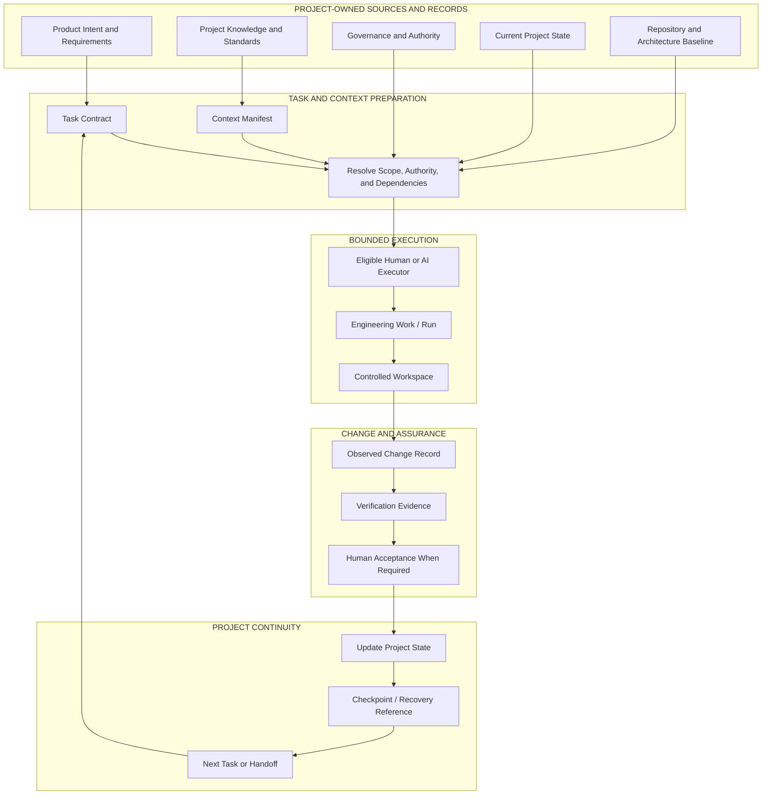
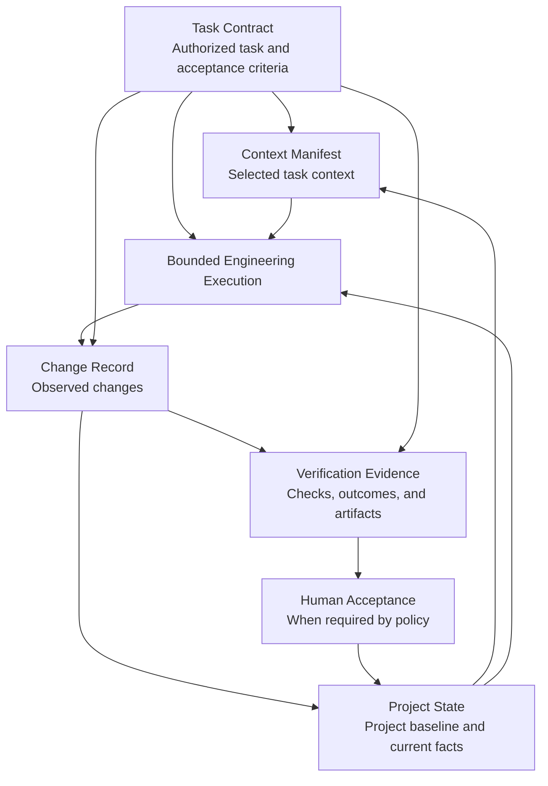
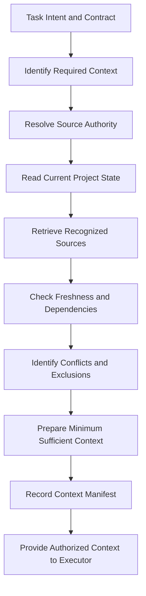
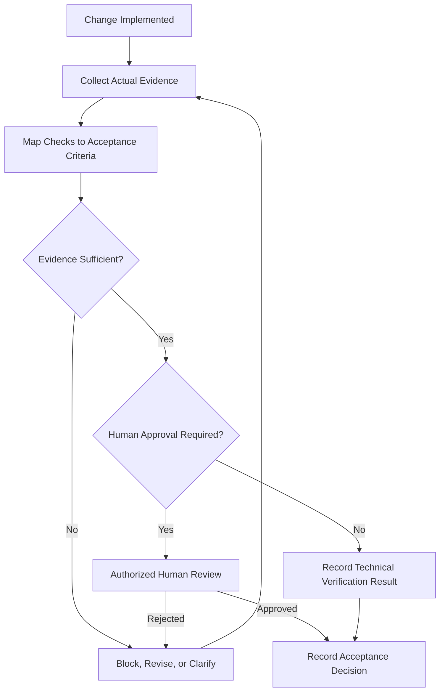

# Beyond Vibe Coding — Conceptual Architecture

**Document status:** Draft — synchronized with BVC Core Specifications v0.1.0  
**Document role:** Conceptual architecture  
**Phase:** Phase 1 foundation, updated for Phase 2 Core Specifications  
**Book companion:** *BEYOND VIBE CODING: A Practical Guide to Building Real-World Software with AI* — Dong Hong  
**Related:** [Framework Overview](./framework-overview.md) · [Start Here](./00-start-here.md) · [Engineering Glossary](./glossary.md) · [Book Chapter Map](./book-chapter-map.md) · [Core Specification Index](../specifications/v0.1/README.md)

---

## 1. Architecture objective

The Beyond Vibe Coding (BVC) architecture organizes AI-assisted software engineering around the project rather than around an individual AI conversation, model, or coding session.

Its objective is to let people and AI executors perform bounded engineering work while the project retains its recognized knowledge, current state, authority rules, material change history, verification evidence, and continuity information.

The architecture separates five concerns:

1. **Define the work:** establish the task, its objective, authorized scope, constraints, and completion conditions.
2. **Prepare the information:** select the relevant and permitted project context and identify the project baseline.
3. **Execute bounded work:** let an eligible human or AI executor perform the task within the authority granted to it.
4. **Record and verify changes:** distinguish intended changes from observed changes, and evaluate results against acceptance criteria.
5. **Preserve continuity:** update project records so that work can be understood, reviewed, continued, or recovered without depending on one conversation.

This document describes a **conceptual architecture**. It does not describe a fully deployed implementation. The repository currently publishes five Draft / Experimental Core Specifications and their initial validation tooling; it does not yet provide the complete engines, runtime services, or security enforcement represented by the conceptual model.

## 2. Architectural principles and invariants

The following principles constrain the design.

1. **Project-owned truth:** the project—not an AI conversation—owns canonical Project Knowledge and Project State.
2. **Task before executor:** define the work and its boundaries before selecting or authorizing an executor.
3. **Context with provenance:** context must be relevant, permitted, and evaluated for authority, trust, validity, freshness, dependencies, and conflict.
4. **Capability is not authority:** an executor's technical ability to perform an action does not grant permission to perform it.
5. **Explicit operations:** CREATE, MODIFY, and DELETE are distinct permissions and must not be inferred from one another.
6. **Fail closed:** when critical scope, authority, state, or evidence cannot be established, block or request a decision rather than guess.
7. **Observed changes:** record actual repository changes using trustworthy source-control evidence where possible; do not rely only on an executor's self-report.
8. **Evidence before acceptance:** a completion claim is not a verified result, and a passing check is not automatically human acceptance or release approval.
9. **Controlled canonical writes:** unless coordinated concurrency has been explicitly designed and validated, only one authorized writer should modify the canonical workspace at a time.
10. **Explicit continuity:** a handoff requires synchronized changes, state, evidence, checkpoint/recovery information, and next action.
11. **Proportionate control:** apply controls appropriate to task scope, uncertainty, impact, and risk; do not impose heavyweight governance on every low-risk experiment.
12. **Technology neutrality:** the normative meaning of project records must not depend on a particular AI provider, programming language, IDE, or database.
13. **Honest implementation status:** conceptual components and planned capabilities must not be presented as shipped software.

## 3. System context

The project contains durable sources and records. A task-specific working context is assembled from recognized sources before execution. The executor receives the task requirements, permitted context, relevant project state, and applicable constraints. Proposed changes are then observed, recorded, verified, and either accepted or sent back for correction.

The diagram shows logical responsibilities and information flow. It does not prescribe a deployment topology, database, programming language, AI runtime, provider integration, or mandatory sequence for every record update.

## 4. The five Core Specifications in the architecture

Phase 2 formalizes five connected, technology-neutral record types. All five are **Draft / Experimental v0.1.0** and use JSON Schema Draft 2020-12.

| Specification | Architectural responsibility | Question it answers |
|---|---|---|
| [Task Contract](../specifications/v0.1/task-contract.md) | Defines the task objective, authorized scope, constraints, expected outputs, acceptance criteria, verification requirements, change budget, authority, and stopping conditions. | What is the executor expected and authorized to do? |
| [Context Manifest](../specifications/v0.1/context-manifest.md) | Records which sources were selected for a task, why they were selected, and their authority, trust, provenance, freshness, inclusion/exclusion, and conflict status. | Which information was selected, and why is it suitable for this task? |
| [Project State](../specifications/v0.1/project-state.md) | Records a versioned snapshot of project baseline, facts, assumptions, decisions, active work, blockers, risks, next actions, and recovery reference. | What is the durable, recognized state of the project? |
| [Change Record](../specifications/v0.1/change-record.md) | Records observed repository changes, operation types, baseline, file inventory, diff totals, scope-integrity outcome, and change-budget outcome. | What actually changed? |
| [Verification Evidence](../specifications/v0.1/verification-evidence.md) | Records checks performed, results, acceptance-criteria references, evidence artifacts, environment, limitations, and a separate acceptance decision. | What was checked, what evidence resulted, and has the work been accepted? |

The five records are related, but they are not interchangeable:

- The Task Contract is the task-level authorization and requirement baseline. It does not authenticate a person or enforce operating-system permissions by itself.
- The Context Manifest records context assembly. It does not fetch source material, prove access, or make an untrusted source authoritative.
- Project State is a durable project snapshot. It is not a transcript, a detailed event log, or a substitute for individual task records.
- The Change Record describes observed changes. It does not prove functional correctness or production readiness.
- Verification Evidence records test and review results. It does not automatically authorize acceptance or release.

### 4.1 Conceptual relationship

This is a traceability model, not an assertion that the current repository automatically orchestrates the complete lifecycle. The records should reference the relevant task, project, baseline, revision, and related records so that their relationship can be inspected.

## 5. Task and authority preparation

### 5.1 Task definition

A task states the intended outcome and the conditions under which the work may be considered complete. At a minimum, the task should make its objective, inputs, scope, constraints, dependencies, expected outputs, acceptance criteria, verification requirements, and stopping conditions understandable.

Large goals should be decomposed into bounded tasks. A task should be small enough to review and verify, but it must retain enough context to avoid technically correct work that solves the wrong problem.

### 5.2 Scope and operation permissions

The Task Contract distinguishes:

- **CREATE:** permission to create a specifically authorized path or resource;
- **MODIFY:** permission to change an existing authorized path or resource;
- **DELETE:** permission to remove an authorized path or resource.

A permission for one operation does not imply permission for another. Forbidden paths, protected resources, file-count limits, diff limits, dependency changes, and other change budgets should be declared according to the project's policy.

Wildcard scope should be proportionate to the task and justified. Broad patterns are not a substitute for understanding which resources the task actually needs.

### 5.3 Authority resolution

Before execution, the workflow must determine whether the task is permitted, which role or executor may perform it, what policy applies, and whether human approval is required. Discovery and proposal can be useful without creating permission to execute.

A record field such as `APPROVED` is data. It is not, by itself, proof that the named person authenticated or had the authority to approve. A future runtime may need identity verification, approval records, signatures, and policy integration.

### 5.4 Fail-closed behavior

If required authority is missing, a required source is unavailable, a material conflict is unresolved, or an executor proposes work outside its scope, the safe outcome is to block or ask for a decision. The executor must not silently expand its authority because doing so appears useful or necessary to complete the task.

## 6. Context preparation and the Context Compiler concept

The book describes a **Context Compiler** as a method for transforming task requirements and recognized project truth into a task-specific working context. It is a conceptual engineering capability, not another AI model and not an independent owner of project truth.

### 6.1 Recognized sources

Potential sources include requirements, approved architecture documents, coding standards, accepted decisions, source files, tests, issue or pull-request references, and other project records. The project must define which sources are authoritative for which questions.

### 6.2 Relevance is not authority

A retrieved item may be relevant but stale, superseded, conflicting, untrusted, or outside the task's permitted scope. Similarity or recency alone does not establish truth. Provenance and authority should remain visible where they affect a decision.

### 6.3 Minimum sufficient context

The objective is not to send every project file or the entire conversation history to the executor. It is to prepare enough relevant and permitted information to perform and verify the task. Unnecessary secrets, credentials, customer data, and private information should not be copied into context records.

### 6.4 Context Manifest boundary

The Context Manifest records what was selected and how it was classified. It does not itself retrieve source contents, prove that an executor read them, authenticate their origin, or guarantee correctness. Those responsibilities belong to source systems and trusted runtime components.

## 7. Project State and continuity

Project State is the durable, recognized snapshot of the project. It should distinguish verified facts from assumptions and open questions, and preserve accepted decisions, active tasks, blockers, risks, next actions, and a recovery reference.

Project State is not AI memory or a full conversation transcript. It should not copy every task or change record into one document. Instead, it references related records and provides a concise current view.

### 7.1 State versus other artifacts

| Artifact | Question | Distinction |
|---|---|---|
| Project Knowledge | What does the project know and recognize? | Standards, architecture, requirements, policies, terminology, decisions, and trusted sources. |
| Project State | Where does the project stand now? | A versioned snapshot of facts, decisions, work, blockers, and next actions. |
| Change Record | What repository change was observed? | A record of actual operations against a declared baseline. |
| Run Record | What happened during a particular engineering run? | A future operational record; not a chat transcript. |
| Run Delta | What material differences occurred during a run? | A future summary of before/after changes. |
| Event Log | Which material events occurred and in what order? | A future event history; not the same as a snapshot. |
| Checkpoint | From which saved point can work continue or recover? | A recovery reference; it is not necessarily the latest state. |
| Handoff | What must the next person or executor know to continue? | A synchronized transfer of task, state, changes, evidence, blockers, and next action. |

The current Phase 2 Project State and Change Record specifications provide initial data structures for two of these concerns. Run Record, Run Delta, Event Log, dedicated Checkpoint, and Handoff specifications or services remain future work unless separately published.

### 7.2 Recovery principle

When a session, model, provider, quota, or machine changes, the project should be able to re-establish the recognized task, state, changes, evidence, authority, and next action from project-owned records.

If the state cannot be established or records conflict, the workflow should block and resolve the discrepancy rather than infer what probably happened.

The current repository does not implement automatic recovery or a complete continuity runtime.

## 8. Execution and workspace control

### 8.1 AI Executor

An AI Executor is a tool or system selected to perform an authorized task. Selection should consider task requirements, capability, context needs, risk, state compatibility, verification requirements, availability, quota, and cost.

The strongest model is not necessarily the best executor for every task. An executor must remain replaceable without changing the project's task meaning, authorization, or acceptance criteria.

### 8.2 Engineering Run

An Engineering Run is a bounded period during which an AI executor or a human performs authorized engineering work. The run is temporary; the project persists beyond it. A future Run Record may capture the task and contract revision, executor, baseline, material actions, changes, evidence, outcome, limitations, and next action.

The current repository does not implement a Run service or a persistent execution ledger.

### 8.3 Canonical workspace and write control

The BVC principle **ONE ACTIVE WRITER** applies to canonical workspace changes unless coordinated concurrency has been explicitly designed, secured, and tested.

Multiple people or tools may inspect, discuss, review, or prepare proposals in parallel. That does not mean they may all write to the same canonical working tree or merge changes without coordination.

A future system could permit isolated workspaces or branches to execute concurrently while preserving a controlled integration boundary. Such concurrency must address conflicts, shared resources, authority, evidence, and integration order. It is not part of the current Phase 2 implementation.

### 8.4 Provider and method neutrality

Provider-specific behavior should be separated from task meaning and project policy. An adapter may translate a BVC task into the inputs or tools expected by a particular executor, but it must not silently widen scope, remove required checks, or replace the project's authority rules.

A Semantic Contract aims to preserve task meaning across executors. It does not claim that different providers have identical capabilities, tools, security properties, or execution behavior.

## 9. Change records and Scope Integrity

A Change Record describes observed repository changes for a task execution. It should be linked to the Task Contract, task, source baseline, and relevant execution reference. Each changed path should be represented with an explicit operation and appropriate change statistics.

### 9.1 Observed rather than self-reported

Where possible, the inventory should come from a trusted source-control collector comparing the declared baseline with the actual working result. A worker-authored summary is useful context, but it is not an authoritative replacement for an observed diff.

### 9.2 Scope Integrity

Scope Integrity asks whether observed changes stayed within the authorized operations, paths, forbidden-path rules, sensitive-resource policy, and Change Budget.

A post-execution validator can identify a supplied inventory that exceeds the contract. It cannot prevent an unauthorized write that has already happened. Preventive enforcement requires a trusted execution boundary, such as appropriate filesystem permissions, isolation, or a controlled tool interface.

### 9.3 Change Record limits

The current Change Record validator evaluates supplied data and selected relationships. It does not yet include a trusted Git diff collector, filesystem monitor, sandbox, or preventive permission enforcement. Its output must not be represented as proof of real-world collection unless the collection source is independently established.

## 10. Evidence and verification

The architecture distinguishes an AI Claim from Engineering Evidence, and an implemented change from a verified result.

### 10.1 Evidence content

Evidence should identify what was checked, how it was checked, which acceptance criteria it addresses, when and where it was checked, the result, the artifact reference, and any remaining limitations.

Examples may include test reports, CI run references, static-analysis results, review records, screenshots, metrics, or environment observations. Evidence should point to real artifacts and avoid embedding secrets or unnecessary private data.

### 10.2 Results and decisions are different

The Verification Evidence specification distinguishes individual check outcomes and the overall verification result from the separate acceptance decision.

- `PASS` means the defined checks met their stated conditions based on the recorded evidence.
- `FAIL`, `INCONCLUSIVE`, `BLOCKED`, or `NOT_RUN` must remain visible and must not be silently converted into success.
- `ACCEPTED` is a separate decision recorded by an authorized person or role.
- Acceptance does not automatically imply release approval unless project policy explicitly grants that authority.

### 10.3 Evidence can become stale

A material change to code, configuration, dependencies, environment, or requirements may invalidate earlier evidence. Verification must be evaluated against the relevant revision and environment.

Verification does not mean running every possible test for every task. It means collecting evidence proportionate to the requirement and risk. An executor must not claim to have verified a production system, external service, physical device, or customer environment it could not access.

## 11. Release and product boundary

Build, deploy, accept, and release are different decisions or states. A deployable artifact is not automatically authorized for release. Release should follow the project's rules for authority, compatibility, rollback, verification evidence, operational readiness, and approval.

A project is also not complete merely because code exists or a local prototype runs. Product progress must be evaluated against requirements and customer outcomes. The book uses Enerix Fin (EFIN), also referred to as EnerixFin, as an engineering case-study context for Solar and BESS engineering and investment workflows.

EFIN-specific identifiers, repository paths, policies, governance rules, and operating procedures are case-specific. They must not be treated as universal BVC requirements without separate justification and validation.

## 12. Failure modes and architectural responses

| Failure mode | Architectural response |
|---|---|
| Task is too broad | Decompose it; define objective, scope, constraints, stopping conditions, and acceptance criteria. |
| Context is incomplete, stale, or conflicting | Identify recognized sources; evaluate authority, freshness, dependencies, trust, and conflicts. |
| AI memory conflicts with project records | Use canonical project records; AI memory does not override them. |
| Executor is capable but unauthorized | Resolve authority before execution; block actions outside the granted scope. |
| Executor proposes an out-of-scope change | Stop the affected work and request authorized scope revision; do not silently expand the task. |
| Multiple writers create competing changes | Preserve a controlled canonical write path unless coordinated concurrency is explicitly designed. |
| AI reports completion without evidence | Keep the result unverified; collect evidence against acceptance criteria. |
| A check passes but approval is missing | Record technical verification separately; do not infer human acceptance or release authority. |
| A run ends or quota is exhausted | Synchronize task, changes, state, evidence, recovery reference, and next action before handoff. |
| State or handoff is inconsistent | Fail closed and resolve the conflict before continuing. |
| Local build is mistaken for product readiness | Evaluate deployment, production environment, security, operations, and customer outcome. |
| Release is treated as a side effect of deployment | Apply the project's separate release authority, evidence, compatibility, and rollback controls. |

## 13. Repository implementation status

The repository currently publishes:

- Phase 1 framework documentation, including this conceptual architecture;
- five Phase 2 Core Specifications, all Draft / Experimental v0.1.0;
- five JSON Schemas using JSON Schema Draft 2020-12;
- three Task Contract examples and four companion Core Specification examples;
- a changed-files inventory example;
- five reusable YAML templates;
- Python validation utilities;
- automated unit tests; and
- a GitHub Actions workflow intended to validate the specifications and run the tests.

The repository does **not** yet provide:

- a complete PAECS runtime;
- a production-ready AI orchestration or multi-agent runtime;
- a sandbox that prevents unauthorized filesystem writes during execution;
- a trusted Git diff collector integrated with every AI run;
- an authenticated human-approval service;
- a complete Project State database or event-sourcing service;
- automatic checkpoint, handoff, and recovery orchestration; or
- a complete BVC Starter Workbench Web Application.

A successful schema validation or CI run proves only that the configured checks passed for the tested revision. It does not prove that a real executor obeyed permissions or that a production system is safe and correct.

## 14. Technology neutrality and implementation direction

The Core Specifications define technology-neutral data contracts. The current repository uses Python for validation and development utilities. Future implementations may introduce other technologies without changing the normative meaning of the records.

| Technology | Potential role | Current status |
|---|---|---|
| Python | Validators and development utilities. | In use. |
| TypeScript | Future application logic, typed interfaces, and integrations. | Planned direction; not yet a required Phase 2 dependency. |
| Tailwind CSS | Future user-interface styling for the Starter Workbench. | Planned direction. |
| PostgreSQL | Persistent storage for project records when an implementation requires it. | Planned direction; not required by the current specifications. |

No database, programming language, agent framework, or provider is mandated by the conceptual architecture. Implementation choices must preserve the published data contracts and their validation semantics.

## 15. Phase boundaries and future design questions

The current roadmap remains:

| Phase | Objective | Status |
|---|---|---|
| Phase 1 | Framework Foundation and Conceptual Architecture. | Published foundation documents. |
| Phase 2 | Five Core Specifications and initial validation foundation. | Draft / Experimental v0.1.0; undergoing integration and review. |
| Phase 3 | Practical BVC Starter Workbench for learning and applying the basic method. | Planned. |
| Future evolution | Advanced runtime enforcement, orchestration, and broader integrations. | Deferred research and future work. |

Advanced Router–Worker orchestration, multi-agent Harness integration, speculative execution, and complex recovery automation are not prerequisites for Phase 2 or the planned beginner-focused Phase 3.

Before any conceptual component is promoted to a stable implementation, the project should define:

- input and output contracts;
- authoritative sources and precedence rules;
- validation and failure behavior;
- security and permission boundaries;
- versioning and compatibility rules;
- evidence and test requirements;
- recovery and migration behavior; and
- known limitations and non-goals.

Until those conditions are met, the diagrams and terms in this document describe the intended engineering method, not shipped functionality.

---

**Security First. Human in Control. AI as Executor. Evidence before Acceptance.**
