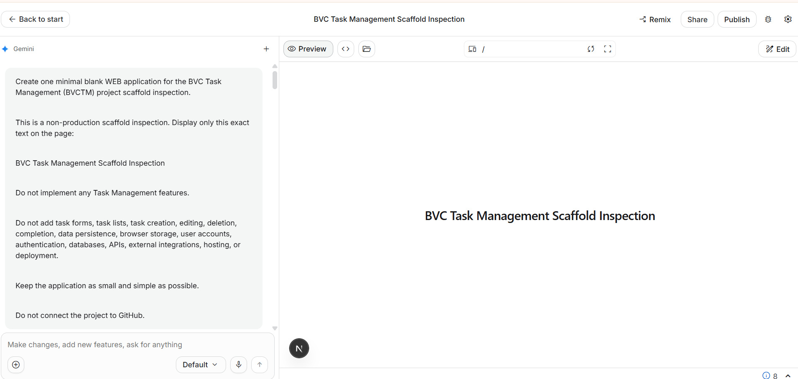

# Phase A · Lesson 01 — Meet Google AI Studio

**Project:** BVC Task Management  
**Learning level:** Beginner  
**Status:** Draft / Evidence Required — actual Preview observed; A1-01 screenshot asset still needs synchronization  
**Estimated time:** 15–20 minutes  
**Previous:** [Practical Labs Home](../../../README.md) — first lesson in this learning path  
**Next:** [A2 — Create Your First Blank Web App](../02-create-your-first-blank-web-app/README.md)

> **Lesson Index:** [Phase A — Meet AI & Build Your First App](../README.md) · [Full Learning Path](../../CURRICULUM_MAP_V0.2.md) · [Project Overview](../../../../projects/task-management/README.md)  
> **Next step →:** [A2 — Inspect the Blank Web App](../02-create-your-first-blank-web-app/README.md)

---

## 00. Lesson Information

**One practical outcome:** Open Google AI Studio, create the first blank BVC Task Management web app with Prompt #0001, and see the exact result in Preview.

**Starting state:** You have a browser, an internet connection, and access to the Google AI Studio account you will use for this practice.

**Scope boundary:** This lesson creates only a blank scaffold for inspection. It does not build Task Management features.

## 01. What You Will Achieve

By the end of this lesson, you will be able to:
- Find Google AI Studio and the Build entry point.
- Understand, in simple words, what Build mode and Preview are for.
- Run the prepared Prompt #0001.
- See the first blank BVC Task Management page in your own GAIS Preview.

You do not need to know programming to complete this lesson.

## 02. Why It Matters

Imagine you have an idea for a small tool that helps you remember your daily work.

With an AI app-building tool, you can describe what you need in ordinary language and ask AI to create a starting point. You still need to look at what it creates. AI can misunderstand a request or produce a result that needs fixing.

We will not ask AI to build the whole product at once. We will take one small step and check the result.

## 03. Before You Start

You need:
- A Google account that you are allowed to use with Google AI Studio.
- A modern web browser.
- An internet connection.

You do **not** need Python, VS Code, GitHub, Localhost, a database, Supabase, or a programming background.

Do not share passwords, private account details, API keys, or secret values in screenshots.

## 04. Step-by-Step Guide

### Step 1 — Open Google AI Studio

**Do this**  
Open the Google AI Studio Apps page:

[https://aistudio.google.com/apps](https://aistudio.google.com/apps)

Sign in using the account you intend to use for this practice project.

**Why**  
This is the workspace where we will create the first practice web app.

**What you should see**  
The Google AI Studio Apps page available to your account.

**Figure A1-01 — Actual Google AI Studio Apps landing screen**  
The repository contains an evidence note describing the owner-supplied screen and its observed controls, but the original screenshot image file has not yet been synchronized into GitHub. We do not insert a placeholder or invented image.

[Read the A1-01 screenshot evidence note](A1-01_SCREENSHOT_EVIDENCE_NOTE.md).

**Check**  
Confirm that the address bar shows `aistudio.google.com/apps` and that you are signed in to the intended GAIS account.

If your screen differs, stop and compare it with the current interface. Do not guess a different menu path.

### Step 2 — Start a new app

**Do this**  
Choose the **New app** entry under the Build area, as described in the A1-01 evidence note.

**Why**  
This opens the app-building workspace where you can describe the first result you want.

**What you should see**  
The GAIS Build workspace with a prompt area.

**Check**  
Make sure you are creating a web app for the BVC Task Management practice project. Do not connect GitHub or an external service.

### Step 3 — Copy Prompt #0001

**Do this**  
Open the canonical [BVCTM-PROMPT-0001 — Create the Initial BVC Task Management Web App Scaffold](../../prompts/BVCTM_PROMPT_0001_INITIAL_WEB_APP_SCAFFOLD.md).

Copy the complete prompt. It is deliberately prepared so you do not have to invent technical instructions.

**Why**  
The first task is only to create an empty starting point. The prompt prevents AI from adding task forms, saving, accounts, or a database before those features are authorized.

**Check**  
Confirm the prompt title says **Create the Initial BVC Task Management Web App Scaffold** and its scope is scaffold inspection only.

### Step 4 — Paste and run Prompt #0001

**Do this**  
Paste the complete Prompt #0001 into the large GAIS prompt box and run it once.

**What you should see**  
GAIS generates a minimal blank web app. The page should display this exact text:

```text
BVC Task Management Scaffold Inspection
```

**Scope boundary**  
Do not add task forms, sample tasks, save behavior, browser storage, login, a database, APIs, external integrations, hosting, or deployment in this run.

If GAIS does not clearly create a web app, stop and share the actual screen instead of guessing.

### Step 5 — Look at the Preview

**Do this**  
Open or view the Preview for the generated app.

**Why**  
Preview lets you see what the app looks like while it is being built. It does not mean every feature has been tested.

**What you should see**  
A simple page with the exact text **BVC Task Management Scaffold Inspection**.

**Figure A1-02 — Actual blank web scaffold Preview after Prompt #0001**



*Figure A1-02. Owner-supplied GAIS screenshot. The Preview displays the exact scaffold text. The conversation also shows that the first development-server start failed, then the AI reported installing dependencies, starting the Next.js development server on port 3000, and receiving HTTP 200 OK. The Preview is OBSERVED; the recovery details are the AI's reported actions, not an independently repeated build/test.*

**What this proves**
- A blank web-app Preview was displayed.
- The page showed the exact scaffold-inspection text.
- The GAIS conversation reported a recovery after the initial server-start problem.

**What this does not prove**
- That Task Management features work.
- That data can be saved or persisted.
- That a production build, automated tests, security checks, or deployment passed.
- That the exact framework and dependency versions have been fully verified.

**If the development server does not start**  
Do not repeatedly ask AI to “fix everything”. Show the exact message, keep the task limited to starting the existing blank app, and check that AI did not add features outside Prompt #0001.

## 05. Complete Prompt

Use the canonical [BVCTM-PROMPT-0001](../../prompts/BVCTM_PROMPT_0001_INITIAL_WEB_APP_SCAFFOLD.md). Do not modify the prompt or add extra features during this first run.

## 06. Check Your Work

- [ ] I opened Google AI Studio Apps.
- [ ] I opened the Build workspace for a new web app.
- [ ] I copied and ran the complete Prompt #0001 once.
- [ ] The Preview displays exactly **BVC Task Management Scaffold Inspection**.
- [ ] I did not ask AI to create Task Management features.
- [ ] I understand that Preview is not proof of saving, persistence, security, or deployment.

**Completion rule:** A1 is complete when the blank app Preview is visible and the scope boundary is understood. A2 will inspect the generated scaffold; it will not run Prompt #0001 a second time.

## 07. What You Have Learned

| Term | Plain-language meaning |
|---|---|
| Google AI Studio | The online AI workspace used in this practice project. |
| Build mode | The area where you describe the app you want AI to create. |
| Prompt | The prepared instruction you give AI for one task. |
| Preview | A view of the app as it looks while you are building it. |

## 08. Common Mistakes & Recovery

**I cannot find the same Build entry.**  
Do not click a different control based on guesswork. Capture the screen you actually see and compare it with the current lesson.

**The development server does not start.**  
Show the exact error to AI and ask for a minimal recovery within the blank-scaffold scope. Check that no feature was added.

**The Preview looks correct, so I assume the application is finished.**  
A Preview shows the visible result at that moment. Later lessons must test actual behavior separately.

**AI created more than I asked for.**  
Do not accept extra functionality automatically. Stop and inspect what changed.

## 09. Continue Learning

- **Previous:** [Practical Labs Home](../../../README.md)
- **Lesson Index:** [Phase A — Meet AI & Build Your First App](../README.md)
- **Next:** [A2 — Create Your First Blank Web App](../02-create-your-first-blank-web-app/README.md)
- **Progress:** Lesson A1 of A4.

---

**BVC — Learn by Building.**  
*Start with one useful result. Check what AI creates.*
