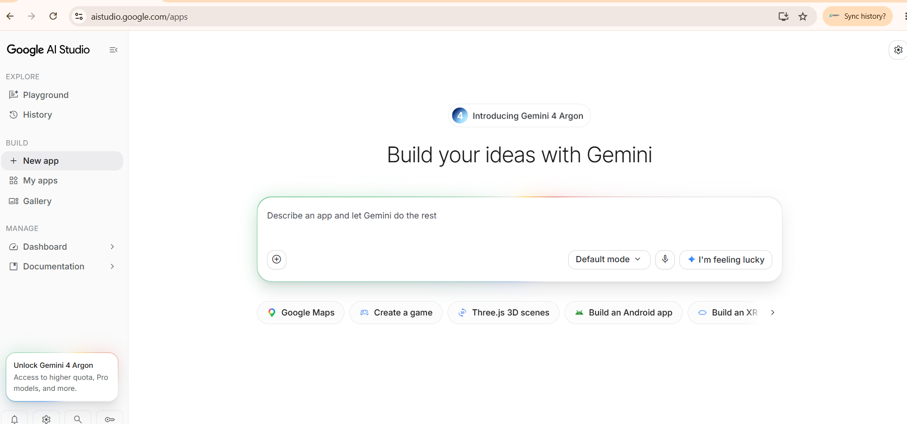

# Phase A · Lesson 01 — Meet Google AI Studio

**Learning level:** Beginner\
**Estimated time:** 10–15 minutes\
**Status:** In progress — A1-01 observed; Prompt #0001 ready; scaffold result awaiting capture
**Project:** BVC Task Management (BVCTM)
**Evidence baseline:** A1-01 actual GAIS screenshot supplied by Human Owner\
**Scaffold task boundary:** BVC-TM-TC-003 Revision 1 — APPROVED

## What you will learn

By the end of this lesson, you should be able to explain in simple words:

- What Google AI Studio (GAIS) is used for in this project.
- What Build mode is intended to help you do.
- What Preview means.
- Why we check what AI creates instead of assuming it is correct.

You do not need to know programming to complete this introduction.

## Why this matters

Imagine you have an idea for a small tool that helps you remember the work you need to do.

In the traditional approach, you might need to learn a programming language, install development tools, and write code before you see anything.

With an AI app-building tool, you can describe what you need in ordinary language and ask AI to help create an initial application. You still need to review and test the result. AI can misunderstand a request or produce something that does not work as expected.

Our goal is not to ask AI to build everything at once. We will work together in small steps.

## Before you start

You need:

- A Google account that you are allowed to use with Google AI Studio.
- A modern web browser.
- An internet connection.

You do **not** need Python, VS Code, GitHub, a local development server, a database, Supabase, or a programming background.

Use the GAIS account and workspace authorized for your own practice. Do not share passwords, private account information, API keys, or secret values in screenshots.

## Step 1 — Open Google AI Studio

**Do this**

Open the official Google AI Studio website:

[https://aistudio.google.com/](https://aistudio.google.com/)

Sign in using the account you intend to use for this practice project.

**Why**

We need to start in the actual tool that will help us create the first web application.

**What you should see**

You should arrive at the Google AI Studio interface available to your account.

**Screenshot checkpoint — A1-01**

<figure>



<figcaption>Figure A1-01. Actual Google AI Studio Apps landing screen at aistudio.google.com/apps. The New app entry is visible and highlighted under BUILD. Evidence status: OBSERVED.</figcaption>
</figure>

**Observation from the supplied screenshot**

The left navigation shows three groups:

- **EXPLORE:** Playground, History.
- **BUILD:** New app, My apps, Gallery.
- **MANAGE:** Dashboard, Documentation.

The address bar shows `aistudio.google.com/apps`.

This screenshot proves that the Apps landing screen was displayed and that **New app** was visible under **BUILD**. It does not prove that an application was created, that WEB was selected, or that a scaffold or Preview exists.

**Check**

Confirm that you are in Google AI Studio. Do not continue by guessing where a control is located.

If your screen looks different from the final verified screenshot, stop and compare it with the current lesson version. The interface may differ by account, rollout, or product update.

## Step 2 — Build with your first BVCTM prompt

Your A1-01 screenshot already shows **New app** highlighted under **BUILD** and the large prompt box in the center. You are at the starting point for Build mode.

Google's current Build mode documentation says web apps are the default. Android apps require a separate selection from the platform picker. The visible **Default mode** control in your screenshot is a mode selector, not an Android selection. Keep the current default; do not switch to Android. [Google AI Studio Build mode documentation](https://ai.google.dev/gemini-api/docs/aistudio-build-mode).

### BVCTM-PROMPT-0001 — Create the Initial BVC Task Management Web App Scaffold

This is the first official prompt in the BVCTM project. It creates only the blank web scaffold permitted by approved Contract BVC-TM-TC-003 Revision 1. It does not build Task Management features yet.

**Copy the complete Prompt #0001 below into GAIS, paste it into the large prompt box, and run it.**

```text
Create one minimal blank WEB application for the BVC Task Management (BVCTM) project scaffold inspection.

This is a non-production scaffold inspection. Display only this exact text on the page:

BVC Task Management Scaffold Inspection

Do not implement any Task Management features.

Do not add task forms, task lists, task creation, editing, deletion, completion, data persistence, browser storage, user accounts, authentication, databases, APIs, external integrations, hosting, or deployment.

Keep the application as small and simple as possible.

Do not connect the project to GitHub.
```

**What you should see**

GAIS should generate the initial web-app scaffold and show its Preview. The actual generated files and framework must be inspected rather than assumed.

**Screenshot checkpoint — A1-02**

After generation finishes, capture the screen showing the actual Preview and app result. Save it as `a1-02-bvctm-initial-scaffold-preview.png` in:

`C:\\beyond-vibe-coding\\practical-labs\\assets\\screenshots\\phase-a\\`

**Important scope boundary**

Do not ask GAIS to add task forms, sample tasks, save behavior, storage, login, or database features in this run. Those belong to a later implementation task and require their own approved Contract.

If GAIS presents an Android selection or a platform choice that does not clearly show WEB, stop and share a screenshot before submitting the prompt.

## Step 3 — Understand Preview

**What it means**

A Preview is a view of the application as it appears while you are building it. It helps you inspect the visible result and interact with the prototype.

A Preview is useful, but it is not proof that every feature works. For example, seeing a task on screen does not by itself prove that the task is saved and will still be there after reopening the app.

**What you should remember**

- The prompt describes what you want.
- AI generates or changes the application.
- Preview lets you inspect the visible result.
- You must still test the behavior you care about.

> [SCREENSHOT REQUIRED: Capture an actual Preview screen from the blank web scaffold created under BVC-TM-TC-003. Do not use a mock interface.]


*Figure A1-02. Actual blank web scaffold Preview — awaiting Human Owner capture and review.*

## What you have learned

| Term | Plain-language meaning |
|---|---|
| Google AI Studio | The online AI tool we will use to help create the practice app. |
| Build mode | The app-building area where we describe what we want AI to create. |
| Preview | A view that lets us inspect the visible application while building it. |

## Check your understanding

Answer these questions in your own words:

1. What is the difference between asking AI to create an app and checking the app in Preview?
2. Why is a visible Preview not enough to prove that a task is saved?
3. Why will we make one small change at a time?

You do not need technical definitions. Explain the ideas as you would explain them to a friend.

## Common mistakes

**I cannot find the same Build mode entry shown in the lesson.**\
Do not click a different control based on guesswork. Take a screenshot of the screen you actually see and compare it with the current lesson version.

**The Preview looks correct, so I assume the application is finished.**\
A Preview only shows what is visible at that moment. Later lessons will test saving, reopening, and other behavior separately.

**The AI created more than I asked for.**\
Do not accept extra functionality automatically. We will learn to give clearer constraints and check the generated result.

## Your next small challenge

Explain, without technical language, how you would ask AI to create a simple tool that helps you remember one thing you need to do tomorrow.

The approved BVC-TM-TC-003 Revision 1 authorizes one isolated blank WEB app and scaffold inspection only. The actual Task Management features will be implemented progressively under a separate approved implementation scope.

## References

- [Google AI Studio Build mode — official documentation](https://aistudio.google.com/docs/aistudio-build-mode)
- [Google Cloud: How to build an app with AI](https://cloud.google.com/use-cases/how-to-build-an-app-with-ai)

## Publication note

This is a lesson draft, not a fully verified GAIS walkthrough. Replace every screenshot placeholder with an authentic, privacy-safe screenshot. Verify exact interface labels and actions against the Human Owner's current GAIS session before marking this lesson Ready for Review.
