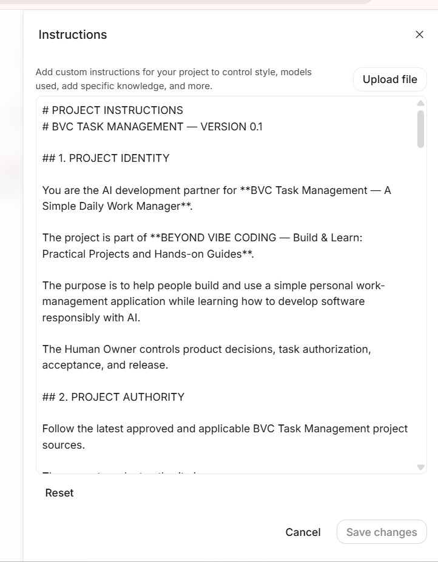

# Phase A · Lesson A3 — Set Up Project Instructions

**Project:** BVC Task Management  
**Learning level:** Beginner  
**Status:** Evidence partially complete — Custom Instructions summary card observed; BVCTM-PROMPT-0002 response received; independent file verification and before/after comparison pending  
**Estimated time:** 10–15 minutes, subject to practical review  
**Previous:** [A2 — Inspect Your First Web App Scaffold](../02-create-your-first-blank-web-app/README.md)  
**Next:** [A4 — Talk to AI Like a Teammate](../04-talk-to-ai-like-a-teammate/README.md)

> **Quick navigation:** [Practical Labs Home](../../../README.md) · [Project Index](../../README.md) · [Phase A Index](../README.md) · [← A2 — Inspect Your First Web App Scaffold](../02-create-your-first-blank-web-app/README.md) · **A3 of A4** · [A4 — Talk to AI Like a Teammate →](../04-talk-to-ai-like-a-teammate/README.md)

---

## 00. Lesson Information

**One practical outcome:** Your GAIS project has the BVC Task Management Project Instructions saved, and the AI can explain the main rules without changing any application files.

**Starting state:** You have created the blank web app and inspected its visible scaffold in Lesson A2.

**Scope boundary:** This lesson configures instructions for the AI. It does not build Task Management features or change the generated application code.

## 01. What You Will Achieve

You will give the AI a clear set of project rules before asking it to build anything.

These rules explain:
- What BVC Task Management is.
- Which project documents it must respect.
- Which technology and files it must preserve.
- What it must not do.
- How it should check and report its work.
- Why it must keep BVC separate from unrelated projects such as EFIN and ENERIXON FIN.

At the end, you will ask the AI to explain the instructions back to you. It must not change any files during that check.

## 02. Why It Matters

Imagine asking a new teammate to help with your work without explaining what the project is, which tools it uses, or which rules must be followed.

The teammate would have to guess.

Project Instructions give AI that missing background and the working rules. They do not replace a task prompt: they explain how to work, while a task prompt explains what to do now.

> **Project Instructions tell AI how to work. Task Prompts tell AI what to do.**

## 03. Before You Start

- Complete Lesson A2.
- Open the same BVC Task Management scaffold project in GAIS.
- Use the canonical file [PROJECT_INSTRUCTIONS_V0.1.md](../../PROJECT_INSTRUCTIONS_V0.1.md).
- Do not paste passwords, API keys, private account information, or customer data.
- Do not ask AI to create a task form, database, sign-in screen, or other feature in this lesson.

The GAIS Code / File Explorer screenshot shows Next.js-related filenames and TypeScript / TSX files. The AI response to Prompt #0002 also listed exact versions, but later stated that no project files were inspected during that turn. Those version and dependency details are therefore NOT VERIFIED by Prompt #0002 until they are checked against the actual GAIS files.

## 04. Step-by-Step Guide

### Step 1 — Open Chat settings

**Do this**  
Open the project settings area in Google AI Studio.

**Where**  
Use the settings gear shown in the supplied GAIS screenshot. In the Chat settings view, the supplied screenshot shows the System instructions area.

**Why**  
Project Instructions are configured for the AI conversation, not by editing application source code.

**What you should see**  
The Chat settings panel and a System instructions section.

**Check**  
Confirm that you are still in the BVC Task Management scaffold project.

**If it looks different**  
Do not guess another menu path. Stop and share a screenshot of the screen you see.

### Step 2 — Open Custom instructions

**Do this**  
Open the Custom instructions editor under System instructions.

**Where**  
The supplied GAIS screenshots show a Custom instructions card that opens an Instructions editor.

**Why**  
This editor is where you provide the project's durable working rules to the AI.

**What you should see**  
A large text area in the Instructions panel.

**Check**  
Make sure the panel belongs to the BVC Task Management project, not another GAIS app.

### Step 3 — Copy the canonical Project Instructions

**Do this**  
Open the complete [BVC Task Management Project Instructions v0.1](../../PROJECT_INSTRUCTIONS_V0.1.md) and copy all of its contents.

**Why**  
Using one canonical file avoids different versions being pasted into different project sessions.

**Type or choose**  
Copy the entire Markdown content, starting at “PROJECT INSTRUCTIONS” and ending at “Human in Control. AI as Executor.”

Do not copy only the first few sections.

**Check**  
Before pasting, confirm that you copied the complete file and that it names BVC Task Management.

### Step 4 — Paste the instructions

**Do this**  
Paste the copied text into the GAIS Instructions editor.

**What you should see**  
The editor contains the headings and rules from the canonical file, including Project Identity, Project Authority, Scope Control, Technology and Scaffold, File Integrity, Security and Privacy, Project Isolation, UI/UX Compliance, Verification, and Stop Conditions.

**Check**  
Compare the first and last sections with the canonical GitHub file.

**Evidence note**  
The Human Owner supplied a screenshot showing the Project Instructions text populated in the GAIS Instructions editor. This is OBSERVED evidence of the editor content only; it does not prove that the Save action completed.

### Step 5 — Save the instructions

**Do this**  
Use the Save changes control shown by the GAIS editor.

**Why**  
Pasting text into the editor is not the same as saving it.

**What you should see**  
The editor closes or returns to its previous settings state. The exact post-save behavior must be confirmed in the current GAIS session.

**Check**  
Reopen the Instructions editor and confirm that the text is still present.

**If it looks different**  
Do not assume the save succeeded. Check the content, save again if the control is available, and capture the actual result.

### Step 6 — Ask AI to explain the instructions

**Do this**  
Open the project chat and run the read-only prompt [BVCTM-PROMPT-0002 — Project Instructions Understanding Check](../../prompts/BVCTM_PROMPT_0002_PROJECT_INSTRUCTIONS_UNDERSTANDING_CHECK.md).

**Why**  
The point is to check whether the AI can explain the rules before it is asked to build anything.

**Important**  
This is a read-only understanding check. The prompt explicitly prohibits file creation, modification, renaming, and deletion.

**What you should see**  
The AI summarizes the project identity, current learning boundary, observed technology, project isolation, and verification rules. Facts not visible in the actual project should be marked UNKNOWN.

### Step 7 — Check that no application files changed

**Do this**  
Look at the GAIS Code / File Explorer area after the understanding check.

**Why**  
The lesson is about instructions, not implementation.

**What you should see**  
No new or modified application files as a result of the read-only check.

**Check**  
Compare the visible file tree with the scaffold recorded in Lesson A2.

If files have changed, stop. Do not accept the result as a successful instructions check.

## 05. Complete Prompt

Use the canonical [BVCTM-PROMPT-0002](../../prompts/BVCTM_PROMPT_0002_PROJECT_INSTRUCTIONS_UNDERSTANDING_CHECK.md).

Do not write a feature-building prompt in this lesson.

## 06. See the Real Result

### A3-02 — Custom Instructions card visible in Chat settings

*Figure A3-02. Actual owner-supplied GAIS screenshot. The Chat settings panel shows the Custom instructions card with a summary beginning “PROJECT INSTRUCTIONS — BVC TASK MANAGEMENT”. This is OBSERVED evidence that the settings summary is present after the editor was closed. It is not a full-text reopen check and does not independently prove every line was saved exactly.*

### A3-03 — BVCTM-PROMPT-0002 understanding response

**Owner-supplied result:** The Human Owner ran [BVCTM-PROMPT-0002](../../prompts/BVCTM_PROMPT_0002_PROJECT_INSTRUCTIONS_UNDERSTANDING_CHECK.md) in the BVC Task Management GAIS project and supplied the AI response.

The AI answered all ten requested areas. It correctly restated the project purpose, Human Owner authority, Beginner boundary, OPEN Phase 3.1 UX status, file-integrity rules, Project Isolation Rule for EFIN and ENERIXON FIN, verification distinctions, and stop conditions.

<badge color="success">Response received</badge> The Project Instructions understanding check has been run and its response reviewed.

#### Important evidence inconsistency — technology details remain unverified

In its answer to questions 4 and 5, the AI listed exact runtime, framework, React, TypeScript, Tailwind, and package versions as “Inspected & Verified”.

However, at the end of that same response, it explicitly stated:

> “Which project files did you actually inspect during this turn? None were read or modified in this turn; this response was generated strictly from the provided Project Instructions and existing project context.”

These statements do not support a claim that the versions were independently inspected during Prompt #0002. Therefore:

- Treat those version numbers and package details as **NOT VERIFIED by this understanding check**.
- Check the actual `package.json`, applicable lockfile (if present), and runtime evidence in the scaffold lesson before publishing exact versions as facts.
- Do not state that a build or test passed merely because the response described what those checks mean.

#### File-change statement

The AI explicitly reported **NO** project file changes. This is an AI self-report and is consistent with the read-only purpose of Prompt #0002. The independent before/after File Explorer or diff comparison is still pending.

### A3-04 — File tree unchanged

**Status:** NOT VERIFIED independently.

Compare the current GAIS Code / File Explorer with the A2 checkpoint. Confirm that no file was created, modified, renamed, moved, or deleted during the understanding check. Capture the actual screen or change history as evidence.

### Evidence status summary

| Checkpoint | Status | Meaning |
|---|---|---|
| A3-01 — Instructions editor populated | OBSERVED in earlier owner-supplied screenshot | The editor contained instruction text at capture time. |
| A3-02 — Settings card visible | OBSERVED; image synchronized in this PR | The Custom Instructions summary card appeared after leaving the editor. |
| A3-03 — Prompt #0002 response | OWNER-SUPPLIED TEXT RESPONSE RECEIVED | All ten questions answered; the technology-version inconsistency is recorded above. |
| A3-04 — File tree unchanged | NOT VERIFIED independently | AI said no files changed; before/after comparison is still needed. |

## 07. Check Your Work

- [ ] The complete canonical Project Instructions were copied.
- [ ] The text was pasted into the correct BVC Task Management GAIS project.
- [ ] Save changes was performed.
- [ ] The editor was reopened and the saved text was confirmed.
- [ ] AI correctly summarized the project's purpose and authority.
- [ ] AI correctly identified the learning boundary.
- [ ] I reviewed the ten answers from BVCTM-PROMPT-0002.
- [ ] I recognized that exact technology versions remain unverified until the actual files are inspected.
- [ ] AI correctly explained Project Isolation, including EFIN and ENERIXON FIN.
- [ ] I recorded the AI's statement that it made no application file changes.
- [ ] I compared the before/after file tree or diff independently.
- [ ] The actual evidence checkpoints were captured.

**Completion rule:** The understanding-check response has been received, but A3 remains partially complete until the full saved instructions are reopened and confirmed, and the before/after file tree is independently checked. An AI self-report is not a substitute for evidence.

## 08. Common Mistakes & Recovery

| What you may see | What it means | Safe next action |
|---|---|---|
| Only part of the instructions appears | The copied content may be incomplete | Compare with the canonical file and paste the complete content |
| Save changes is not available | The editor may not have an unsaved change or the UI may differ | Stop and inspect the current screen; do not claim it was saved |
| AI claims a framework version without evidence | It is guessing or relying on unsupported context | Ask it to mark the version UNKNOWN and inspect the actual manifest |
| AI proposes a Task Management feature | The understanding check has drifted into implementation | Remind it that this is read-only and do not accept any file changes |
| Files change during the check | The read-only boundary was not respected | Stop and inspect the actual diff or file history before continuing |

## 09. What You Have Learned

You have learned that:
- AI needs project context and rules before doing project work.
- Project Instructions are different from a one-time task prompt.
- The project must have one clear source of truth.
- AI should inspect technology and files rather than guess.
- Project Isolation helps prevent information from unrelated projects from leaking into the current project.
- Instructions guide the AI but do not technically lock its access to files.

## 10. Continue Learning

- **Previous:** [A2 — Create Your First Blank Web App](../02-create-your-first-blank-web-app/README.md)
- **Next:** [A4 — Talk to AI Like a Teammate](../04-talk-to-ai-like-a-teammate/README.md)
- **Lesson Index:** [Phase A — Meet AI & Build Your First App](../README.md)
- **Progress:** Lesson A3 of A4.

---

**BVC — Learn by Building.**  
*Give AI the project rules before giving it the work.*

## Continue learning

[Practical Labs Home](../../../README.md) · [Project Index](../../README.md) · [Phase A Index](../README.md) · [← A2 — Inspect Your First Web App Scaffold](../02-create-your-first-blank-web-app/README.md) · [A4 — Talk to AI Like a Teammate →](../04-talk-to-ai-like-a-teammate/README.md)
