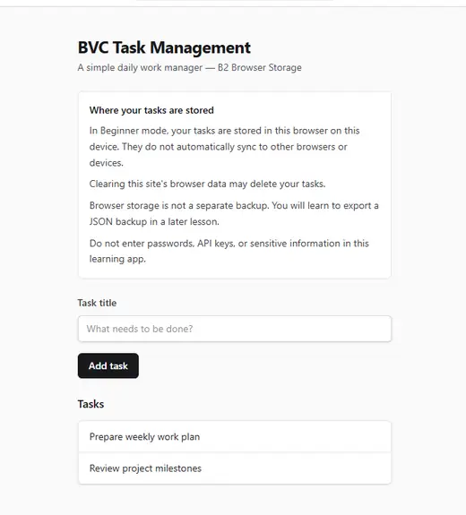

# Phase B · Lesson B2 — Save Your Task

> **Quick navigation:** [Practical Labs Home](../../../README.md) · [Project Index](../../README.md) · [Phase B Index](../README.md) · [← Previous: B1](../b1-create-your-first-task/README.md) · [Next: B3 →](../b3-close-and-reopen/README.md)  
> **Progress:** Phase B · Lesson B2 — Save Your Task

**Learning level:** Beginner  
**Learning outcome:** Save the task workspace in the current browser profile and understand where that data lives.  
**Lesson status:** Contract `BVC-TM-TC-005` Revision 1 is approved and canonical through PR #64. The Human Owner issued B2 Execution Authorization on 2026-11-17; RC-003, RC-004 and RC-005 are PASS. Gemini reports Stage 2 implementation in `app/page.tsx` (report dated 2026-11-18). Static source review, build and lint are reported PASS. The Owner-supplied Local Storage screenshot now shows the correct runtime origin, exact workspace key and parsed top-level envelope metadata alongside the two Preview tasks. The data.tasks array has not yet been expanded in the evidence image, and post-refresh restoration remains pending. Prompt #0005 and Context Pack are canonical through PR #67; continuity was reconciled by PR #68 and the Owner's RC-005 decision by PR #69.

## 1. What you will learn

In B1, a task appears in the list but exists only in the page's current memory. B2 introduces saving so the application can load the task again after a page reload.

The approved design direction for the Beginner level is a small, versioned JSON workspace in browser `localStorage`. This is a design baseline, not proof that persistence has been implemented or tested.

## 2. Understand browser storage

For the Beginner learning level:

- Data is stored in the current browser profile for this application.
- It does not automatically synchronize to another browser, computer, or phone.
- Clearing the browser's site data may remove the saved workspace.
- It is not a cloud database or a backup service.
- Never use real passwords, API keys, private customer information, or sensitive data in the learning app.

**Approved disclosure — DR-005 (2026-11-13):** Before the first task that will be persisted, show the full approved disclosure at the top of the workspace. The learner must acknowledge it before continuing. When a valid workspace is loaded later, keep the full disclosure visible as a readable, non-blocking notice. A Settings page or More menu is outside the B2 scope.

> **Where your tasks are stored**
>
> In Beginner mode, your tasks are stored in this browser on this device. They do not automatically sync to other browsers or devices.
>
> Clearing this site's browser data may delete your tasks.
>
> Browser storage is not a separate backup. You will learn to export a JSON backup in a later lesson.
>
> Do not enter passwords, API keys, or sensitive information in this learning app.
>
> **Action:** Got it — continue

A Vietnamese reference translation is recorded in the canonical Product/UX Decision Register. The approved English copy above is authoritative for the current Beginner implementation.

**Implementation authority:** `BVC-TM-TC-005 Revision 1` is the approved Contract. It defines the exact one-file boundary, workspace schema, DR-005 acknowledgement behavior, load/save order, storage-error handling and acceptance criteria. The Human Owner separately issued conditional execution authorization on 2026-11-17. All conditions were satisfied when the Owner confirmed RC-005 PASS — PROCEED WITH B2 on 2026-11-18. Stage 2 is authorized, but implementation and runtime persistence are not yet evidenced. The Owner's Option A clarification confirms that PR #64 also approved the exact runtime envelope in storage.format; no separate schema approval is required.

## 3. Before you begin

- B1 has been implemented and its create/validation behavior has been accepted.
- The active B2 Task Contract is available and identifies the allowed files and verification requirements.
- DR-005 is approved; its exact Beginner disclosure and placement are documented above.
- The current source and data shape are inspected before asking AI to modify persistence.

If any condition is missing, use this lesson for understanding only. Do not ask AI to write storage code.

## 4. Learning sequence

When B2 is authorized:

1. Ask AI to explain the current in-memory task state and where it is created.
2. Review the approved storage-disclosure copy and where the learner will see it.
3. Ask AI to implement only the approved, versioned browser workspace behavior.
4. Confirm that adding a task updates the stored workspace.
5. Reload the Preview and check whether the task is loaded again.
6. Check the visible result and any storage error behavior.
7. Review the changed-file list and the Contract's verification evidence.

Do not let AI add Supabase, Firebase, an account, API calls, or cloud synchronization. Those are outside the Beginner B2 scope.

## 5. What counts as evidence

- The actual save interaction and visible result.
- A task created after B1 that is still available after a reload.
- The same app origin and browser profile used for the test.
- The approved first-use storage disclosure as displayed in the actual UI.
- A record of any error and how the app responds.
- The actual changed-file list and the verification result required by the B2 Contract.

A success message alone is not proof that data was saved. B2 Contract requires initial save/load verification, including a normal refresh in the same browser profile. B3 remains a separate learner exercise on closing/reopening and recovery; it does not repeat B2 implementation.

## 6. B2 completion checklist

- [x] DR-005 is approved and published through PR #62; the actual GAIS disclosure still requires runtime verification.
- [x] BVC-TM-TC-005 Revision 1 is Owner-approved and canonical on main through PR #64.
- [ ] Beginner storage uses only the approved browser-local approach.
- [ ] No external database, account, or cloud sync has been added.
- [ ] The saved workspace can be loaded after a reload.
- [ ] Storage errors are reported truthfully.
- [ ] The learner understands that clearing browser site data may remove the workspace.

## 7. GAIS preflight and source-of-truth boundary

Before execution, verify the existing GAIS app ID, inspect the live `app/page.tsx`, compare it with the Owner-provided B1 source, review the Code/File Explorer changed-file inventory and confirm there is no competing writer. Stop if more than `app/page.tsx` must change. GitHub is the canonical home for Product, UX, Architecture, Governance, Contracts, Prompts and evidence. GAIS is only the app build/Preview workspace. Do not create repository-level `design/`, `governance/`, `task-contracts/`, `continuity/` or register folders inside GAIS. Supply only the lesson Context Pack, approved Contract and canonical Prompt.

**Prompt status:** BVCTM-PROMPT-0005 and its task-specific Context Pack are canonical on `main` through merged PR #67; their post-merge records were reconciled by PR #68. Stage 1 is complete and the Human Owner confirmed `RC-005 PASS — PROCEED WITH B2` on 2026-11-18. Gemini may begin Stage 2 only after immediate pre-write checks pass. No GitHub connection is required in the beginner's GAIS project.

## 7.1 Canonical execution prompt — BVCTM-PROMPT-0005

The full copy-ready [Prompt #0005 — Phase B2: Save Your Task](../../prompts/BVCTM_PROMPT_0005_PHASE_B2_SAVE_YOUR_TASK.md) and its [B2 Context Pack](../../../../projects/task-management/phase3.3/BVC_TM_P3.3_005_CONTEXT_PACK_V0.1.yaml) are maintained in their canonical locations.

Provide Gemini with the complete canonical Context Pack and Prompt #0005. Stage 1 acknowledgment and the Owner gate are complete. Follow the Stage 2 Vietnamese learner guide below before sending the implementation instruction.

### Copy-and-paste Prompt #0005

Copy the entire prompt below. Also provide the complete Context Pack in the same GAIS conversation. Do not connect GAIS to GitHub.

~~~~text
# BVCTM-PROMPT-0005 — Phase B2: Save Your Task

**Project:** BVC Task Management — A Simple Daily Work Manager  
**Task ID:** BVC-TM-P3.3-005  
**Contract:** BVC-TM-TC-005 Revision 1 — APPROVED  
**Context Pack:** BVC-TM-P3.3-005 Context Pack v0.1  
**Target GAIS Application ID:** ca589018-617d-4919-bbe2-6b9c588ccd85  
**Authorized executor:** Gemini in Google AI Studio  
**Risk:** R2  
**Mode:** CONDITIONAL WRITE — TWO-STAGE OWNER GATE

---

## 1. Authority and governing sources

You are the implementation executor for the existing BVC Task Management Beginner application.

Follow the Project Instructions already saved in this GAIS project's Custom Instructions. The Human Owner will provide the complete lesson-specific B2 Context Pack and this Prompt. **A GitHub connection is not required and must not be created for this Beginner GAIS task.** GitHub is the canonical home for BVC governance and learning documents; GAIS is the application build/Preview workspace.

The governing task is BVC-TM-P3.3-005 under BVC-TM-TC-005 Revision 1. The approved Contract controls implementation scope, storage behavior, acceptance criteria and stop conditions.

### Owner decisions already recorded

1. On 2026-11-17, the Human Owner selected Option A and confirmed that approval of Contract #005 Revision 1 through merged PR #64 also approved the exact runtime workspace envelope in the Contract's storage.format. No separate schema approval is required.
2. On 2026-11-17, the Human Owner explicitly issued B2 Execution Authorization: AUTHORIZED WITHIN APPROVED CONTRACT SCOPE, conditional on RC-003, RC-004 and RC-005 all being PASS.
3. RC-003 and RC-004 have been reviewed and recorded PASS. RC-005 remains pending until you complete the acknowledgment stage below and the Human Owner confirms it.
4. The Contract's original execution_authorization and storage.scope_note describe the state when Contract #005 was approved. The later Owner decisions above resolve those approval-status questions. Do not alter the approved schema or edit the Contract.

The Context Pack contains the exact Owner decisions, preflight evidence, storage envelope and disclosure text. If it is not supplied, stop and request it.

## 2. Two-stage gate — mandatory

### Stage 1: RC-005 acknowledgment only

On receiving this Prompt and the Context Pack:

- Read both completely.
- Read the saved GAIS Project Instructions.
- Inspect the current project identity, current app/page.tsx and File Explorer inventory using read-only actions only.
- Confirm Application ID ca589018-617d-4919-bbe2-6b9c588ccd85.
- Compare current app/page.tsx against the preflight baseline: 3,703 bytes; SHA-256 1d0be58bdf1c8da452c3d2fcb071034fbb90d5506968b688c8449fc8f14fe373. If it differs, report the exact difference and STOP.
- Confirm the exact one-file allowlist and all stop conditions.
- Confirm that you understand the approved runtime envelope and exact DR-005 copy.
- Confirm you will not connect GitHub or modify any other file.

Return a structured response titled **RC-005 EXECUTOR ACKNOWLEDGMENT** containing:
1. Target Application ID.
2. Contract ID/revision, Task ID and risk.
3. Exact permitted operation and file.
4. File-count and diff-line budgets.
5. Prohibited files, services and features.
6. Storage key and exact runtime envelope.
7. DR-005 disclosure and acknowledgement behavior.
8. Required load, validation, save and error behavior.
9. Stop conditions.
10. This exact statement: "I understand and accept the one-file B2 scope. I have not modified any file."

**Do not edit, generate replacement code, run write-capable commands or implement B2 during Stage 1.** Wait for the Human Owner to review the acknowledgment and send:

**RC-005 PASS — PROCEED WITH B2**

This confirms the RC-005 executor acknowledgment. It does not expand the already-issued authorization.

If any source, identity, Project Instructions, Context Pack, schema or disclosure requirement is missing or inconsistent, report BLOCKED and wait.

### Stage 2: implementation — only after the exact Owner gate confirmation

After receiving the exact Stage 2 gate confirmation, implement the approved B2 behavior under the conditional Owner authorization. Do not ask for another Contract approval or a second execution authorization.

## 3. Reconfirm the target and inspect before editing

Target existing GAIS project only:
- Application ID: ca589018-617d-4919-bbe2-6b9c588ccd85
- Authorized file relative to project root: app/page.tsx

Before editing, report the confirmed identity, current source line/byte count and SHA-256 if available, current File Explorer inventory, exact source baseline and differences, planned behavior, and confirmation that no other file is needed.

If the app ID differs, source materially differs from preflight, a pending editor change appears, another writer is active, or an extra file is required, STOP before editing.

## 4. B2 learning outcome

Extend accepted B1 task capture so a task is saved in the current browser profile and loaded again after a normal Preview reload in the same browser profile and app origin. Explain that browser-local storage is not cross-device sync and is not a separate backup. Keep the implementation small and beginner-friendly.

## 5. Exact authorized storage design

Use exactly one browser localStorage key:

~~~text
bvc-task-management:workspace:v1
~~~

Use this exact runtime workspace envelope. Angle-bracket values are generated placeholders, not literal values:

~~~json
{
  "format": "bvc-task-management-workspace",
  "formatVersion": 1,
  "sourceMode": "browser",
  "workspaceId": "<stable UUID>",
  "data": {
    "projects": [],
    "tasks": [
      {
        "id": "<UUID>",
        "title": "<trimmed task title>"
      }
    ],
    "checklistItems": [],
    "settings": {},
    "appliedStarterKits": []
  }
}
~~~

Rules:
- Generate workspaceId once, when the first task is successfully persisted; reuse it on later saves.
- Generate each new task id with crypto.randomUUID().
- Use crypto.randomUUID() for workspaceId too.
- If crypto.randomUUID() is unavailable in actual Preview, stop. Do not use Math.random, Date.now-based IDs, a package or an insecure fallback.
- B2 creates/reads only task fields id and title. Keep projects, checklistItems and appliedStarterKits empty, and settings an empty object.
- Do not add exportedAt, timezone, backup metadata or later export/import fields.

## 6. Required runtime behavior

### 6.1 Initial load

- Access browser storage only on the client; do not read window.localStorage during server rendering.
- On first client mount, read the agreed key and validate it before enabling task writes.
- Do not write an empty workspace on mount.
- If the key is absent, initialize an empty in-memory task list and an unpersisted workspace. Do not call setItem.
- If a valid workspace exists, load tasks in insertion order and preserve workspaceId.
- Prevent duplicate initialization or premature writes while load is in progress.

### 6.2 Validation and preservation

Validate:
- JSON parses successfully.
- format is exactly bvc-task-management-workspace.
- formatVersion is exactly 1.
- sourceMode is exactly browser.
- workspaceId is a non-empty UUID string.
- data is an object.
- projects, tasks, checklistItems and appliedStarterKits are arrays.
- settings is an object.
- Each task has a unique non-empty id and a non-empty trimmed title.
- Do not create additional task fields in B2. If an existing record contains unrecognized fields that B2 cannot preserve safely, preserve the original stored value and stop rather than stripping or overwriting it.

For malformed JSON, unsupported versions, missing structures or invalid task records:
- Preserve the original stored value exactly.
- Do not clear, repair, replace or overwrite it.
- Disable task writes for the session.
- Show a clear, accessible error/recovery message.
- Do not silently treat invalid data as an empty workspace.

If reading localStorage throws an access/security error, do not treat it as a missing key or claim an empty saved workspace. Report the failure and block writes.

### 6.3 DR-005 first-use disclosure

For a fresh session with no saved workspace:
- Display the exact approved disclosure below at the top of the workspace, before the first task can be persisted.
- Require explicit acknowledgement through the exact action label.
- No task may be written before acknowledgement.
- Acknowledgement state is component memory only for the current page session. Do not create another localStorage key, cookie or sessionStorage item.

For a valid existing workspace after reload:
- Show the disclosure as a readable, non-blocking notice/control.
- Do not repeatedly block task entry when a valid saved workspace exists.
- Do not implement a Settings page, More menu or later-phase navigation in B2. Keep the full approved disclosure available in the current workspace notice; the one-file Contract does not authorize building Settings.

Exact approved English copy:

~~~text
Where your tasks are stored

In Beginner mode, your tasks are stored in this browser on this device. They do not automatically sync to other browsers or devices.

Clearing this site's browser data may delete your tasks.

Browser storage is not a separate backup. You will learn to export a JSON backup in a later lesson.

Do not enter passwords, API keys, or sensitive information in this learning app.

Action: Got it — continue
~~~

Do not paraphrase or shorten the disclosure. Do not claim acknowledgement creates a backup.

### 6.4 Task submission and save order

Preserve every B1 behavior:
- One Task title input and one Add task button.
- Trim leading/trailing whitespace.
- Reject empty/whitespace-only titles with exactly: "Please enter a task title."
- Enter submits the form.
- Keep insertion order.
- On successful add, clear the title input and previous validation message.
- No task edit, delete, complete, due date, priority, project, notes, checklist, tag or assignment.

For a valid submission after acknowledgement:
1. Build the new task with a UUID and trimmed title.
2. Build the complete next workspace envelope in memory.
3. Serialize the complete envelope.
4. Call localStorage.setItem exactly once for the single agreed key.
5. Only after setItem succeeds, update React task state and clear the input/validation state.

If setItem throws:
- Preserve the previous task list and entered title.
- Show a plain-language, accessible error.
- Do not show the new task as saved.
- Do not claim success.
- Allow a safe retry.

Never silently fall back to sessionStorage or memory-only operation while claiming the task is saved.

### 6.5 Storage and UI lifecycle

- Keep the implementation inside the existing Page component in app/page.tsx.
- Use standard React hooks already available in the existing dependency set.
- Ensure initialization does not cause duplicate writes or overwrite data.
- Keep Preview responsive and accessible.
- Use accessible labels, validation announcements and storage-error feedback.
- Avoid unnecessary abstractions and dependencies.

## 7. Strict implementation boundary

Authorized: MODIFY exactly one existing file, app/page.tsx.

Budget:
- Maximum changed files: 1.
- Maximum modified files: 1.
- Maximum created files: 0.
- Maximum deleted files: 0.
- Maximum binary files: 0.
- Maximum total diff: 350 lines.

Forbidden:
- Any CREATE, DELETE, rename, move or modification of another file.
- package.json, bun.lock, any lockfile, configuration, metadata, layout, global CSS, routes or README.
- New dependencies or package installation.
- API routes, backend code, server-side filesystem writes, database, Supabase, Firebase, PostgreSQL, Auth, RLS, external services or cloud sync.
- GitHub connection, GitHub repository changes, commits, branches or deployment from GAIS.
- JSON export/import, file download/upload, backup, restore or merge flows.
- Projects, Checklists, Settings, Starter Kits or other later-phase functionality.
- Any change to the approved storage key, envelope, DR-005 text or Contract scope.

Existing bun.lock, metadata.json, layout.tsx and other scaffold files are not authorized for modification. The historical scaffold title in metadata/layout must remain untouched.

If a forbidden change appears necessary, STOP and report. Do not expand scope.

## 8. Verification requirements

After implementation, verify and report each Contract acceptance criterion:

- B2-AC-001: Fresh session shows DR-005 before first persistence; confirm no write before acknowledgement.
- B2-AC-002: Rendered disclosure exactly matches approved copy.
- B2-AC-003: Valid task is saved under the exact key and envelope.
- B2-AC-004: Two tasks survive normal Preview refresh in the same browser profile and app origin, each shown once in insertion order.
- B2-AC-005: B1 regression: trimming, empty/space-only rejection, exact message, input/error clearing, Enter, insertion order and empty state.
- B2-AC-006: Malformed JSON and unsupported version preserved and writes blocked. Use a disposable test profile only; never corrupt/delete the Owner's actual workspace data. If no safe disposable profile is available, mark runtime simulation NOT_RUN and perform static review only.
- B2-AC-007: Storage read/write errors preserve previous data and title input. If safe runtime failure simulation is unavailable, mark it NOT_RUN and explain.
- B2-AC-008: Only app/page.tsx changes.
- B2-AC-009: Check compact phone and desktop Preview widths.
- B2-AC-010: Human Owner reviews source/diff, Preview and evidence, then explicitly accepts.
- B2-AC-011: No later-phase features, external services, API, database, Auth or export/import were added.

Do not claim any check passed unless actually performed. Distinguish static review, actual Preview interaction, storage inspection, and tests not run.

## 9. Required post-implementation report

Return:
1. Contract ID/revision, Task ID, Prompt ID and target Application ID.
2. Exact changed-file inventory.
3. Complete app/page.tsx source or reviewable exact diff.
4. Before/after line count, byte count and SHA-256 if available.
5. Confirmation that all other files remain unchanged, with actual inventory evidence.
6. Actual Preview behavior and authentic evidence.
7. Storage key and envelope example using synthetic placeholders.
8. Each B2-AC-001 through B2-AC-011: PASS, FAIL, NOT_RUN or NOT_VERIFIED, with evidence.
9. B1 regression results.
10. Malformed-data/storage-error results.
11. All limitations and stop conditions.

Do not claim B2 accepted, complete, published, merged or deployed. Only the Human Owner can accept the result.

## 10. Final authority and stop rule

The Human Owner retains exclusive authority over final review, acceptance, task closure, publication, merge and release.

This Prompt and the approved Context Pack apply only to BVC-TM-P3.3-005 under BVC-TM-TC-005 Revision 1.

**The first response is RC-005 acknowledgment only. Do not edit until the Human Owner sends: RC-005 PASS — PROCEED WITH B2.**
~~~~

## 7.2 Stage 2 — Vietnamese guide for the learner

### Bối cảnh

Ở B1, newbie đã tạo và hiển thị task thành công, nhưng danh sách chỉ nằm trong React state (bộ nhớ tạm của trang). Khi refresh, trang có thể mất danh sách đó. B2 chuyển task sang browser `localStorage` để ứng dụng có thể đọc lại dữ liệu ở lần mở trang tiếp theo trong cùng browser profile và app origin.

### Mục đích

Giúp newbie hiểu và thực hành khái niệm **persistence (lưu dữ liệu lâu dài hơn vòng đời trang)** mà chưa cần backend, database, đăng nhập hay cloud sync.

### Mục tiêu

1. Hiển thị đầy đủ thông báo DR-005 và yêu cầu xác nhận trước lần lưu đầu.
2. Đọc và kiểm tra dữ liệu lưu sẵn trước khi cho phép ghi.
3. Lưu task theo đúng key và workspace envelope đã được Owner duyệt.
4. Refresh cùng Preview/browser profile và khôi phục task theo thứ tự.
5. Bảo toàn dữ liệu lỗi; báo rõ khi browser storage không truy cập được hoặc không ghi được.
6. Không làm hỏng những hành vi B1 như trim, validation, Enter submission và empty state.

### Kết quả mong muốn

Newbie thêm hai task, thấy chúng xuất hiện đúng thứ tự, refresh Preview trong cùng browser profile và vẫn nhìn thấy cả hai. Browser storage chỉ thuộc trình duyệt/thiết bị hiện tại; không tự đồng bộ sang thiết bị khác và không phải backup.

### Gemini đã làm gì theo báo cáo Stage 2?

Gemini báo cáo đã sửa duy nhất `app/page.tsx`, thêm bước đọc/validate workspace, DR-005 acknowledgement, tạo UUID, lưu JSON envelope vào localStorage và xử lý lỗi. Build và ESLint được báo cáo thành công. Human Owner sau đó đã kiểm tra Local Storage và refresh Preview; hai task được khôi phục đúng thứ tự. Các kiểm thử B1 regression, malformed-data/storage-error và responsive vẫn cần hoàn tất.

### Newbie cần làm gì bây giờ?

Model đang dùng và đã chạy Stage 2: **Gemini 4 Hydrogen**. Giữ nguyên GAIS application hiện tại, không Remix, không tạo app mới và không kết nối GitHub. Thực hiện checklist Owner Preview ở mục 7.3; gửi ảnh Preview hai task, kết quả Local Storage và ảnh sau refresh để review. Không thêm yêu cầu tính năng mới vào bài này.

### Phạm vi và giới hạn

Contract #005 chỉ cho phép sửa `app/page.tsx`, tối đa một file thay đổi và 350 dòng diff; không tạo/xóa file. Không thêm database, API, Auth, dependency, export/import, backup, restore, Settings/More menu hoặc cloud sync. Các test dữ liệu malformed / storage error chỉ được chạy trong disposable browser profile, không trên workspace thật của Owner.

## 7.3 Stage 2 implementation report — 2026-11-18

### A. Kết quả Gemini báo cáo

Người học đã chạy Stage 2 trong GAIS bằng Gemini 4 Hydrogen. Gemini cung cấp báo cáo triển khai với các thông tin sau:

| Hạng mục | Kết quả được báo cáo |
|---|---|
| GAIS Application ID | `ca589018-617d-4919-bbe2-6b9c588ccd85` |
| File ứng dụng thay đổi | `app/page.tsx` duy nhất |
| File tạo mới / xóa | 0 / 0 |
| Source trước triển khai | 3.703 bytes; 115 dòng kết thúc newline; SHA-256 `1d0be58bdf1c8da452c3d2fcb071034fbb90d5506968b688c8449fc8f14fe373` |
| Source sau triển khai | 10.960 bytes; 302 dòng kết thúc newline; SHA-256 `4f926f8c9836c94505f71651871283f4299182fe181ecb432110d06c462ace5e` |
| Chênh lệch kích thước | +7.257 bytes; +187 dòng kết thúc newline |
| Build | SUCCESS theo báo cáo Gemini |
| ESLint | 0 errors, 0 warnings theo báo cáo Gemini |
| Attachment Prompt/Context Pack | Gemini báo cáo đã phân loại là platform-managed và giữ nguyên |

Đây là kết quả do executor báo cáo. Báo cáo source và đầy đủ nội dung `app/page.tsx` đã được Human Owner cung cấp trong phiên làm việc; các thao tác trình duyệt tương tác vẫn cần kiểm tra riêng.

### B. Kết quả kiểm tra source tĩnh

Source được cung cấp thể hiện:
- Dùng đúng key `bvc-task-management:workspace:v1` và workspace envelope đã duyệt.
- Đọc dữ liệu ở client, không ghi workspace rỗng khi mount.
- Kiểm tra schema trước khi cho phép ghi.
- Hiển thị DR-005 và yêu cầu xác nhận ở workspace mới.
- Dùng `crypto.randomUUID()` để tạo workspace ID và task ID.
- Gọi `localStorage.setItem` một lần khi lưu task; chỉ cập nhật React state và xóa input sau khi ghi thành công.
- Nếu đọc/ghi storage lỗi hoặc dữ liệu không hợp lệ, hiển thị lỗi và không tự xóa/ghi đè giá trị đang lưu.

Parser kiểm tra chính xác key set và từ chối record có field lạ hoặc cấu trúc ngoài envelope B2. Đây là hành vi fail-closed theo yêu cầu bảo toàn dữ liệu: dữ liệu không nhận dạng được bị giữ nguyên, thao tác ghi bị khóa. Không tự sửa hoặc bỏ field lạ.

**Lưu ý:** review source tĩnh không chứng minh thao tác trong browser đã hoạt động.

### C. Năm ảnh GAIS do Human Owner cung cấp

Các ảnh chụp màn hình gửi ngày 18/11/2026 được dùng làm bằng chứng hình ảnh cho bài học:

1. **Ảnh Code / Gemini trong lúc thực hiện:** hiển thị GAIS Code Explorer, file `app/page.tsx` và bối cảnh Gemini đang chạy Stage 2.
2. **Ảnh Preview sau triển khai:** hiển thị BVC Task Management — B2 Browser Storage, toàn bộ thông báo DR-005 và nút `Got it — continue`.
3. **Ảnh Code Explorer / source cuối:** hiển thị `app/page.tsx` là file đang xem, vùng form và danh sách Tasks ở phần cuối source.
4. **Ảnh Preview sau khi chạy Stage 2:** DR-005 vẫn hiển thị; không còn nút `Got it — continue`; ô `Task title` và nút `Add task` đang hoạt động; danh sách lúc đó còn rỗng. Ảnh thể hiện trạng thái sau acknowledgement, trước khi newbie tạo task.
5. **Ảnh Local Storage thực tế (18/11/2026):** Preview hiển thị hai task; Chrome DevTools đang ở Application → Storage → Local Storage, chọn đúng runtime origin `ais-dev-...run.app`; bảng có key `bvc-task-management:workspace:v1`; parsed value hiển thị `format`, `formatVersion`, `sourceMode` và `workspaceId`. Nút mở rộng `data` vẫn đang thu gọn trong ảnh, vì vậy chưa đọc được hai task records bên trong JSON.

Các ảnh hỗ trợ nhận diện giao diện và bối cảnh triển khai. Ảnh Local Storage mới xác nhận key và metadata cấp cao đang hiển thị; cần mở rộng `data → tasks` để đối chiếu hai record. Ảnh tĩnh này cũng chưa chứng minh các task còn tồn tại sau refresh.

### D. Trạng thái kiểm chứng

| Tiêu chí / kiểm tra | Trạng thái hiện tại | Bằng chứng còn cần |
|---|---|---|
| B2-AC-001 — DR-005 trước lần lưu đầu | SCREENSHOT EVIDENCE; INTERACTIVE NOT_RUN | Owner click nút xác nhận và thử trước/sau xác nhận |
| B2-AC-002 — Nội dung DR-005 chính xác | STATIC / SCREENSHOT REVIEW REPORTED PASS | Owner đối chiếu nội dung hiển thị trong Preview |
| B2-AC-003 — Lưu đúng key/envelope | **OWNER SCREENSHOT VERIFIED** | Đúng runtime origin, key và envelope; `data.tasks` đã mở rộng, hai UUID/title khớp Preview |
| B2-AC-004 — Hai task còn sau refresh | **OWNER SCREENSHOT VERIFIED** | Ảnh Preview sau refresh hiển thị hai task đúng một lần và đúng thứ tự; xem `assets/b2-preview-after-refresh.webp` |
| B2-AC-005 — B1 regression | STATIC REVIEW REPORTED PASS; INTERACTIVE NOT_RUN | Thử empty, whitespace, Enter, input/error clearing |
| B2-AC-006 — Malformed/unsupported data | STATIC REVIEW REPORTED PASS; RUNTIME NOT_RUN | Disposable profile only |
| B2-AC-007 — Storage read/write failure | STATIC REVIEW REPORTED PASS; RUNTIME NOT_RUN | Safe disposable test setup |
| B2-AC-008 — Chỉ một file thay đổi | EXECUTOR INVENTORY REPORTED PASS | Owner xem Action history / file inventory hiện tại |
| B2-AC-009 — Phone / desktop layout | STATIC REVIEW REPORTED PASS; VISUAL TEST NOT_RUN | Preview ở cả hai viewport |
| B2-AC-010 — Owner review và acceptance | NOT_VERIFIED | Quyết định chấp nhận rõ ràng của Owner |
| B2-AC-011 — Không thêm tính năng ngoài phạm vi | STATIC REVIEW REPORTED PASS | Đối chiếu source/diff cuối cùng |

### E. Hướng dẫn Owner kiểm thử trực tiếp trên Preview

Thực hiện trong đúng GAIS app và cùng browser profile:

1. Nhấn **Got it — continue**.
2. Tạo task thứ nhất: `Prepare weekly work plan`.
3. Tạo task thứ hai: `Review project milestones`.
4. Kiểm tra cả hai task hiển thị đúng một lần và theo thứ tự thêm.
5. Mở Chrome DevTools → **Application** → **Storage** → **Local Storage**. Chọn origin runtime của app Preview có dạng `https://ais-dev-...run.app`. Không chọn `https://aistudio.google.com`: đó là trang Google AI Studio bao bọc ứng dụng, không phải origin của Preview.
6. Chọn key `bvc-task-management:workspace:v1`. Kiểm tra parsed value có `format = bvc-task-management-workspace`, `formatVersion = 1`, `sourceMode = browser` và một `workspaceId` dạng UUID.
7. Trong cây parsed value phía dưới, bấm tam giác cạnh `data`, sau đó mở `tasks`. Đối chiếu hai object có `id` riêng biệt và `title` lần lượt là `Prepare weekly work plan` và `Review project milestones`. Không chỉ dựa vào danh sách đang hiển thị bên Preview.
8. Refresh Preview trong cùng browser profile/origin. Hai task phải xuất hiện lại đúng thứ tự. Sau đó kiểm tra Local Storage lần nữa để xác nhận key vẫn còn.
9. Thử input rỗng, chỉ có dấu cách, và gửi task bằng Enter.
10. Chụp ảnh Preview có hai task, Local Storage key và phần `data.tasks` đã mở rộng. Chỉ dùng tên task giả lập, không đưa dữ liệu nhạy cảm.
11. Không thử dữ liệu malformed hoặc storage error trên profile trình duyệt đang sử dụng thực tế. Nếu cần, dùng profile dùng một lần (disposable profile).

Sau khi hoàn tất, gửi ảnh và kết quả kiểm tra để review. Việc các thao tác trên đạt kết quả không tự động thay thế quyết định Owner acceptance.

### F. Trạng thái B2 hiện tại

- **Implementation:** Gemini báo cáo đã triển khai; source tĩnh, build và lint được báo cáo PASS.
- **Live task save / reload:** B2-AC-003 và B2-AC-004 đã có Owner screenshot evidence; B1 regression và các runtime error tests vẫn pending.
- **Malformed-data / storage-error runtime:** NOT_RUN.
- **B2-AC-010 Owner acceptance:** NOT_VERIFIED.
- **Publication / release / deployment:** NOT_CLAIMED.

## 7.4 Local Storage in Chrome DevTools — GAIS visual walkthrough

### Mục đích

Local Storage là vùng lưu dữ liệu theo **origin** của website. Origin gồm giao thức, hostname và port (nếu có). GAIS Preview chạy trong runtime origin riêng, vì vậy dữ liệu của ứng dụng nằm ở origin runtime, không nằm trong origin của trang Google AI Studio đang bao bọc nó.

### Ảnh minh họa thực tế

Ảnh dưới đây do Human Owner chụp từ GAIS Preview ngày 18/11/2026. Bên trái là ứng dụng với hai task; bên phải là Chrome DevTools đang chọn Application → Storage → Local Storage và key workspace của B2.

*Hình: Runtime origin của Preview được chọn trong Local Storage. Key `bvc-task-management:workspace:v1` xuất hiện trong bảng; parsed value cho thấy `format`, `formatVersion`, `sourceMode` và `workspaceId`.*

### Làm theo từng bước

1. **Mở Developer Tools:** nhấn `F12` trong Chrome.
2. **Mở tab Application:** nếu không thấy tab này, bấm dấu `»` ở thanh tab DevTools rồi chọn **Application**.
3. **Mở Local Storage:** trong thanh điều hướng bên trái của Application, tìm nhóm **Storage**, mở **Local Storage**.
4. **Chọn đúng origin:** chọn origin runtime của Preview có dạng `https://ais-dev-...run.app`. Trong ảnh minh họa, frame origin là `https://ais-dev-v4sj3cf5za2d5sdcjpij66-545447457406.asia-northeast1.run.app`. Không chọn origin `https://aistudio.google.com` để tìm dữ liệu của app.
5. **Tìm key:** trong bảng bên phải, cột **Key** phải có `bvc-task-management:workspace:v1`. Cột **Value** là dữ liệu JSON được lưu.
6. **Đọc parsed value:** bấm vào dòng key. Ở vùng parsed object phía dưới, xác nhận:
   - `format`: `bvc-task-management-workspace`
   - `formatVersion`: `1`
   - `sourceMode`: `browser`
   - `workspaceId`: một UUID không rỗng.
7. **Mở danh sách task:** bấm tam giác cạnh `data`, rồi mở `tasks`. Cần nhìn thấy hai object task và đối chiếu đúng title với Preview. Ảnh overview ban đầu có `data` thu gọn. Ảnh follow-up [expanded task records](assets/b2-localstorage-task-records.webp) minh họa kết quả sau khi mở rộng `data → tasks`.
8. **Kiểm tra sau refresh:** refresh Preview trong cùng browser profile/origin. Hai task phải xuất hiện lại đúng thứ tự. Sau đó kiểm tra Local Storage lần nữa để xác nhận key vẫn tồn tại.

### Cách đọc kết quả

| Thành phần | Ý nghĩa | Điều cần xác nhận |
|---|---|---|
| Origin | Website/app đang sở hữu vùng lưu trữ | Là runtime `ais-dev-...run.app` |
| Key | Tên mục lưu trữ | Chính xác `bvc-task-management:workspace:v1` |
| format | Loại workspace | `bvc-task-management-workspace` |
| formatVersion | Phiên bản schema | `1` |
| sourceMode | Nguồn lưu | `browser` |
| workspaceId | ID ổn định của workspace | UUID không rỗng |
| data.tasks | Mảng công việc đã lưu | Hai record có UUID riêng và title khớp Preview; ảnh follow-up xác nhận |

**An toàn:** chỉ quan sát dữ liệu. Không sửa trực tiếp Value, không bấm Delete, không dùng Clear site data/Clear storage và không xóa Local Storage để “thử lại”. Các thử nghiệm malformed data hoặc storage error chỉ được thực hiện trong disposable browser profile.

### Ảnh follow-up — expanded task records (20/11/2026)

Human Owner supplied a second, closer screenshot after expanding `data → tasks` in the same runtime Local Storage origin.

*Hình: Hai task records thực tế trong Local Storage. Task 0 có ID `e520ee3c-146a-413b-bcba-641122619dbc` và title `Prepare weekly work plan`. Task 1 có ID `e88047aa-baea-4927-b47f-35f056d40cfa` và title `Review project milestones`. Cả hai title khớp với danh sách task trong Preview.*

### Ảnh Preview sau refresh — 20/11/2026

Human Owner xác nhận ảnh dưới đây được chụp sau khi refresh lại ứng dụng GAIS Preview. Cả hai task vẫn xuất hiện đúng một lần và giữ nguyên thứ tự.

*Hình: Preview sau refresh hiển thị `Prepare weekly work plan` trước, tiếp theo là `Review project milestones`. Danh sách không mất task và không xuất hiện bản ghi trùng.*

### Trạng thái bằng chứng sau refresh

- **B2-AC-003:** **OWNER SCREENSHOT VERIFIED** — key, workspace envelope và hai task records trong `data.tasks` đã được đối chiếu bằng ảnh DevTools.
- **B2-AC-004:** **OWNER SCREENSHOT VERIFIED** — Human Owner xác nhận ảnh Preview được chụp sau refresh; cả hai task xuất hiện lại đúng một lần và đúng thứ tự.
- Bằng chứng refresh xác nhận kết quả khôi phục hiển thị trong Preview. B1 interactive regression, malformed-data/storage-error runtime tests và viewport checks vẫn chưa hoàn tất.

## 8. Next lesson

After B2 is verified and accepted, continue to [B3 — Close and Reopen](../b3-close-and-reopen/README.md) for an independent learner-focused close/reopen and recovery exercise.

---

## Continue learning

[Phase B Index](../README.md) · [← Previous: B1](../b1-create-your-first-task/README.md) · [Next → B3](../b3-close-and-reopen/README.md)
