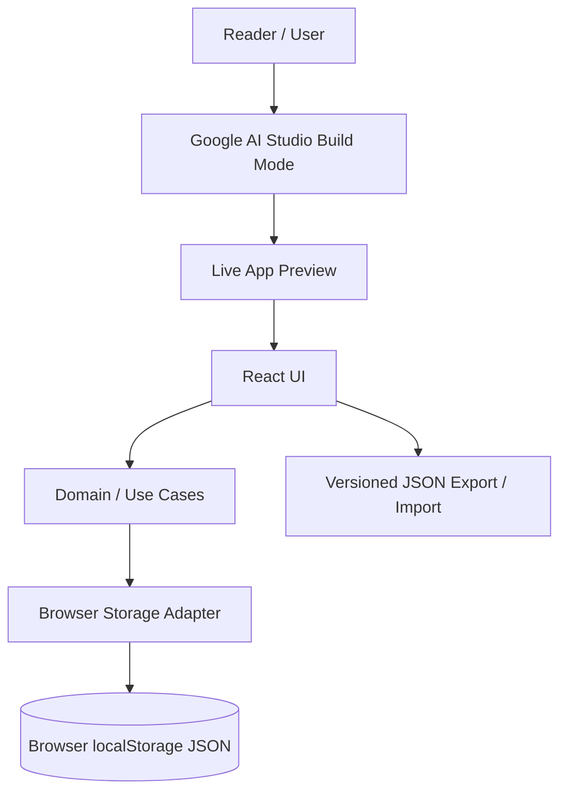
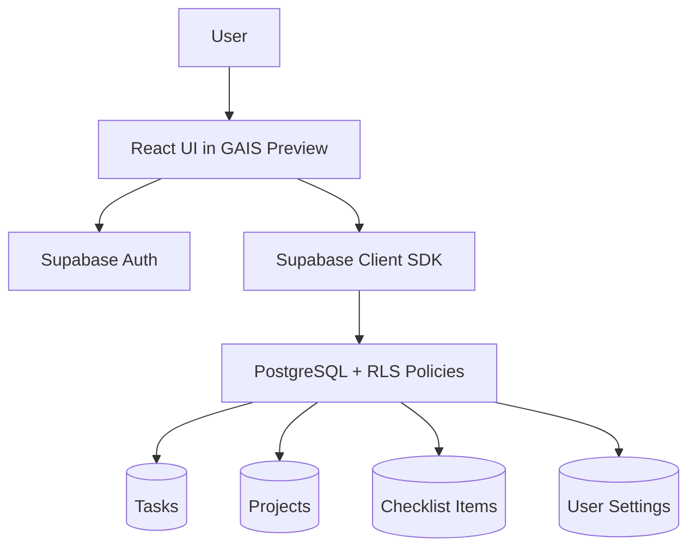
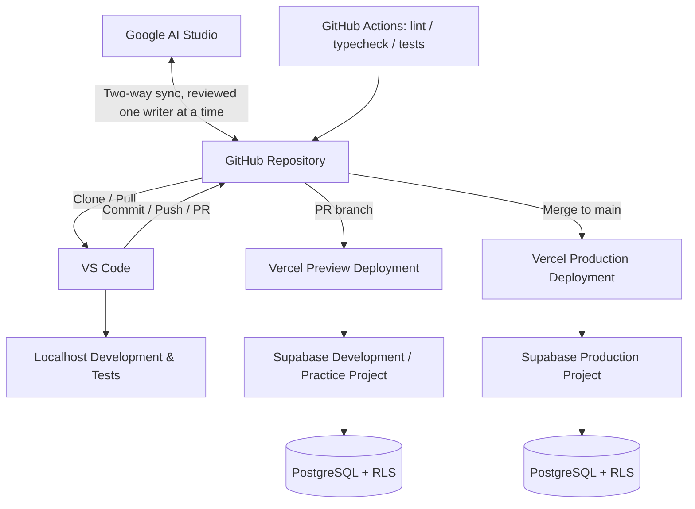

# BVC Task Management — Application Architecture v0.1

**Document ID:** BVC-TM-ARCH-001\
**Phase:** 3.2 — Application Architecture & Technical Design\
**Version:** 0.1.0\
**Status:** Draft for Owner Review\
**Parent:** BVC-TM-PD-001 Product Definition v0.1.0, subject to Product Change Record BVC-TM-PCR-001\
**Date:** 2026-11-04

---

## 1. Purpose

Define the architecture needed to evolve BVC Task Management through three progressive learning levels:

- Beginner — create and use a useful application in Google AI Studio without an external database.
- Intermediate — connect the application to Supabase and learn relational data, SQL, Authentication and Row Level Security.
- Advanced — use a professional development workflow combining Google AI Studio, GitHub, VS Code/Localhost, Supabase and Web App Hosting.

This is an architecture specification, not implementation evidence. It does not claim that an application, database or deployment already exists.

## 2. Architecture decisions at a glance

| ID | Decision | Status |
|---|---|---|
| ADR-001 | One product and one domain model across all three levels | Proposed baseline |
| ADR-002 | GAIS Build mode is the primary Beginner learning environment | Owner-approved direction |
| ADR-003 | Beginner uses a small browser `localStorage` JSON store; no external database/Auth and no Local-First architecture | Proposed architecture for Owner review |
| ADR-004 | Intermediate introduces Supabase PostgreSQL, Auth and RLS | Owner-approved direction |
| ADR-005 | Advanced adds GitHub, VS Code/Localhost and hosted Web App deployment | Owner-approved direction |
| ADR-006 | React + TypeScript frontend; prefer a Vercel-compatible SPA/build output | Recommended; verify actual GAIS scaffold |
| ADR-007 | Supabase Free is the default learning database tier | Recommended; Owner confirmation required |
| ADR-008 | Vercel Hobby is the default practice hosting target for personal, non-commercial apps | Recommended; Owner confirmation required |
| ADR-009 | Vercel native Git integration handles deployment; GitHub Actions focuses on checks/tests | Recommended |
| ADR-010 | No multi-user shared workspace in the initial BVC Task Management scope | Retained product boundary |

## 3. Guiding principles

1. **Start in the sandbox:** Beginners should be able to build and preview without installing an IDE, Node.js, database or local server.
2. **Add concepts progressively:** Do not introduce database, authentication, RLS and deployment complexity before they are needed.
3. **One product, progressive architecture:** All levels share the same product behavior and domain model.
4. **Separate UI from persistence:** UI components must not depend directly on browser storage or Supabase APIs.
5. **Human-owned source control:** GitHub holds the reviewed source history; a person controls commits, branch merges and release decisions.
6. **Secure by default:** Any Supabase table exposed to a client must have deliberate grants and RLS policies.
7. **No secrets in browser code:** Privileged keys and server-only credentials must never be included in client bundles or public repositories.
8. **Preview is not production:** GAIS Preview and Vercel Preview are validation environments; Vercel Production is the public deployment environment.
9. **Provider independence:** Hosting can be changed without rewriting business rules or data contracts.
10. **No UI redesign in Phase 3.2:** Phase 3.1 screens, navigation, wireframes, visual direction and responsive behavior remain the design input.

## 4. Three-level architecture

### 4.1 Level 1 — Beginner: Build & Use

**Tool:** Google AI Studio Build mode.\
**Database:** None.\
**Localhost / VS Code:** Not required.\
**Authentication:** None.

Architecture:



- Use GAIS to generate and iteratively refine the application.
- Use the existing Phase 3.1 UI/UX package as the design authority.
- Use browser `localStorage` for a small versioned JSON workspace; do not introduce a database server, SQL, Supabase or sign-in. This is only a no-database teaching persistence mechanism, not a Local-First architecture or a local development server.
- Provide versioned JSON export/import so the learner can preserve or move their practice data.
- Each browser profile maintains its own dataset. Do not imply cross-device sync.
- This is browser persistence, not a requirement to run a local development server or Localhost on the learner's PC.
- The app must disclose that clearing browser data may remove the workspace unless a backup has been exported.

**Beginner exit outcome:** A learner can build the app in GAIS, create/edit/complete tasks, close and reopen the preview in the same browser profile with data still available, and export/import a valid backup.

### 4.2 Level 2 — Intermediate: Build & Connect

**Tools:** GAIS + Supabase.\
**Database:** Supabase PostgreSQL.\
**Authentication:** Supabase Auth.\
**Security:** RLS for every exposed application table.



- Introduce PostgreSQL tables, primary/foreign keys, relationships, constraints and indexes.
- Introduce authentication because RLS needs a trustworthy user identity for per-user data isolation.
- Use a simple email/password or magic-link flow for learning; the exact method is a Phase 3.3 implementation choice.
- Each authenticated person owns their own tasks and projects. This is not team collaboration.
- The browser uses only a Supabase publishable/anon key with RLS. Never expose a service-role key.
- Normal CRUD may go directly from the browser to Supabase under RLS. A custom backend is not required for ordinary task CRUD.
- Use schema migrations as version-controlled SQL files before Advanced level.

**Intermediate exit outcome:** A learner can create an account, save tasks in hosted PostgreSQL, access only their own rows, explain the schema, and demonstrate that RLS blocks access to another user's data.

### 4.3 Level 3 — Advanced: Production Engineering

**Tools:** GAIS + GitHub + VS Code/Localhost + Supabase + Hosting.\
**Recommended default practice hosting:** Vercel Hobby, for personal/non-commercial projects only.



Advanced capabilities:

- Import/link the GAIS application to GitHub and understand two-way synchronization.
- Use GitHub as the reviewed source history and collaboration boundary.
- Clone/pull the repository into VS Code.
- Run the application on Localhost for local development and debugging.
- Use branches and Pull Requests; do not edit the same files concurrently in GAIS and VS Code.
- Version database schema changes as migrations.
- Separate development and production environment variables and Supabase projects where plan limits allow.
- Connect GitHub to Vercel. Non-production branches/PRs produce Preview Deployments; merges to the configured production branch (normally `main`) produce Production Deployments.
- Use GitHub Actions for linting, type checking, unit/integration tests and security checks. Avoid duplicating Vercel's deployment build in Actions unless an explicit requirement exists.
- Verify the live URL, database access, RLS behavior, backup/restore and rollback procedure.
- Monitor logs, resource usage and service-plan limitations.

**Advanced exit outcome:** The learner can explain the full source-to-production workflow, review a code change, test locally, protect secrets, migrate the database, deploy the web app, validate it over the Internet, and recover from a failed release.

## 5. One application, two persistence adapters

Use a domain-facing interface such as:

```ts
interface WorkspaceRepository {
  listTasks(query?: TaskQuery): Promise<Task[]>;
  createTask(input: CreateTaskInput): Promise<Task>;
  updateTask(id: string, patch: UpdateTaskInput): Promise<Task>;
  deleteTask(id: string): Promise<void>;
  listProjects(): Promise<Project[]>;
  createProject(input: CreateProjectInput): Promise<Project>;
  exportWorkspace(): Promise<WorkspaceBackup>;
  importWorkspace(backup: WorkspaceBackup): Promise<ImportResult>;
}
```

Implementations:

- `BrowserJsonWorkspaceRepository` (using `localStorage`) for Beginner.
- `SupabaseWorkspaceRepository` for Intermediate and Advanced.

The UI and use cases depend on the interface, not on the provider. Select the adapter through a validated application configuration. Do not let a browser user switch to an insecure or unconfigured provider at runtime.

## 6. Recommended application structure

```text
src/
  app/
    routes/
    providers/
  components/
    navigation/
    tasks/
    projects/
    templates/
    settings/
  features/
    tasks/
    projects/
    starter-kits/
    backup/
  domain/
    entities/
    rules/
    validation/
  application/
    use-cases/
    ports/
  infrastructure/
    browser-storage/
    supabase/
    backup/
  styles/
  tests/
```

This is a logical structure, not a requirement to create every folder before implementation.

Recommended frontend direction:
- React + TypeScript.
- Reuse the Phase 3.1 component and responsive specifications without redesign.
- Prefer a simple Vercel-compatible client application build. Vite is a candidate for a React SPA; confirm compatibility with the actual GAIS-generated scaffold before freezing the build tool.
- Do not add an AI API integration inside the Task Management product MVP.

## 7. Routing and screen boundaries

Map the Phase 3.1 information architecture to stable routes:

| Screen | Suggested route |
|---|---|
| My Day | `/my-day` |
| My Tasks | `/tasks` |
| Task detail | `/tasks/:taskId` |
| Projects | `/projects` |
| Project detail | `/projects/:projectId` |
| Templates | `/templates` |
| Settings | `/settings` |
| Backup & Restore | `/settings/backup` |

Route names may be adjusted to the selected router, but the Phase 3.1 information architecture must remain unchanged.

## 8. Data ownership and synchronization

- Beginner: data is persisted in the current browser profile; it does not synchronize automatically with another device.
- Intermediate: data is stored in Supabase and associated with the authenticated user; the same account can access it from supported devices.
- Advanced: the same Supabase data model is managed using version-controlled migrations and an operational deployment workflow.
- Do not describe a browser backup file as a cloud backup.
- Do not claim Supabase Free provides downloadable automatic database backups.

## 9. Date and timezone semantics

- `due_date` is a PostgreSQL `date` / date-only concept, not a timestamp.
- `focus_date` is a date-only value for Today's Focus.
- Save the user's IANA timezone (for example, `Asia/Bangkok`) in user preferences.
- Calculate Overdue, Due Today and Upcoming using the selected user timezone and the Phase 3.1 placement rules.
- Store audit timestamps such as `created_at` and `updated_at` as `timestamptz` in UTC.
- Test month/year boundaries, daylight-saving transitions where relevant, and browser timezone changes.

## 10. Backup, restore and migration

- Use a documented, versioned JSON workspace format at all levels.
- Validate file version, structure, IDs, limits and relationships before import.
- Import must not partially overwrite a valid workspace on failure.
- Level 1 imports into the browser JSON workspace.
- Level 2/3 imports into the authenticated user's Supabase records after explicit preview and confirmation.
- Do not implement silent destructive replace.
- Database schema migrations and user workspace exports are different things: a SQL migration changes the database structure; a JSON export transfers a user's business data.

## 11. Security boundaries

- Supabase RLS is mandatory for exposed tables.
- Use least-privilege table grants and explicit policies.
- Browser-safe publishable key only in client code.
- Service-role/secret keys are server-only and should not be required for normal CRUD.
- Validate input on both client and data boundary; never rely solely on hidden UI controls.
- Avoid HTML injection when rendering notes or titles.
- Use synthetic data in public learning examples.
- Never put customer, personal or confidential information into public repositories or sample artifacts.

## 12. Hosting decision

**Recommended practice default:** Vercel Hobby for personal and non-commercial learning applications.

Conditions:
- The learner understands that Hobby is restricted to personal/non-commercial use.
- Quotas and terms can change; the book should link to current official limits rather than hardcode permanent guarantees.
- Hobby is suitable for public learning/demo deployments within limits, not a production SLA or a guarantee of commercial suitability.
- For paid/commercial applications, client work, or business use, choose Vercel Pro/Enterprise or another hosting platform that fits the use case.
- Experienced developers and Tech Leads may substitute Cloud Run, AWS, Azure or their own cloud/hosting, while retaining the same architecture boundaries and verification principles.

Hosting provider selection remains a proposed decision until Owner confirmation.

## 13. Out of scope for Phase 3.2

- Implementing application source code.
- Creating a GAIS application.
- Creating GitHub repositories or changing branches.
- Creating Supabase projects or applying SQL migrations.
- Creating Vercel projects or deploying a live URL.
- Reopening or redesigning Phase 3.1 UI/UX.
- Multi-user team collaboration, invitations, role management or shared workspaces.
- AI chatbot or Gemini API features inside the Task Management product.
- Enterprise availability, compliance or SLA claims.

## 14. Dependencies and handoff to Phase 3.3

Phase 3.3 may begin only after:
- Product Change Record BVC-TM-PCR-001 is approved and the product definition is updated through controlled versioning.
- Phase 3.2 Architecture Review & Acceptance is completed.
- Hosting and Supabase practice tiers are confirmed.
- The generated GAIS scaffold is inspected for framework/build compatibility.
- A first bounded implementation Task Contract is approved.
