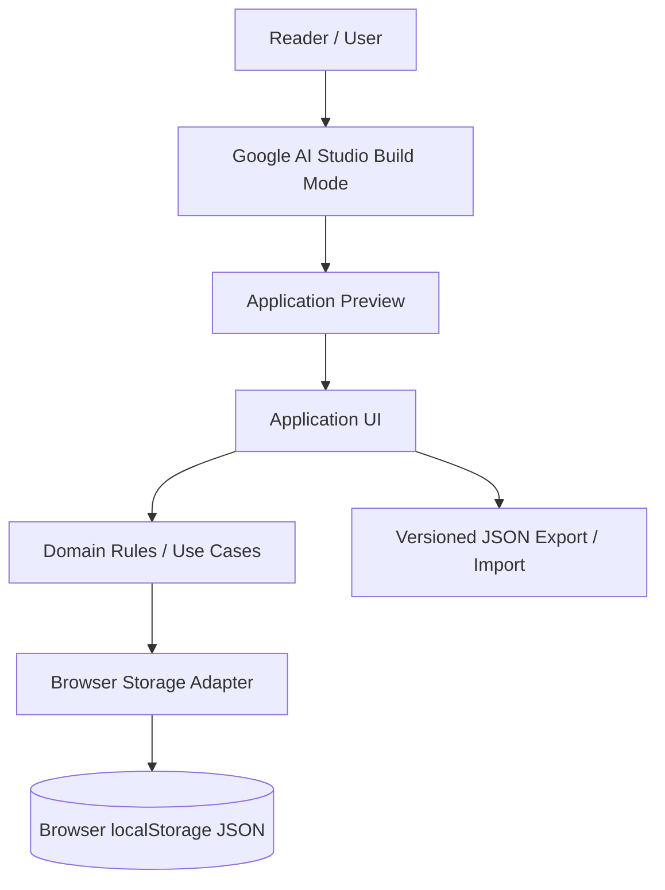
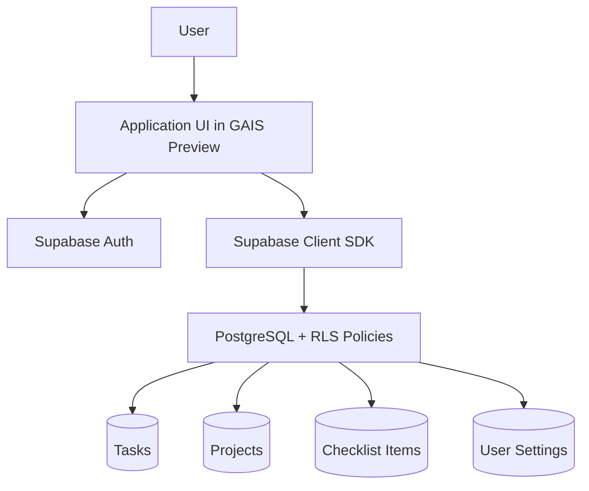
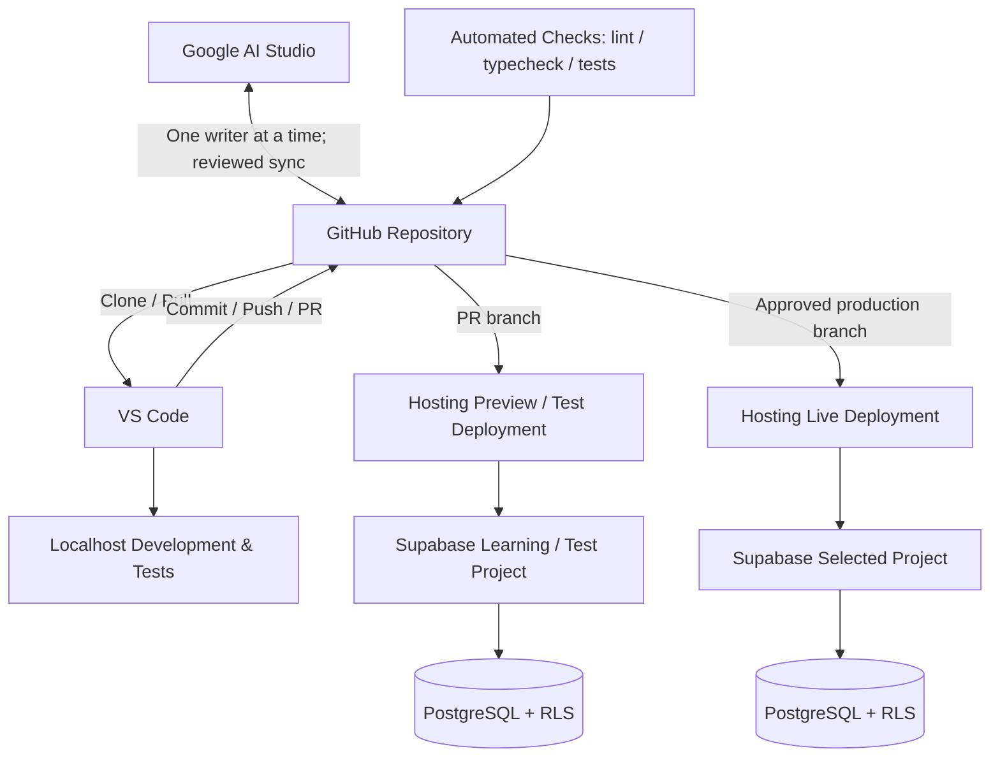

# BVC Task Management — Application Architecture v0.1

**Document ID:** BVC-TM-ARCH-001  
**Phase:** 3.2 — Application Architecture & Technical Design  
**Version:** 0.1.1  
**Status:** Product Owner Accepted — Phase 3.2 Design Baseline  
**Parent:** BVC-TM-PD-001 Product Definition v0.2.0  
**Change Record:** BVC-TM-PCR-001  
**Date:** 2026-11-04

---

## 1. Purpose

Define the architecture needed to evolve BVC Task Management through three progressive learning levels:

- **Beginner:** Create and use a useful application in Google AI Studio without an external database.
- **Intermediate:** Connect the application to Supabase and learn relational data, SQL, Authentication and Row Level Security.
- **Advanced:** Use Google AI Studio, GitHub, VS Code/Localhost, Supabase and a compatible free-tier Web App Hosting service.

This is an architecture specification, not implementation evidence.

It does not claim that an application, database, hosting project or deployment already exists.

The architecture must support the same product and logical data model across all three levels while introducing engineering complexity progressively.

## 2. Architecture decisions at a glance

| ID | Decision | Status |
|---|---|---|
| ADR-001 | One product and one logical domain model across all three levels | Accepted product direction |
| ADR-002 | Google AI Studio Build mode is the primary Beginner learning environment | Owner-approved direction |
| ADR-003 | Beginner uses a small browser `localStorage` JSON workspace; no external database/Auth and no Local-First architecture | Accepted for design |
| ADR-004 | Intermediate introduces Supabase PostgreSQL, Auth and RLS | Owner-approved direction |
| ADR-005 | Advanced adds GitHub, VS Code/Localhost and hosted Web App deployment | Owner-approved direction |
| ADR-006 | React-based frontend; exact framework/build output must be verified against the actual GAIS scaffold | Deferred implementation verification |
| ADR-007 | Supabase Free is the reference database environment for the book's practical exercises | Owner-approved learning direction |
| ADR-008 | Hosting is provider-neutral; the practical guide focuses on compatible free-tier hosting | Owner-approved learning direction |
| ADR-009 | A representative provider may be used for a step-by-step hosting example; Vercel is optional and not mandatory | Optional teaching example |
| ADR-010 | No multi-user shared workspace in the initial BVC Task Management scope | Retained product boundary |
| ADR-011 | GitHub holds reviewed source history; human control is required for commits, merges and release decisions | Accepted engineering boundary |

## 3. Guiding principles

1. **Start in the sandbox:** Beginners should be able to build and preview without installing an IDE, Node.js, database or local server.
2. **Add concepts progressively:** Do not introduce database, authentication, RLS and deployment complexity before they are needed.
3. **One product, progressive architecture:** All levels share the same product behavior and logical domain model.
4. **Separate UI from persistence:** UI components must not depend directly on browser storage or Supabase APIs.
5. **Human-owned source control:** GitHub holds the reviewed source history; a person controls commits, branch merges and release decisions.
6. **Secure by default:** Any Supabase table exposed to a client must have deliberate grants and RLS policies.
7. **No secrets in browser code:** Privileged keys and server-only credentials must never be included in client bundles or public repositories.
8. **Preview is not production:** A preview or test deployment is used for validation; the live deployment is a separate release target.
9. **Provider-neutral hosting:** The application architecture must not depend on one hosting vendor. The book demonstrates a compatible free-tier workflow without making that provider mandatory.
10. **One reference database for the learning path:** Supabase Free is used consistently in the practical database exercises so readers do not have to learn multiple database platforms at once.
11. **No UI redesign in Phase 3.2:** Phase 3.1 screens, navigation, wireframes, visual direction and responsive behavior remain the design input.
12. **Privacy of infrastructure choices:** The project does not require an individual to disclose personal hosting accounts, subscriptions, billing details or private infrastructure arrangements.

## 4. Three-level architecture

### 4.1 Level 1 — Beginner: Build & Use

**Tool:** Google AI Studio Build mode.  
**Database:** None.  
**Localhost / VS Code:** Not required.  
**Authentication:** None.  
**Persistence:** Small browser JSON workspace using `localStorage`.

Architecture:



Design rules:

- Use GAIS to generate and iteratively refine the application.
- Use the existing Phase 3.1 UI/UX package as the design authority.
- Use browser `localStorage` for a small versioned JSON workspace.
- Do not introduce a database server, SQL, Supabase or sign-in.
- This is a no-database teaching persistence mechanism, not a Local-First architecture or a local development server.
- Provide versioned JSON export/import so the learner can preserve or move practice data.
- Each browser profile maintains its own dataset. Do not imply cross-device synchronization.
- The app must disclose that clearing browser data may remove the workspace unless a backup has been exported.
- Handle invalid data, browser storage quota and write failures with truthful UI feedback.

**Beginner exit outcome:**

A learner can build the app in GAIS, create/edit/complete tasks, close and reopen the preview in the same browser profile with data still available, and export/import a valid backup.

### 4.2 Level 2 — Intermediate: Build & Connect

**Tools:** Google AI Studio + Supabase.  
**Database:** Supabase PostgreSQL.  
**Reference plan for the book:** Supabase Free.  
**Authentication:** Supabase Auth.  
**Security:** RLS for every exposed application table.



Design rules:

- Introduce PostgreSQL tables, primary/foreign keys, relationships, constraints and indexes.
- Use Supabase Free as the reference database environment in the book's hands-on exercises.
- Introduce authentication because RLS needs a trustworthy user identity for per-user data isolation.
- Use a simple email/password or magic-link flow for learning; the exact method is a Phase 3.3 implementation choice.
- Each authenticated person owns their own tasks and projects. This is not team collaboration.
- The browser uses only a Supabase publishable/anon key with RLS.
- Never expose a service-role key.
- Normal CRUD may go directly from the browser to Supabase under RLS. A custom backend is not required for ordinary task CRUD.
- Use schema migrations as version-controlled SQL files before or during Advanced level.
- Explain Supabase Free limitations and provide a manual export/backup exercise.

**Intermediate exit outcome:**

A learner can create an account, save tasks in hosted PostgreSQL, access only their own rows, explain the schema, and demonstrate that RLS blocks access to another user's data.

### 4.3 Level 3 — Advanced: Production Engineering

**Tools:** Google AI Studio + GitHub + VS Code/Localhost + Supabase + free-tier Hosting.  
**Database:** Supabase PostgreSQL.  
**Hosting:** A compatible free-tier Web App Hosting service chosen for the learning exercise.



Advanced capabilities:

- Import/link the GAIS application to GitHub and understand two-way synchronization.
- Use GitHub as the reviewed source history and Pull Request boundary.
- Clone/pull the repository into VS Code.
- Run the application on Localhost for local development and debugging.
- Use branches and Pull Requests.
- Do not edit the same files concurrently in GAIS and VS Code.
- Version database schema changes as migrations.
- Separate development and production environment variables and data where the selected free-tier services support it.
- Connect GitHub to a compatible hosting service.
- Use preview/test deployments where supported.
- Promote an approved change to the live deployment.
- Use GitHub Actions or equivalent CI tooling for linting, type checking, unit/integration tests and security checks.
- Avoid duplicating deployment builds when the hosting provider already supplies the required Git integration.
- Verify the live URL, database access, RLS behavior, backup/restore and rollback procedure.
- Monitor service usage and free-tier limitations.

The book may use Vercel Hobby as one optional illustrative walkthrough for eligible personal and non-commercial exercises. It must not be described as the required provider or the product's architectural standard.

**Advanced exit outcome:**

The learner can explain the full source-to-deployment workflow, review a code change, test locally, protect secrets, migrate the database, deploy the web app, validate it over the Internet and recover from a failed release.

## 5. One application, two persistence adapters

Use a domain-facing interface such as:

```ts
interface WorkspaceRepository {
  listTasks(query?: TaskQuery): Promise<Task[]>;
  createTask(input: CreateTaskInput): Promise<Task>;
  updateTask(id: string, patch: UpdateTaskInput): Promise<Task>;
  deleteTask(id: string): Promise<void>;

  listProjects(): Promise<Project[]>;
  createProject(input: CreateProjectInput): Promise<Project>;

  exportWorkspace(): Promise<WorkspaceBackup>;
  importWorkspace(backup: WorkspaceBackup): Promise<ImportResult>;
}
```

Implementations:

- `BrowserJsonWorkspaceRepository` using `localStorage` for Beginner.
- `SupabaseWorkspaceRepository` for Intermediate and Advanced.

The UI and use cases depend on the interface, not on the storage provider.

Select the adapter through a validated application configuration.

Do not let a browser user switch to an insecure or unconfigured provider at runtime.

## 6. Recommended application structure

```text
src/
  app/
    routes/
    providers/
  components/
    navigation/
    tasks/
    projects/
    templates/
    settings/
  features/
    tasks/
    projects/
    starter-kits/
    backup/
  domain/
    entities/
    rules/
    validation/
  application/
    use-cases/
    ports/
  infrastructure/
    browser-storage/
    supabase/
    backup/
  styles/
  tests/
```

This is a logical structure, not a requirement to create every folder before implementation.

Recommended frontend direction:

- Use the framework generated by GAIS if it is suitable and maintainable.
- React + TypeScript is a recommended direction, not a frozen assumption.
- Inspect the actual exported scaffold before selecting Vite, a server runtime or another build tool.
- Reuse the Phase 3.1 component and responsive specifications without redesign.
- Keep the application deployable to a compatible free-tier hosting service.
- Do not add an AI API integration inside the Task Management product MVP.

## 7. Routing and screen boundaries

Map the Phase 3.1 information architecture to stable routes:

| Screen | Suggested route |
|---|---|
| My Day | `/my-day` |
| My Tasks | `/tasks` |
| Task detail | `/tasks/:taskId` |
| Projects | `/projects` |
| Project detail | `/projects/:projectId` |
| Templates | `/templates` |
| Settings | `/settings` |
| Backup & Restore | `/settings/backup` |

Route names may be adjusted to the selected router, but the Phase 3.1 information architecture must remain unchanged.

## 8. Data ownership and synchronization

- **Beginner:** Data is persisted in the current browser profile; it does not synchronize automatically with another device.
- **Intermediate:** Data is stored in Supabase and associated with the authenticated user; the same account can access it from supported devices.
- **Advanced:** The same Supabase data model is managed using version-controlled migrations and an operational deployment workflow.
- Do not describe a browser backup file as a cloud backup.
- Do not describe a database migration as a user-data backup.
- Do not claim Supabase Free provides provider-managed automatic database backups.
- The reader must understand that Free-tier services have limits and are intended for practical learning, not guaranteed enterprise operations.

## 9. Date and timezone semantics

- `due_date` is a PostgreSQL `date` / date-only concept, not a timestamp.
- `focus_date` is a date-only value for Today's Focus.
- Save the user's IANA timezone (for example, `Asia/Bangkok`) in user preferences.
- Calculate Overdue, Due Today and Upcoming using the selected user timezone and the Phase 3.1 placement rules.
- Store audit timestamps such as `created_at` and `updated_at` as `timestamptz` in UTC.
- Test month/year boundaries, daylight-saving transitions where relevant, and browser timezone changes.

## 10. Backup, restore and migration

- Use a documented, versioned JSON workspace format at all levels.
- Validate file version, structure, IDs, limits and relationships before import.
- Import must not partially overwrite a valid workspace on failure.
- Level 1 imports into the browser JSON workspace.
- Level 2/3 imports into the authenticated user's Supabase records after explicit preview and confirmation.
- Do not implement silent destructive replacement.
- Database schema migrations and user workspace exports are different things:
  - A SQL migration changes the database structure.
  - A JSON export transfers a user's business data.
  - A provider-managed database backup is a separate recovery mechanism.

## 11. Security boundaries

- Supabase RLS is mandatory for exposed tables.
- Use least-privilege table grants and explicit policies.
- Browser-safe publishable key only in client code.
- Service-role/secret keys are server-only and should not be required for normal CRUD.
- Validate input on both client and data boundary; never rely solely on hidden UI controls.
- Avoid HTML injection when rendering notes or titles.
- Use synthetic data in public learning examples.
- Never put customer, personal or confidential information into public repositories or sample artifacts.
- Do not commit `.env` or other secret-bearing files.

## 12. Hosting and deployment architecture

Hosting is a replaceable deployment boundary, not a product-specific infrastructure dependency.

The architecture requires a hosting service that supports the actual generated application and provides a practical deployment path for the learning exercise.

The book focuses on free-tier hosting.

A representative provider may be used for a step-by-step example. Vercel Hobby may be shown as an optional example for eligible personal/non-commercial practice, but readers are not required to use Vercel.

The exact provider is selected by the reader according to:

- Compatibility with the generated framework and runtime.
- Support for the build output and routing requirements.
- Available free-tier deployment capability.
- Environment-variable configuration.
- Current terms, quotas and usage limitations.

The book does not prescribe, record or require disclosure of private hosting accounts, subscriptions, billing arrangements or infrastructure choices.

Deployment principles:

- Keep source history in GitHub.
- Use preview/test deployment where supported.
- Separate test and live environment variables.
- Never expose privileged secrets in client bundles.
- Verify the intended commit and deployed version.
- Test the deployed application rather than assuming a successful build proves correctness.
- Explain free-tier limitations and the absence of an SLA where applicable.

## 13. Out of scope for Phase 3.2

- Implementing application source code.
- Creating a GAIS application.
- Creating GitHub repositories or changing branches.
- Creating Supabase projects or applying SQL migrations.
- Creating any hosting project or deploying a live URL.
- Selecting or recording an individual's private hosting account or subscription.
- Reopening or redesigning Phase 3.1 UI/UX.
- Multi-user team collaboration, invitations, role management or shared workspaces.
- AI chatbot or Gemini API features inside the Task Management product.
- Enterprise availability, compliance or SLA claims.

## 14. Dependencies and handoff to Phase 3.3

Phase 3.3 may begin only after:

- Product Change Record BVC-TM-PCR-001 is approved and Product Definition v0.2.0 is published through controlled versioning.
- Phase 3.2 Architecture Review & Acceptance is completed.
- The Supabase Free reference learning environment is documented with current limitations.
- The generated GAIS scaffold is inspected for framework/build compatibility.
- A representative free-tier hosting walkthrough is verified against the actual scaffold.
- A first bounded implementation Task Contract is approved.

---

**BEYOND VIBE CODING — Build & Learn**  
*Build something useful. Use it every day. Learn by doing.*

