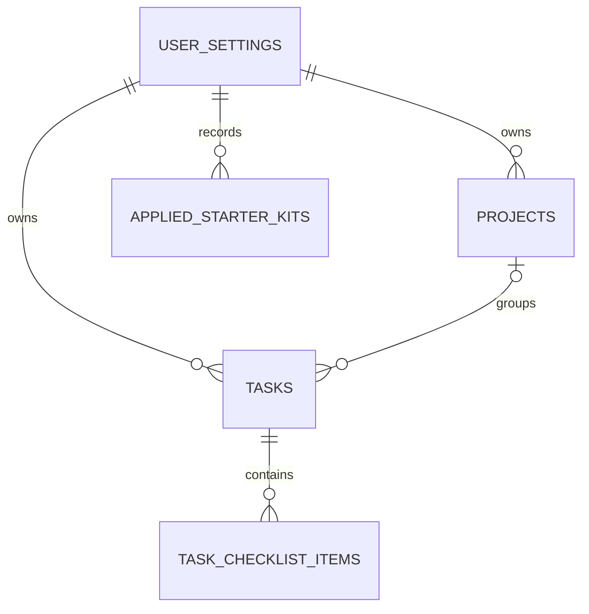

# BVC Task Management — Data Model & Persistence Design v0.1

**Document ID:** BVC-TM-DATA-001\
**Phase:** 3.2\
**Version:** 0.1.0\
**Status:** Draft for Owner Review\
**Date:** 2026-11-04

## 1. Purpose

Define one logical business data model that can be stored by the Beginner browser adapter and the Intermediate/Advanced Supabase adapter.

The model supports the Phase 3.1 product concepts: Task, Project/Work Area, Checklist Item, Starter Kit and Workspace Settings.

## 2. Data design principles

- Keep business concepts independent from the persistence provider.
- Use UUID identifiers so records can be moved between adapters.
- Keep date-only business dates separate from UTC audit timestamps.
- A task may exist without a project.
- Removing a project must not delete its tasks.
- Starter kits are versioned templates; applying a kit must not overwrite user content.
- The same domain validation rules apply in Browser Storage and Supabase modes.

## 3. Logical entity relationship



`USER_SETTINGS` represents the authenticated user's settings in Supabase. In Beginner mode, the equivalent is a browser-local workspace settings record; no user account is created.

## 4. Entities

### 4.1 Task

| Field | Type | Rule |
|---|---|---|
| `id` | UUID | Primary key |
| `user_id` | UUID | Required in Supabase modes; omitted from browser-only ownership or mapped to local workspace ID |
| `title` | TEXT | Required, trimmed, non-empty |
| `notes` | TEXT | Optional |
| `status` | TEXT | `todo`, `in_progress`, `done` |
| `priority` | TEXT | `low`, `normal`, `high`; default `normal` |
| `due_date` | DATE | Optional, date-only |
| `focus_date` | DATE | Optional, identifies the local calendar date for Today's Focus |
| `project_id` | UUID | Optional |
| `responsible_label` | TEXT | Optional free-text label; not an account or permission |
| `source_template_key` | TEXT | Optional idempotency key for starter-kit-created items |
| `created_at` | TIMESTAMPTZ | Required |
| `updated_at` | TIMESTAMPTZ | Required |
| `completed_at` | TIMESTAMPTZ | Optional |

### 4.2 Project

| Field | Type | Rule |
|---|---|---|
| `id` | UUID | Primary key |
| `user_id` | UUID | Required in Supabase modes |
| `name` | TEXT | Required, trimmed, non-empty |
| `description` | TEXT | Optional |
| `source_template_key` | TEXT | Optional starter-kit idempotency key |
| `created_at` | TIMESTAMPTZ | Required |
| `updated_at` | TIMESTAMPTZ | Required |
| `archived_at` | TIMESTAMPTZ | Optional |

When a project is removed, tasks are preserved and `project_id` becomes null. Do not cascade-delete tasks.

### 4.3 Task Checklist Item

| Field | Type | Rule |
|---|---|---|
| `id` | UUID | Primary key |
| `task_id` | UUID | Required foreign key |
| `user_id` | UUID | Required in Supabase modes |
| `title` | TEXT | Required |
| `is_completed` | BOOLEAN | Default false |
| `sort_order` | INTEGER | Default 0 |
| `created_at` | TIMESTAMPTZ | Required |
| `updated_at` | TIMESTAMPTZ | Required |

### 4.4 User Settings

| Field | Type | Rule |
|---|---|---|
| `user_id` | UUID | Primary key and reference to `auth.users(id)` |
| `timezone` | TEXT | IANA timezone; default from browser, user may change |
| `selected_starter_kit` | TEXT | Optional |
| `preferences` | JSONB | Small validated UI preferences only |
| `created_at` | TIMESTAMPTZ | Required |
| `updated_at` | TIMESTAMPTZ | Required |

Do not use `preferences` as an unstructured substitute for core entities or security-sensitive authorization rules.

### 4.5 Applied Starter Kit

| Field | Type | Rule |
|---|---|---|
| `id` | UUID | Primary key |
| `user_id` | UUID | Required in Supabase modes |
| `kit_key` | TEXT | Required |
| `kit_version` | TEXT | Required |
| `applied_at` | TIMESTAMPTZ | Required |
| Unique constraint | `(user_id, kit_key, kit_version)` | Prevent duplicate application record |

Starter-kit definitions are bundled, versioned application assets. The database stores application history and resulting user-editable records, not the canonical static kit definitions.

## 5. PostgreSQL schema proposal

Use the `public` schema for application tables in the initial learning project. Supabase Auth owns `auth.users`; do not copy passwords or authentication secrets into application tables.

Suggested tables:

```text
public.user_settings
public.projects
public.tasks
public.task_checklist_items
public.applied_starter_kits
```

Recommended indexes:
- `tasks(user_id, status)`
- `tasks(user_id, due_date)`
- `tasks(user_id, project_id)`
- `tasks(user_id, updated_at DESC)`
- `task_checklist_items(user_id, task_id, sort_order)`
- `projects(user_id, archived_at, name)`
- unique `applied_starter_kits(user_id, kit_key, kit_version)`

Use `CHECK` constraints for task status and priority. Use foreign keys for ownership and relationship integrity. Add indexes only for demonstrated query patterns; verify plans as data grows.

## 6. Persistence adapters

### Beginner: Browser JSON Storage (`localStorage`)

- Store the small Beginner workspace as versioned JSON in browser `localStorage`; this is not an external database and requires no Localhost/IDE setup.
- Keep a local workspace ID.
- Apply a `formatVersion` and validate/migrate the JSON structure when the application version changes.
- Handle browser storage quota and write failures with truthful UI feedback.
- Provide versioned JSON export/import.
- Do not claim automatic cloud sync or cross-device availability.

### Intermediate / Advanced: Supabase

- Use Supabase PostgreSQL as the persistent store.
- Use Supabase Auth to identify the owner.
- Store `user_id` on every owner-scoped application row.
- Use RLS and ownership checks on every exposed table.
- Maintain schema changes as ordered SQL migration files.

## 7. Versioned workspace backup format

Proposed top-level JSON envelope:

```json
{
  "format": "bvc-task-management-workspace",
  "formatVersion": 1,
  "exportedAt": "2026-11-04T00:00:00.000Z",
  "sourceMode": "browser",
  "workspaceId": "uuid",
  "timezone": "Asia/Bangkok",
  "data": {
    "projects": [],
    "tasks": [],
    "checklistItems": [],
    "settings": {},
    "appliedStarterKits": []
  }
}
```

Validation requirements:
- Reject unknown major format versions.
- Enforce maximum file size and record counts.
- Validate every required field, allowed enum and identifier.
- Validate that referenced project/task IDs exist in the imported dataset.
- Reject invalid relationships before writing.
- Preview the import and explain whether records will be merged or replaced.
- Never partially replace a valid workspace on parse/validation failure.
- Require explicit confirmation before replacing current user data.

## 8. Migration between learning levels

### Level 1 → Level 2

1. Export a versioned Browser Storage backup.
2. Sign in to the Supabase-backed app.
3. Validate and preview the backup.
4. Map imported records to the authenticated `user_id`.
5. Preserve UUIDs where conflict-free; otherwise create a mapping and update all references.
6. Import transactionally where possible.
7. Report created, skipped and rejected records.
8. Verify record counts and key relationships.

### Level 2 → Level 3

No business-data migration is required if the same Supabase project and schema are retained. The learner changes the development/deployment workflow, not the logical data model. Use migrations to keep the database structure aligned with Git.

## 9. Date and time semantics

- `due_date` and `focus_date` are PostgreSQL `DATE`, never UTC midnight timestamps.
- `created_at`, `updated_at`, `completed_at` are `TIMESTAMPTZ` stored in UTC.
- Store IANA timezone per user.
- Calculate My Day sections using the user's selected timezone.
- Test boundary conditions at local midnight, month-end, year-end and daylight-saving transitions in applicable zones.

## 10. Open decisions for Owner / implementation review

| ID | Decision | Recommended default | Status |
|---|---|---|---|
| DATA-001 | Is browser `localStorage` acceptable for Beginner persistence? | Yes for a small teaching workspace; no external database, Localhost or Local-First architecture | Proposed |
| DATA-002 | Should starter-kit definitions be static application assets? | Yes, versioned in source code | Proposed |
| DATA-003 | Import semantics for existing Supabase workspace | Preview + merge by default; replacement only with confirmation | Proposed |
| DATA-004 | Timezone source | Browser IANA timezone on first use, user-editable | Proposed |
| DATA-005 | Is an Advanced local Supabase stack required? | No; Supabase CLI/migrations are taught, local DB stack optional | Proposed |

## 11. References

- Supabase PostgreSQL and RLS: https://supabase.com/docs/guides/database/postgres/row-level-security
- Supabase migrations: https://supabase.com/docs/guides/deployment/database-migrations
