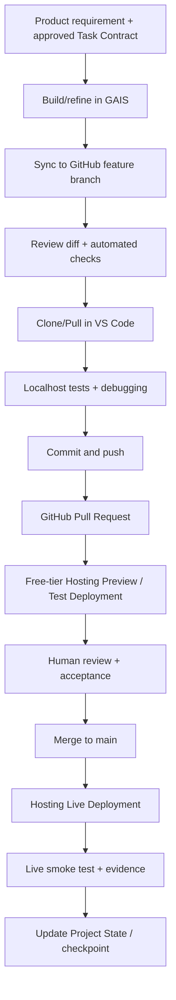

# BVC Task Management — Development, Testing & Deployment Design v0.1

**Document ID:** BVC-TM-DEVOPS-001  
**Phase:** 3.2 — Application Architecture & Technical Design  
**Version:** 0.1.1  
**Status:** Product Owner Accepted — Phase 3.2 Design Baseline  
**Date:** 2026-11-04

## 1. Purpose

Define how readers progress from Google AI Studio Build mode to a controlled, testable and publicly accessible application without requiring Beginner readers to install local development tools.

This document describes a provider-neutral engineering workflow.

The book focuses on free-tier services for practical exercises:

- Google AI Studio for AI-assisted application creation.
- GitHub for reviewed source history.
- VS Code and Localhost for Advanced local development.
- Supabase Free as the reference database environment.
- A compatible free-tier hosting service for the deployment walkthrough.

A hosting provider may be used as an illustrative example in the book, but no provider is mandatory.

This document is a workflow and technical design specification. It does not claim that implementation, CI, database provisioning or deployment has already occurred.

## 2. Tool responsibilities

| Tool / Service | Responsibility |
|---|---|
| Google AI Studio | Build and refine the application with AI; preview; import/link/sync source |
| GitHub | Canonical reviewed source history, branches, commits, PRs and traceability |
| VS Code | Advanced local editing, debugging and test execution |
| Localhost | Run the app locally during Advanced development; not a Beginner prerequisite |
| Supabase Free | Reference hosted PostgreSQL, Auth, RLS and database learning environment |
| Free-tier Web App Hosting | Publish the Advanced practice application using a compatible free-tier service |
| GitHub Actions or equivalent CI | Automated quality gates where configured |

### 2.1 Provider-neutral hosting rule

The hosting service is a deployment target, not a dependency of the product's business logic or domain model.

The reader may use a free-tier provider that supports the generated application's framework, runtime, build output and routing requirements.

The book may use Vercel Hobby as one optional step-by-step example for eligible personal and non-commercial learning exercises. This does not establish Vercel as the required platform.

The practical guide should demonstrate one coherent workflow rather than compare many hosting vendors or explain advanced paid infrastructure.

### 2.2 Generated application compatibility

The actual Google AI Studio exported scaffold must be inspected before finalizing deployment instructions.

Do not assume that every generated project is a static frontend or that every hosting provider supports the same runtime.

Verify at least:

- Frontend framework and version.
- Package manager and lockfile.
- Build command.
- Output directory.
- Node.js/server runtime dependencies, if any.
- Routing and rewrite requirements.
- Required environment variables.
- Local development command.
- Compatibility with the selected free-tier hosting example.

The book should teach the reader how to inspect these items rather than hardcode assumptions about an unseen scaffold.

## 3. Source-control policy

- `main` is the reviewed integration/production branch.
- Feature branches use `feat/<short-scope>` or `fix/<short-scope>`.
- Changes enter `main` through Pull Requests.
- One active writer per file set: do not simultaneously edit the same files in GAIS and VS Code.
- After edits in GAIS, synchronize and review the resulting Git diff before merging.
- After edits in VS Code, commit/push and then pull/synchronize into GAIS before asking GAIS to continue from the latest repository state.
- Keep PRs small and tied to one implementation Task Contract.
- Do not allow an AI executor to merge or deploy without the Owner's explicit authorization.
- Never treat a successful Git push as proof that the application works.
- Review file changes before committing and exclude temporary scripts, generated caches and unrelated files.

## 4. Recommended development lifecycle

This is a conceptual workflow. A free-tier provider may not support every Preview or branch-deployment feature. The practical guide must use the capabilities actually available in its selected example.

## 5. Continuous integration and artifact policy

Use GitHub Actions or an equivalent CI service for:

- Dependency installation and lockfile consistency.
- Lint.
- Type checking.
- Unit tests.
- Component/integration tests.
- Build verification where required.
- Dependency/security scanning where configured.

Do not upload large build directories or duplicate deployment bundles as workflow artifacts unless a test or release process genuinely requires them.

When artifacts are needed:

- Upload only test reports or targeted evidence.
- Set short retention for ordinary test artifacts.
- Do not store dependency directories or full project copies as artifacts.
- Do not store secrets or environment files in workflow artifacts.
- Review repository and CI storage usage periodically.

If the selected hosting service already integrates with GitHub for build/deployment, avoid building and deploying the same app again in GitHub Actions unless a specific pipeline requirement justifies that complexity.

CI and hosting deployment are related but distinct responsibilities:

- CI checks whether changes satisfy defined quality rules.
- Hosting publishes the application to an accessible environment.
- Neither replaces human review or runtime verification.

## 6. Free-tier hosting deployment model

The book focuses on a practical deployment exercise using a compatible free-tier Web App Hosting service.

### 6.1 Learning objective

The reader should learn to:

1. Identify the application's build/runtime requirements.
2. Confirm that the selected free-tier hosting service supports those requirements.
3. Connect the reviewed GitHub repository or upload the required build artifact.
4. Configure the required environment variables without committing secrets.
5. Create a test/preview deployment where supported.
6. Review the deployed application.
7. Promote or publish the accepted version as the live learning application.
8. Verify that the deployed version corresponds to the intended commit.

### 6.2 Example provider

The book may demonstrate one provider in a step-by-step walkthrough.

Vercel Hobby may be used as an optional example for eligible personal and non-commercial learning exercises. Readers may choose another compatible free-tier provider.

The book must not:

- Describe Vercel as the required provider.
- Present any provider as the product's architectural standard.
- Require readers to purchase a paid subscription for the core exercise.
- Promise unlimited hosting, permanent quotas or a service-level agreement.
- Require the author or reader to disclose personal hosting accounts or subscription details.

### 6.3 Free-tier limitations

Free-tier services may impose limits on:

- Build minutes or build concurrency.
- Bandwidth and data transfer.
- Storage.
- Function execution and runtime.
- Request volume.
- Project count.
- Preview deployments.
- Inactivity and automatic pausing.
- Custom domains or other optional features.

The practical guide must link to the selected provider's current official documentation and explain only the limits relevant to the exercise.

Do not hardcode quotas as permanent facts. Recheck them when the book or lab instructions are updated.

Free-tier hosting is a learning environment. It must not be represented as a guarantee of commercial eligibility, enterprise availability, compliance or SLA.

## 7. Supabase Free environment and migration deployment

Supabase Free is the reference database environment for the book's Intermediate and Advanced exercises.

The learning workflow covers:

- Creating a Supabase project.
- Understanding the project and database relationship.
- Creating PostgreSQL tables.
- Defining primary keys, foreign keys and constraints.
- Learning SQL and basic indexes.
- Connecting the application with the Supabase client.
- Using Supabase Auth.
- Applying and testing RLS.
- Exporting data and understanding backup limitations.
- Managing schema changes through SQL migrations at Advanced level.

### 7.1 Free-plan considerations

The book must explain that Supabase Free has quotas and operational limitations.

At a minimum, readers should understand:

- Database and file-storage limits.
- Project-count and usage limits.
- Inactivity-related project pausing.
- The difference between application-level JSON export and database backup.
- The need to export and protect important learning data.
- The possibility that provider plan conditions may change.

Do not promise that the Free plan provides provider-managed automatic database backups.

Link to current official documentation rather than permanently hardcoding plan limits.

### 7.2 Migration workflow

- Store schema changes as ordered SQL migration files in Git.
- Review migration SQL before applying it.
- Use Supabase CLI in Advanced to create/replay migrations.
- Test migrations against the learning/development environment before applying them to another environment.
- Do not use manual Dashboard edits as the only record of schema changes.
- A migration rollback must be explicitly designed; not every SQL change is automatically reversible.
- Keep database changes and application changes compatible during a release.

The book should use Supabase Free as the consistent reference environment. It does not need to teach multiple database vendors in the core walkthrough.

## 8. Testing strategy

| Layer | Examples | Required evidence |
|---|---|---|
| Domain/unit | Status transitions, priority, date placement, filters, validation | Test output |
| Persistence adapter | Browser JSON storage CRUD, Supabase CRUD, import/export | Automated tests |
| Security | RLS positive/negative access tests | SQL tests or integration results |
| Component | Forms, lists, empty/error/loading states | Component test output |
| End-to-end | First use, create/edit/delete, complete task, starter kit, backup/restore | Browser test report |
| Responsive | 320/360/390 px, tablet, desktop breakpoints | Screenshots / test matrix |
| Deployment smoke | Open live URL, auth, create/read/update/delete, refresh, reload | Deployment smoke-test record |
| Recovery | Restore backup, recover from failed release | Evidence record |

Never mark a check PASS just because a build completed.

Verify real behavior against acceptance criteria.

## 9. Environments and release promotion

| Environment | Trigger | Purpose |
|---|---|---|
| GAIS Preview | Manual iteration in GAIS | Beginner and early feature review |
| Localhost | Developer starts local server | Advanced development/debugging |
| Hosting Preview / Test | Feature branch, PR or manual deployment where supported | Review before live publication |
| Hosting Live | Approved release to configured live target | Public learning application |

Use consistent environment variable names and separate values by environment where supported.

Do not let Preview/Test deployments write to live user data by default.

The exact environment names and controls depend on the selected hosting provider. The learning material should explain the underlying principles rather than require an identical dashboard across providers.

## 10. Operational checklist

### Before deployment

- Build succeeds from a clean checkout.
- Required environment variables are present.
- No secret is included in the client bundle.
- RLS checks pass for authenticated data.
- Database migrations are applied to the intended environment.
- Core end-to-end and responsive tests pass.
- Preview/test deployment has been reviewed where supported.
- Human Owner approves release.
- Free-tier usage and provider terms are understood.

### After deployment

- Visit the live URL.
- Verify the app loads and assets resolve.
- Verify sign-in/sign-out if Level 2/3 mode is enabled.
- Create, update and delete a synthetic task.
- Verify user-level data isolation.
- Verify no unexpected errors in browser console/runtime logs.
- Confirm deployment points to the intended commit.
- Record URL, commit SHA, timestamp and evidence.
- Keep rollback/redeploy instructions available.
- Export important learning data separately from the hosting deployment.

## 11. Hosting selection boundary

The book is not a hosting-provider comparison guide.

For the practical exercise, readers need only understand how to select a free-tier service that:

- Supports the generated application's framework and runtime.
- Supports the required build output and routing.
- Allows the deployment workflow used in the lesson.
- Provides environment-variable configuration where required.
- Has terms and limitations suitable for the exercise.

A representative free-tier provider may be selected for the book's screenshots and walkthrough.

Readers remain free to use another compatible provider.

Private hosting accounts, paid subscriptions, billing details and personal infrastructure choices are outside the required learning scope.

## 12. References

- Google AI Studio Build mode: https://ai.google.dev/gemini-api/docs/aistudio-build-mode
- GitHub Actions documentation: https://docs.github.com/actions
- Supabase pricing: https://supabase.com/pricing
- Supabase billing and quotas: https://supabase.com/docs/guides/platform/billing-on-supabase
- Supabase Free project pausing: https://supabase.com/docs/guides/platform/free-project-pausing
- Supabase database backups: https://supabase.com/docs/guides/platform/backups
- Supabase RLS: https://supabase.com/docs/guides/database/postgres/row-level-security
- Supabase migrations: https://supabase.com/docs/guides/deployment/database-migrations
- Vercel Hobby, only when used as an optional example: https://vercel.com/docs/plans/hobby
- Vercel terms, only when used as an optional example: https://vercel.com/legal/terms

---

**BEYOND VIBE CODING — Build & Learn**  
*Build something useful. Use it every day. Learn by doing.*

