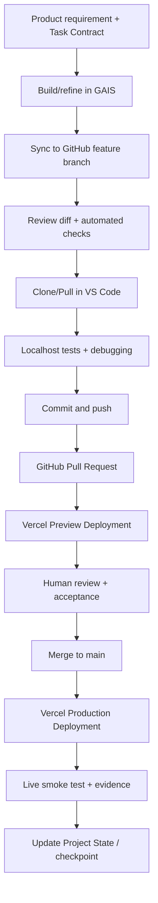

# BVC Task Management — Development, Testing & Deployment Design v0.1

**Document ID:** BVC-TM-DEVOPS-001\
**Phase:** 3.2\
**Version:** 0.1.0\
**Status:** Draft for Owner Review\
**Date:** 2026-11-04

## 1. Purpose

Define how readers progress from GAIS Build mode to a controlled, testable and publicly deployed application without requiring Beginner readers to install local development tools.

## 2. Tool responsibilities

| Tool | Responsibility |
|---|---|
| Google AI Studio | Build and refine the application with AI; preview; import/link/sync source |
| GitHub | Canonical reviewed source history, branches, commits, PRs and traceability |
| VS Code | Advanced local editing, debugging and test execution |
| Localhost | Run the app locally during Advanced development; not a Beginner prerequisite |
| Supabase | Hosted PostgreSQL, Auth, RLS, SQL migrations and data services |
| Vercel | Recommended default practice hosting for personal/non-commercial apps |
| GitHub Actions | Automated quality gates; not a duplicate Vercel deployment system by default |

Google AI Studio Build mode currently documents React as the default web frontend, a Node.js server runtime, GitHub two-way sync, code export and deployment to Cloud Run. Vercel compatibility must be verified against the actual exported project scaffold; do not assume every generated server configuration deploys to Vercel without adjustment.

## 3. Source-control policy

- `main` is the protected/reviewed production branch.
- Feature branches use `feat/<short-scope>` or `fix/<short-scope>`.
- Changes enter `main` through Pull Requests.
- One active writer per file set: do not simultaneously edit the same files in GAIS and VS Code.
- After edits in GAIS, sync and review the resulting Git diff before merging.
- After edits in VS Code, commit/push and then pull/sync into GAIS before asking GAIS to continue from the latest repository state.
- Keep PRs small and tied to one implementation Task Contract.
- Do not allow an AI executor to merge or deploy without the Owner's explicit authorization.

## 4. Recommended development lifecycle

## 5. CI and Actions storage-conscious design

Use GitHub Actions for:
- dependency installation and lockfile consistency;
- lint;
- type checking;
- unit tests;
- component/integration tests;
- build verification where required;
- dependency/security scanning where configured.

Do not upload large build directories or duplicate deploy bundles as workflow artifacts unless a test or release process genuinely requires them.

When artifacts are needed:
- upload only test reports or targeted evidence;
- set short retention (recommended 7 days for ordinary test artifacts);
- do not store dependency directories or full project copies as artifacts;
- review repository Actions usage periodically.

Vercel's native Git integration can handle Preview and Production deployments. Avoid building and deploying the same app again in GitHub Actions unless a specific pipeline requirement justifies that complexity.

## 6. Vercel deployment model

Recommended practice default: Vercel Hobby, subject to Owner confirmation.

- Connect the BVC application GitHub repository to a Vercel Project.
- Configure `main` as the Production Branch.
- Pushes/PRs to feature branches create Preview deployments.
- Merge to `main` triggers the Production deployment.
- Use generated `*.vercel.app` URL for the learning path.
- Add a custom domain only when the learner owns/controls it and DNS configuration is understood.
- Store environment variables in Vercel Project Settings; do not commit them.
- Configure separate Preview and Production values.

### Hobby limitations

Vercel Hobby is restricted to personal and non-commercial use under Vercel's terms. Limits and fair-use conditions may change. Do not teach Hobby as the default for customer projects, paid SaaS or commercial services. For those cases, readers choose Vercel Pro/Enterprise or their organization's hosting/cloud.

Vercel Hobby enables real Internet-facing practice deployment, but it is not a contractual production SLA or an assurance of continuous availability.

## 7. Supabase environment and migration deployment

- Store schema changes as ordered SQL migration files in Git.
- Review migration SQL before applying it.
- Use Supabase CLI in Advanced to create/replay migrations.
- Prefer separate development and production projects when practical and allowed by the selected plan.
- Test migrations against development/preview before production.
- Do not use manual Dashboard edits as the only record of schema changes.
- A migration rollback must be explicitly designed; not every SQL change is automatically reversible.
- Keep database changes and application changes compatible during a release.

## 8. Testing strategy

| Layer | Examples | Required evidence |
|---|---|---|
| Domain/unit | Status transitions, priority, date placement, filters, validation | Test output |
| Persistence adapter | browser JSON storage CRUD, Supabase CRUD, import/export | Automated tests |
| Security | RLS positive/negative access tests | SQL tests or integration results |
| Component | Forms, lists, empty/error/loading states | Component test output |
| End-to-end | First use, create/edit/delete, complete task, starter kit, backup/restore | Browser test report |
| Responsive | 320/360/390 px, tablet, desktop breakpoints | Screenshots / test matrix |
| Deployment smoke | Open live URL, auth, create/read/update/delete, refresh, reload | Production smoke-test record |
| Recovery | Restore backup, recover from failed release | Evidence record |

Never mark a check PASS just because a build completed. Verify real behavior against acceptance criteria.

## 9. Environments and release promotion

| Environment | Trigger | Purpose |
|---|---|---|
| GAIS Preview | Manual iteration in GAIS | Beginner and early feature review |
| Localhost | Developer starts local server | Advanced development/debugging |
| Vercel Preview | Feature branch / PR push | Review before production |
| Vercel Production | Merge to `main` | Public app release |

Use consistent environment variable names and separate values by environment. Do not let Preview deployments write to production data by default.

## 10. Operational checklist

Before deployment:
- Build succeeds from a clean checkout.
- Required environment variables are present.
- No secret is included in the client bundle.
- RLS checks pass.
- Database migrations are applied to the intended environment.
- Core end-to-end and responsive tests pass.
- Preview deployment has been reviewed.
- Human Owner approves release.

After deployment:
- Visit the production URL.
- Verify the app loads and assets resolve.
- Verify sign-in/sign-out if Level 2/3 mode is enabled.
- Create, update and delete a synthetic task.
- Verify user-level isolation.
- Verify no unexpected errors in browser console/runtime logs.
- Confirm deployment points to the intended commit.
- Record URL, commit SHA, timestamp and evidence.
- Keep rollback/redeploy instructions available.

## 11. Hosting alternatives

The reference design is provider-independent. Experienced developers/Tech Leads may replace Vercel with:
- Google Cloud Run;
- AWS services;
- Azure services;
- a managed platform selected by their organization;
- self-managed cloud or hosting infrastructure.

Keep the same fundamentals: Git source history, secure environment configuration, database migrations, automated testing, deployment verification, monitoring and recovery.

## 12. References

- Google AI Studio Build mode: https://ai.google.dev/gemini-api/docs/aistudio-build-mode
- Vercel Git deployment: https://vercel.com/docs/git
- Vercel Hobby: https://vercel.com/docs/plans/hobby
- Vercel terms: https://vercel.com/legal/terms
- Supabase production checklist: https://supabase.com/docs/guides/deployment/going-into-prod
