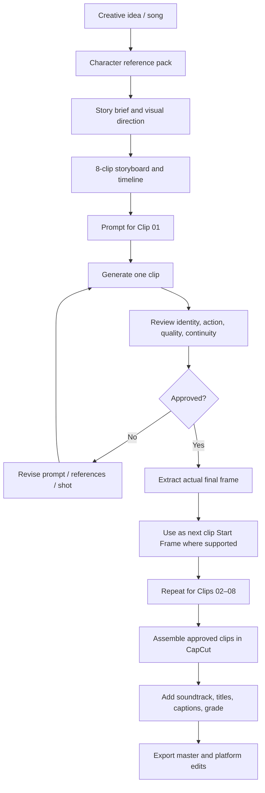

# Create a Personal Cinematic Music Video with AI
## A Complete Practical Lab Using “Don't Ask Me Why”

**Lab type:** Creative AI / Prompt Engineering / Video Production  
**Level:** Beginner to Intermediate  
**Case-study output:** Eight clips × 15 seconds ≈ 2 minutes  
**Primary workflow:** Character references → storyboard → prompts → video generation → review → CapCut  
**Example tools:** ElevenLabs Image & Video, Google Veo, and CapCut. Tool names are examples, not mandatory dependencies.

---

## 1. What You Will Build

In this lab, you will plan and produce a short cinematic personal music video featuring one consistent main character based on your own permitted avatar photographs.

The case study is the Vietnamese romantic story **Don't Ask Me Why** . It follows DongHP through a city at night, memories of a relationship, an old letter, a flower, rain, music, acceptance, and a hopeful new beginning.

The complete case-study timeline contains eight 15-second clips. You can also make a shorter 30–60-second version by selecting a subset of clips or creating a condensed edit. Do not assume that a 2-minute master automatically fits every short-form platform's preferred pacing.

### Learning objectives

By the end, you should be able to:

- Prepare a character reference pack from multiple portrait angles.
- Write a short creative brief and a beginning–middle–ending story.
- Break a longer narrative into video-generation-sized shots.
- Write prompts that specify identity, action, framing, camera movement, lighting, mood, continuity, negative constraints, and output settings.
- Use an actual final frame from one clip as the next clip's opening frame when supported.
- Inspect generated footage, identify defects, and revise prompts.
- Assemble a master video and short-form edits in CapCut.

### What you need

1. A set of personal photographs that you own or have permission to use.
2. Access to an AI video-generation tool. The examples use ElevenLabs Image & Video and Google Veo; interfaces and capabilities vary.
3. A video-editing tool such as CapCut.
4. Your own soundtrack or properly licensed music, if the project includes music.
5. A folder for references, prompts, generated clips, review frames, and final exports.

No programming or local development environment is required for this creative lab.

---

## 2. Understand the Production Workflow

The production flow is deliberately staged. Do not generate all clips in one request and hope the model preserves everything.



### The core production rule

**Generate → Review → Approve → Continue.**

A clip is not approved merely because the AI finished generating it. Watch the complete clip and inspect critical frames. Fix identity drift, deformed hands, inconsistent wardrobe, disappearing props, abrupt cuts, or incorrect ending frames before moving on.

---

## 3. Step 1 — Prepare Your Avatar / Character References

The main character must remain recognizably the same person throughout the video.

### 3.1 Photograph checklist

Prepare clear images of the same person:

| Reference | Recommended view | Main use |
|---|---|---|
| REF_01 | Front / neutral expression | Baseline facial geometry |
| REF_02 | Three-quarter left | Left-facing shots |
| REF_03 | Three-quarter right | Right-facing shots |
| REF_04 | Side profile | Profile shots |
| REF_05 | Looking slightly up or away | Emotional / horizon gaze |

For best results:

- Use natural, even light and a clear, unobstructed face.
- Keep glasses, hairstyle, and facial hair consistent with the intended character.
- Avoid extreme filters, beauty effects, sunglasses, and heavy shadows.
- Use a neutral expression for at least one master portrait.
- Avoid mixing images of different people or images with different ages and styling.
- Keep original files unchanged; create working copies for cropping and resizing.

### 3.2 Create an identity sheet

Record the character's stable attributes:

| Attribute | Example for DongHP |
|---|---|
| Character name | DongHP |
| Person | Same adult Vietnamese man across all clips |
| Hair | Short dark hair |
| Glasses | Rectangular dark-framed glasses |
| Face | Preserve reference facial geometry and natural skin texture |
| Wardrobe baseline | Black leather jacket, dark inner shirt, dark trousers |
| Continuity rule | Do not redesign, beautify, age, slim, or replace the character |

Treat this as a reference specification, not as a replacement for the actual photographs.

### 3.3 Attach references correctly

If the selected video tool supports character or image references, attach the appropriate references according to that tool's current input limits. Some models restrict the combination of reference images, Start Frames, and End Frames. Do not force unsupported combinations.

When the tool cannot accept all references, prioritize the strongest master portrait plus the frame continuity anchors supported by the model. Reduce face-heavy shots and use rear/profile views where appropriate.

**Checkpoint 1:** You have five clear reference angles, one identity description, and a stable wardrobe specification.

---

## 4. Step 2 — Write the Story Before Writing Prompts

A good video prompt does not rescue a story that has no clear progression.

### 4.1 Case-study story

**Title:** Don't Ask Me Why

**Logline:** A lonely man moves through a neon-lit city, discovers a letter and a flower that revive a happy memory, faces the pain of absence, returns to music, and finally learns to let go and welcome a new beginning.

**Emotional arc:**

1. Loneliness.
2. Recognition.
3. Nostalgia.
4. Happiness remembered.
5. Loss.
6. Reflection through music.
7. Acceptance.
8. Hope.

### 4.2 Eight-clip master timeline

| ID | Timeline | Segment title | Story role |
|---|---|---|---|
| Clip 01 | 00:00–00:15 | A Lonely Man in the City | Introduce DongHP and the lonely urban world |
| Clip 02 | 00:15–00:30 | The Street Remembers | Establish the city and awaken memories |
| Clip 03 | 00:30–00:45 | The Forgotten Letter | Discover the letter, photograph, and pressed flower |
| Clip 04 | 00:45–01:00 | Golden Memories | Show a warm, happy lakeside memory |
| Clip 05 | 01:00–01:15 | Rain of Memories | Return to the present and carry the flower through the rain |
| Clip 06 | 01:15–01:30 | The Last Song | Express grief and memory through guitar |
| Clip 07 | 01:30–01:45 | Learning to Let Go | Accept the past and walk toward the dawn |
| Clip 08 | 01:45–02:00 | A New Beginning | End with calm confidence and hope |

The full timeline is approximately two minutes. For a 30–60-second short, select a coherent mini-story rather than simply speeding up all eight clips.

---

## 5. Step 3 — Create a Visual Bible and Continuity Rules

A visual bible is a compact production reference shared by every clip prompt.

### 5.1 Character continuity

- One main character: DongHP.
- Same face, hair, glasses, apparent age, body proportions, and natural skin.
- Same black leather jacket, dark shirt, and dark trousers across the present-day storyline.
- The woman in the memory sequence should be shown from behind, as a silhouette, or through non-identifying body details if consistent facial identity is not needed.
- Do not ask the model to invent a detailed female face if that face is not part of the reference pack.

### 5.2 Recurring objects

| Object | Story meaning | Continuity rule |
|---|---|---|
| White flower | A relationship and a memory | Keep one consistent flower type, color, and scale |
| Old letter | The past returning | Keep it a physical paper object |
| Sepia photograph | A preserved memory | Do not animate it into a new person |
| Acoustic guitar | Music as expression | Keep the instrument visually stable |
| Rainy window | Present loneliness | Keep rain outside the room |

### 5.3 Color progression

| Story stage | Visual palette |
|---|---|
| Clips 01–02 | Cool blue, cyan, magenta neon; wet reflections |
| Clip 03 | Dark interior, warm practical light, restrained sepia |
| Clip 04 | Golden-hour honey and amber; soft backlight |
| Clip 05 | Cold rainy blue/magenta contrasted with a warm lamp |
| Clip 06 | Amber room light with cool rainy-window reflections |
| Clips 07–08 | Neutral dawn moving into warm golden sunrise |

### 5.4 Continuity between clips

When supported by the selected model:

1. Export the approved previous clip.
2. Extract its actual final decoded frame.
3. Use that exact image as the next clip's Start Frame.
4. Use a separately prepared End Frame only when the next composition requires a controlled target.
5. Review the first second of the new clip to confirm the opening match.

Do not use a storyboard illustration as if it were an actual frame from the rendered video.

**Checkpoint 2:** Your story, character description, wardrobe, recurring objects, color progression, and continuity plan are documented.

---

## 6. Step 4 — Learn the Anatomy of a Video Prompt

A useful prompt is a miniature production brief. It should tell the model what to create and what must remain unchanged.

### 6.1 Prompt structure

Use this reusable structure:

1. **Project and clip:** title, segment number, timeline, duration.
2. **Creative objective:** what the viewer should understand or feel.
3. **Start / End Frame contract:** the required opening and closing composition.
4. **Character identity:** face, hair, glasses, wardrobe, and reference priority.
5. **Shot-by-shot timeline:** actions and events with timestamps.
6. **Camera direction:** shot size, angle, movement, focus, and pacing.
7. **Environment and lighting:** location, weather, color, time of day.
8. **Continuity rules:** props, screen direction, wardrobe, and prior clip.
9. **Negative constraints:** defects and unwanted elements to avoid.
10. **Output contract:** duration, aspect ratio, resolution, number of outputs, audio, and filename.

### 6.2 Prompt quality checklist

Before generation, ask:

- Can the model identify exactly one main character?
- Is each action physically simple and visible?
- Does each shot add a new event?
- Are the camera angle and movement specified?
- Are opening and ending frames unambiguous?
- Are recurring props described consistently?
- Are anatomy and identity constraints explicit?
- Does the output contract match the tool's actual settings?

### 6.3 Keep actions simple

Video models often struggle with complex contact between hands, faces, and small objects. Prefer one clear physical action per shot. For example, show one person holding a flower in a static close-up rather than two people passing it hand-to-hand with overlapping fingers. If a handoff is essential, use a wider shot or a cut that hides the most difficult contact.

---

## 7. Step 5 — Generate the Eight Clips

The following sections are copy-ready prompt templates for the case study. Replace filenames with your own assets. The prompts are deliberately tool-neutral enough to adapt, but their settings must be mapped to the actual controls available in the selected generator.

### Clip 01 — A Lonely Man in the City
**Timeline:** 00:00–00:15  
**Purpose:** Introduce DongHP, the city, and the emotional tone.

**Story beats:**
- Establish a neon-lit city at night after rain.
- Introduce DongHP in the frame.
- Let him pause and look into the distance.
- End on a composition that can lead into a walk through the city.

**Prompt file:** [CLIP_01_A_LONELY_MAN_IN_THE_CITY.md](./prompts/CLIP_01_A_LONELY_MAN_IN_THE_CITY.md)

**Prompt:**

```text
Create a photorealistic 15-second cinematic opening for “Don't Ask Me Why”.
Use the supplied avatar references to preserve the same adult man, DongHP:
short dark hair, rectangular dark glasses, natural facial proportions,
black leather jacket and dark shirt. Show him alone on a wet city street
at night, surrounded by blue, cyan and magenta neon reflections.
Use a wide establishing shot, then a controlled medium shot of him
standing quietly and looking into the distance. Keep his expression
restrained and believable. Smooth camera movement, realistic rain,
wet asphalt and cinematic depth of field. No extra main characters,
no face replacement, no wardrobe change, no text, no logos, no dialogue.
Landscape 16:9, 15 seconds, one output, audio off.
```

### Clip 02 — The Street Remembers
**Timeline:** 00:15–00:30  
**Purpose:** Move from the character introduction into a city filled with memory.

**Story beats:**
- Continue DongHP's journey through the city.
- Show neon signs, wet pavement, and a nostalgic storefront.
- Use a rear or side tracking shot.
- End with him approaching a place that triggers memory.

**Prompt file:** [CLIP_02_THE_STREET_REMEMBERS.md](./prompts/CLIP_02_THE_STREET_REMEMBERS.md)

**Prompt:**

```text
Create Clip 02, a 15-second continuation of the same cinematic music video.
Begin with the actual final frame of approved Clip 01 when available.
Preserve DongHP's exact referenced identity, glasses, short dark hair,
black leather jacket and dark outfit. He walks slowly along a neon-lit
street after rain. Show wet reflections, a nostalgic cassette or music
store window, and passing colored lights. Use a wide street view followed
by a smooth rear/side tracking shot. Let the city carry the atmosphere;
avoid repeated frontal portraits. End with DongHP slowing near the shop
window, as if a memory has returned. No face drift, no extra people,
no readable generated signs, no captions or logos. 16:9, 480p,
15 seconds, one output, generated audio off.
```

### Clip 03 — The Forgotten Letter
**Timeline:** 00:30–00:45  
**Purpose:** Introduce the physical objects that unlock the past.

**Story beats:**
- Transition from the city to a quiet room.
- Reveal the letter, old photograph, and pressed flower.
- Show DongHP opening or studying the letter.
- End on the keepsakes as a visual bridge into the memory.

**Prompt file:** [CLIP_03_THE_FORGOTTEN_LETTER.md](./prompts/CLIP_03_THE_FORGOTTEN_LETTER.md)

**Prompt:**

```text
Create a 15-second photorealistic cinematic scene in a quiet, dim room.
Continue from Clip 02 using a clean editorial cut, not a location morph.
DongHP, the same man from the avatar references, enters or sits beside
a wooden table. He discovers an old handwritten letter, one sepia
photograph and one pressed flower. Use a medium shot, then a macro
detail of the paper and flower. His expression is quiet and reflective.
Preserve his facial identity, glasses, hair and dark outfit. Keep all
objects physical and stable; do not invent readable text or animate
the photograph. Warm practical lamp light, subtle shadows, realistic
paper texture, controlled camera movement. No extra characters, no
identity drift, no duplicated objects, no subtitles or logos.
16:9, 480p, exactly 15 seconds, one output, audio off.
```

### Clip 04 — Golden Memories
**Timeline:** 00:45–01:00  
**Purpose:** Reveal the happy memory behind the flower.

**Story beats:**
- Begin on the actual final frame of Clip 03.
- Cut to a warm lakeside sunset.
- Show the couple mainly from behind or in silhouette.
- Use simple, anatomically safe framing for the flower.
- End on the flower as the link between past and present.

**Prompt file:** [CLIP_04_GOLDEN_MEMORIES.md](./prompts/CLIP_04_GOLDEN_MEMORIES.md)

**Prompt:**

```text
Create a warm, photorealistic 15-second flashback titled “Golden Memories”.
Begin on the actual final frame of approved Clip 03, then make a clean
editorial cut to a peaceful lakeside sunset. DongHP is the same man
from the supplied avatar references, wearing his black leather jacket
and dark outfit. The woman is shown from behind or as a soft silhouette
in a flowing light-cream dress; do not generate a detailed face.
Show the couple walking together from behind, then sitting quietly
beside the lake. For the flower moment, keep the camera wide or use
a static insert: one clearly visible male hand holds one small white
flower; avoid a close hand-to-hand exchange or overlapping fingers.
End with a simple flower composition in warm golden light. No extra
hands, no duplicated fingers, no face drift, no text or logos.
16:9, 480p, 15 seconds, one output, audio off.
```

**Production lesson:** Hand-to-hand contact is a high-risk generation moment. A beautiful story can be preserved with safer blocking: show the woman holding the flower, cut to DongHP already holding it, and let the audience infer the exchange. Do not demand two complex overlapping hands merely for literal continuity.

### Clip 05 — Rain of Memories
**Timeline:** 01:00–01:15  
**Purpose:** Return from the happy memory to the present.

**Story beats:**
- Begin from Clip 04's approved ending.
- Cut from golden sunset to cold rainy city.
- Show DongHP walking without an umbrella.
- Insert one close-up of the flower in his hand.
- Return to the music room and guitar.

**Prompt file:** [CLIP_05_RAIN_OF_MEMORIES.md](./prompts/CLIP_05_RAIN_OF_MEMORIES.md)

**Prompt:**

```text
Create a 15-second continuation titled “Rain of Memories”.
Use the actual final frame of Clip 04 as the opening anchor when available.
Make a clean cut from warm sunset memory to the cold blue/magenta present.
DongHP is alone in a rainy city at night, wearing the same black leather
jacket and dark clothes. Show a wide city shot, then a rear/side tracking
shot as he walks slowly without an umbrella. Use one controlled macro
insert of a single white flower held naturally in one hand emerging
from the leather sleeve. Keep the hand simple and anatomically correct:
five fingers, no overlap, no duplicate hand. Cut to the dim music room
with an acoustic guitar and warm amber lamp. End with his hand resting
on the guitar strings beside the flower. No face drift, no extra people,
no morphing, no generated audio, no text or logos. 16:9, 480p,
15 seconds, one output.
```

### Clip 06 — The Last Song
**Timeline:** 01:15–01:30  
**Purpose:** Let music express the emotion that words cannot.

**Story beats:**
- Begin on the actual ending of Clip 05.
- Show the first chord.
- Use a detail of the guitar performance.
- Show DongHP's restrained emotional expression.
- End on the guitar and keepsakes.

**Prompt file:** [CLIP_06_THE_LAST_SONG.md](./prompts/CLIP_06_THE_LAST_SONG.md)

**Prompt:**

```text
Create a 15-second cinematic sequence titled “The Last Song”.
Begin on the actual final frame of approved Clip 05. Preserve the same
music room, acoustic guitar, flower, letter, photograph, rainy window
and amber lamp. DongHP, with the exact same avatar identity and outfit,
gently plays a slow guitar progression. Use five distinct visual beats:
the first chord, a close detail of the strings, a medium three-quarter
portrait, a brief focus shift to the flower and letter, and a final
wide-medium composition of DongHP with the guitar. Keep both hands
natural and correctly placed on the instrument. His expression is quiet,
not theatrical. No rapid strumming, no extra fingers, no warped guitar,
no duplicate props, no identity change, no text, no lip-sync or generated
music. Add the original soundtrack later in CapCut. 16:9, 480p,
15 seconds, one output, audio off.
```

### Clip 07 — Learning to Let Go
**Timeline:** 01:30–01:45  
**Purpose:** Show acceptance and transition toward hope.

**Story beats:**
- Begin on Clip 06's actual final frame.
- Acknowledge the flower and keepsakes.
- Leave the room.
- Cut to the riverside at dawn.
- End with DongHP walking toward the sunrise.

**Prompt file:** [CLIP_07_LEARNING_TO_LET_GO.md](./prompts/CLIP_07_LEARNING_TO_LET_GO.md)

**Prompt:**

```text
Create a 15-second cinematic chapter titled “Learning to Let Go”.
Begin with the actual final frame of Clip 06. DongHP lets the final guitar
chord fade and looks toward the rainy window. Show a brief detail of
the flower, letter and old photograph, then cut to him leaving the room.
Do not make him destroy or burn the keepsakes. Cut cleanly to a quiet
riverside promenade after rain at first light. Show him walking away
from camera along the wet path toward a warm sunrise. Preserve the same
black leather jacket, dark clothes and body proportions. Use a brief
side profile only if the avatar identity can be preserved. End on a wide
rear shot with trees, water and distant skyline. Calm, accepting,
hopeful; no new people, no woman, no morphing, no text or logos.
16:9, 480p, 15 seconds, one output, audio off.
```

### Clip 08 — A New Beginning
**Timeline:** 01:45–02:00  
**Purpose:** Deliver a positive, memorable ending.

**Story beats:**
- Begin on the actual final frame of Clip 07.
- Continue the same walk and screen direction.
- Reveal the face using the avatar reference angles.
- Show a calm, natural expression.
- End with a steady hero composition in sunrise light.

**Prompt file:** [CLIP_08_A_NEW_BEGINNING.md](./prompts/CLIP_08_A_NEW_BEGINNING.md)

**Prompt:**

```text
Create the final 15-second cinematic chapter, “A New Beginning”.
Begin exactly on the actual final frame of approved Clip 07. Continue
DongHP's walk beside the same lake at sunrise; match the wet promenade,
trees, railing, water, skyline and sun direction. Use the supplied
multi-angle avatar references as the identity authority. Preserve the
same face, short dark hair, rectangular glasses, natural skin texture,
black leather jacket and dark shirt. Move from a rear wide view to a
controlled three-quarter portrait matching the supplied right-angle
reference, then hold a calm, hopeful expression with only a subtle
natural smile. Finish on a stable close-medium hero portrait against
the golden lake and soft skyline. Do not generate a lookalike or
beautify the face. No new characters, no face morphing, no wardrobe
change, no text, logos or subtitles. Warm natural sunrise, smooth
camera movement, photorealistic finish. 16:9, 480p, 15 seconds,
one output, audio off.
```

---

## 8. Step 6 — Generate One Clip at a Time

For every clip:

1. Open the selected video-generation tool.
2. Select a model and verify that the requested duration, aspect ratio, resolution, and frame-reference mode are supported.
3. Attach the relevant avatar references.
4. Attach the approved previous clip's actual final frame as the Start Frame when the model supports it.
5. Attach the prepared End Frame only if supported in the same generation mode.
6. Paste the corresponding clip prompt.
7. Disable generated audio when you will add your soundtrack in CapCut.
8. Generate one output first.
9. Review the result before continuing.

### Model and tool selection

ElevenLabs Image & Video and Google Veo are examples. Do not assume their available models, duration limits, reference-image support, or control names are identical. Choose the model that is currently available in your account and record its exact displayed name.

A useful tool-selection checklist:

- Does this model accept image references?
- Can it accept Start Frame and End Frame together?
- Can it preserve a character from multiple angles?
- Does it support the required duration?
- Can generated audio be disabled?
- Can it export the required aspect ratio and resolution?

When a feature is unavailable, simplify the shot or adjust the workflow rather than pretending the tool supports it.

---

## 9. Step 7 — Review and Approve Every Clip

Review the entire clip, not just its thumbnail or final frame.

### 9.1 Review dimensions

| Review area | Questions |
|---|---|
| Identity | Is DongHP recognizably the same person? Are hair, glasses, face, and age stable? |
| Wardrobe | Does the jacket and dark outfit remain consistent? |
| Action | Does the requested action happen clearly and naturally? |
| Anatomy | Are hands, fingers, joints, and object contact believable? |
| Props | Are the flower, letter, photograph, and guitar stable? |
| Camera | Is the framing controlled? Does every shot add new information? |
| Lighting | Does the clip follow the chapter's color direction? |
| Continuity | Does the first frame connect to the previous clip? |
| Ending | Does the final composition match the intended next transition? |
| Technical output | Is duration, aspect ratio, resolution, and audio correct? |

### 9.2 Common defects and corrective actions

| Defect | Likely corrective action |
|---|---|
| Face changes between shots | Attach the correct identity references; reduce the number of face angles; simplify movement |
| Extra fingers or overlapping hands | Replace handoff with separate shots; reduce contact; use a wider framing |
| Object disappears | Name the object consistently and reduce simultaneous actions |
| Wardrobe changes | Repeat exact wardrobe constraints and use a reference frame |
| Camera jumps | Request fewer cuts and slower camera movement |
| Start frame does not match | Use the actual prior final frame and check tool input mode |
| End frame is inaccurate | Use a clearer End Frame and reduce late-shot actions |
| Generated signs contain gibberish | Prohibit readable text and add titles during editing |
| AI audio conflicts with soundtrack | Disable generated audio and add the original track in CapCut |

### 9.3 Approval gate

Mark each clip:

- **PASS:** identity, story, continuity, and technical requirements are acceptable.
- **REVISE:** a correctable defect remains.
- **REJECT:** the clip has a major identity, story, or technical failure.

Only approved clips should enter the master timeline.

---

## 10. Step 8 — Edit the Final Video in CapCut

After all clips are approved:

1. Create a new CapCut project.
2. Import the approved clips in the correct order.
3. Set the project canvas to the desired output ratio.
4. Align cuts to the original soundtrack's timing.
5. Add the original audio track.
6. Adjust clip volume and mute generated audio.
7. Add titles and captions as separate editable layers.
8. Apply a consistent color grade across the eight segments.
9. Add transitions only where they support the story.
10. Watch the entire master video before export.

### 10.1 Recommended outputs

| Output | Aspect ratio | Intended use |
|---|---|---|
| Master cinematic edit | 16:9 | YouTube or archive |
| Short-form vertical edit | 9:16 | YouTube Shorts, Facebook Reels, TikTok |
| Optional square edit | 1:1 | Feed posts where appropriate |

A 30–60-second vertical edit should be re-cut for a coherent mini-story. Select the strongest moments, preserve context, and add captions/title safe areas. Do not merely crop the entire 2-minute landscape master and assume the result will work.

### 10.2 Final quality checks

- No black frames or accidental gaps.
- No repeated or missing clips.
- Soundtrack is synchronized.
- Captions are readable and correctly spelled.
- Important faces and action are within the safe area.
- No unintended AI-generated text or watermark.
- Export settings match the intended platform.
- Watch the exported file after rendering.

---

## 11. Suggested Project Folder Structure

Use a clear folder structure so assets, prompts, outputs, and revisions are easy to find.

```text
DONT-ASK-ME-WHY/
├── 01_BRIEF/
│   ├── STORY_BRIEF.md
│   ├── STORYBOARD.md
│   └── VISUAL_BIBLE.md
├── 02_AVATAR_REFERENCES/
│   ├── REF_01_FRONT.jpg
│   ├── REF_02_LEFT_3Q.jpg
│   ├── REF_03_RIGHT_3Q.jpg
│   ├── REF_04_PROFILE.jpg
│   └── REF_05_LOOK_UP.jpg
├── 03_PROMPTS/
│   ├── CLIP_01_PROMPT.md
│   ├── CLIP_02_PROMPT.md
│   ├── CLIP_03_PROMPT.md
│   ├── CLIP_04_PROMPT.md
│   ├── CLIP_05_PROMPT.md
│   ├── CLIP_06_PROMPT.md
│   ├── CLIP_07_PROMPT.md
│   └── CLIP_08_PROMPT.md
├── 04_GENERATED_CLIPS/
│   ├── DHEVS_01.mp4
│   ├── DHEVS_02.mp4
│   ├── DHEVS_03.mp4
│   ├── DHEVS_04.mp4
│   ├── DHEVS_05.mp4
│   ├── DHEVS_06.mp4
│   ├── DHEVS_07.mp4
│   └── DHEVS_08.mp4
├── 05_CONTINUITY_FRAMES/
├── 06_REVIEW/
├── 07_CAPCUT_EXPORTS/
└── 08_FINAL/
    ├── DHEVS_MASTER_16x9.mp4
    └── DHEVS_SHORT_9x16.mp4
```

Keep original avatar photographs and generated reference assets separate. Do not overwrite approved master clips with experimental re-renders.

---

## 12. Hands-on Exercises

### Exercise A — Build your own avatar pack

Prepare five photographs and write a one-paragraph character identity specification. Ask a reviewer to compare all images and identify any inconsistent age, lighting, glasses, or hairstyle.

**Acceptance:** Five views of one person, clear enough for image-reference use.

### Exercise B — Write a 30-second story

Create a simple story with a beginning, a change, and an ending. Divide it into two 15-second clips.

**Acceptance:** Each clip has a clear role and a visible event.

### Exercise C — Write and test one prompt

Use the prompt structure in Section 6 to create one 10–15-second video.

**Acceptance:** The generated video contains the requested subject and action, with no major identity or technical defect.

### Exercise D — Practice frame continuity

Use the actual final frame of the approved first clip as the next clip's Start Frame, if supported by the selected model.

**Acceptance:** The next clip opens in a visibly consistent scene, subject position, wardrobe, and lighting.

### Exercise E — Diagnose and revise a defect

Record one real defect, such as face drift, extra fingers, a disappearing prop, or a camera jump. Change the prompt to address that defect and regenerate.

**Acceptance:** The revision targets the observed defect rather than adding unrelated prompt detail.

### Exercise F — Finish a short-form edit

Assemble a 30–60-second vertical edit with a coherent narrative, soundtrack, captions, and a clean ending.

**Acceptance:** The exported file plays correctly from beginning to end and is suitable for the selected platform.

---

## 13. Final Deliverables and Completion Checklist

A completed lab should contain:

- [ ] A written story brief.
- [ ] A five-angle avatar reference set.
- [ ] A character identity and wardrobe specification.
- [ ] An eight-clip storyboard and timeline.
- [ ] Eight individual prompts.
- [ ] Eight generated clips.
- [ ] Actual continuity frames where used.
- [ ] Review notes and approval status for each clip.
- [ ] A CapCut master project or equivalent edit.
- [ ] A master export.
- [ ] At least one 30–60-second short-form edit.
- [ ] A record of models/tools and settings actually used.

### What success means

Success is not simply obtaining eight AI-generated videos. Success means creating a coherent story with a consistent character, controlled visual direction, reviewed outputs, and a finished edit that communicates the intended emotion.

---

## 14. Responsible Use and Practical Limitations

- Use your own likeness or images for which you have permission.
- Obtain consent before using another person's identifiable face or private images.
- Respect music, footage, and image licensing.
- Do not present AI-generated events as documentary evidence of events that never happened.
- Review generated hands, faces, text, logos, and objects carefully.
- Tool interfaces, model names, generation limits, fees, and reference-image features change. Check current official documentation and the controls available in your own account.
- A prompt is an instruction, not a guarantee. Human review and editing remain essential.

---

## 15. Next Step

Start with **Clip 01 — A Lonely Man in the City**. Do not attempt all eight clips at once. Build one approved clip, learn from the result, and carry the lessons into the next segment.

> **The goal is not to make AI create more footage. The goal is to direct AI to tell your story—with your identity, your creative decisions, and your final approval.**

Return to the [Prompt Engineering index](../README.md).
