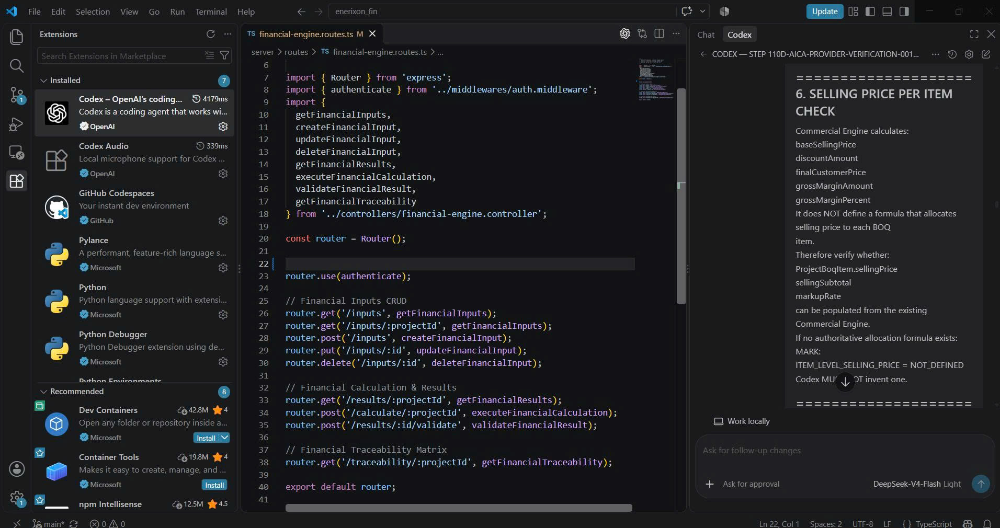
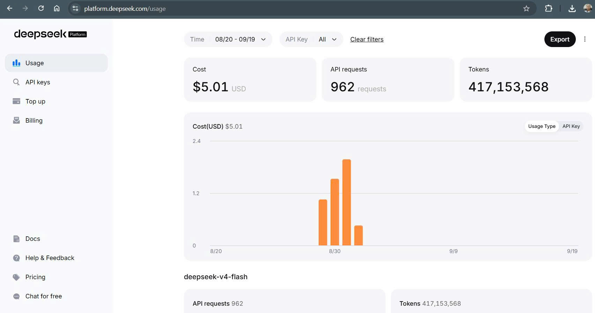

# 417 Million Tokens for Just USD 5.01: My DeepSeek + Codex Experience in VS Code — What Can I Improve to Optimize AI Coding Costs Further?

**From a real-world experiment to practical lessons in prompt engineering, context engineering and AI agent cost optimization.**

> Build. Measure. Learn. Improve. Repeat.

I did not start this experiment with a perfect cost-optimization method. I started by trying a different model provider in my everyday coding environment, using it on real development work, and then looking at the bill.

The result caught my attention: **417,153,568 billed tokens for approximately USD 5.01** over the observed billing period.

That number is interesting, but it is not the end of the story. It raises more useful questions:

- What does the token total actually include?
- How much of the cost comes from cached input, uncached input and output?
- Does a high cache-hit rate mean that the context is efficient?
- What can the billing export tell me about the agent workflow—and what can it not tell me?
- Most importantly, what should I measure next if I want to reduce cost without reducing engineering quality?

This article documents what I tried, what the available evidence shows, where I still have blind spots, and how I plan to improve the workflow.

---

## 1. The setup: DeepSeek as a provider for Codex in VS Code

I configured DeepSeek as the model provider for the Codex IDE extension in Visual Studio Code. The editor, extension, workspace and local tool interactions remained on my workstation. Model inference and API billing took place through DeepSeek's remote API.

This distinction matters. Configuring a provider in a local coding client does not mean the model itself is running locally or offline.

The screenshot below records the development environment during the experiment. It shows the Codex extension in VS Code, a project TypeScript file open in the editor, and a Codex conversation using a DeepSeek V4 Flash Light model selection.



*Figure 1. Development environment during the experiment. The screenshot is contextual evidence of the visible VS Code/Codex session and selected model; it does not independently prove that every request in the billing export originated from this interface.*

For anyone reproducing the setup, use DeepSeek's current official integration instructions rather than copying an old configuration or running an unreviewed setup script:

- [DeepSeek — Integrate with Codex](https://api-docs.deepseek.com/quick_start/agent_integrations/codex/)
- [DeepSeek API documentation](https://api-docs.deepseek.com/)

Provider APIs, model aliases, supported protocols, client versions and authentication flows can change. Check the current documentation before configuring your own environment.

## 2. The result that made me investigate the bill

The DeepSeek usage dashboard screenshot shows the headline totals:



*Figure 2. DeepSeek Platform usage dashboard. The visible summary reports USD 5.01, 962 API requests and 417,153,568 tokens for the selected dashboard range.*

The detailed case study uses the records reconciled for **29 August through 1 September 2026**. The exported CSV filenames cover a wider query window, but the rows included in this analysis cover those four dates.

| Measure | Observed result |
|---|---:|
| Total billed tokens | **417,153,568** |
| API requests | **962** |
| Reconciled API cost | **USD 5.014844192** |
| Input cache-hit tokens | 413,217,024 |
| Input cache-miss tokens | 2,443,289 |
| Output tokens | 1,493,255 |
| Total input tokens | 415,660,313 |
| Input cache-hit rate | **99.4124%** |

The token total reconciles as follows:

```text
413,217,024 cache-hit input
+ 2,443,289 cache-miss input
+ 1,493,255 output
= 417,153,568 billed tokens
```

The Amount/Usage CSV and Cost/Billing CSV also reconcile to the same total API cost: **USD 5.014844192**.

I use the phrase *billed tokens* deliberately. The total is not 417 million newly submitted input tokens: it includes cache-hit input, cache-miss input and output.

The dashboard rounds the cost to USD 5.01. The more precise figure comes from reconciling the exported billing data.

## 3. Where did the USD 5.01 go?

The token categories tell a more useful story than the headline total alone.

| Billing category | Tokens | Cost (USD) | Share of total cost |
|---|---:|---:|---:|
| Input cache hit | 413,217,024 | 3.371224192 | 67.22% |
| Input cache miss | 2,443,289 | 0.566604280 | 11.30% |
| Output | 1,493,255 | 1.077015720 | 21.48% |
| **Total** | **417,153,568** | **5.014844192** | **100%** |

One result surprised me: cache-hit input accounted for more than 67% of the total bill.

A **99.4124% input cache-hit rate** sounds excellent at first. It means most input tokens in this report were billed as cache hits rather than cache misses. But cached tokens were not free. Their large volume still produced USD 3.37 in cost.

That leads to an important distinction:

**Cache optimization and context optimization are related, but they are not the same thing.**

- Cache optimization can reduce the unit price of repeated, matching input.
- Context optimization asks whether the agent needed to receive all that input in the first place.

A large, stable context can be cache-friendly and still contain irrelevant or redundant material. A high cache-hit percentage alone cannot tell me whether the context was useful, necessary or correctly scoped.

The next improvement is not simply to chase an even higher cache-hit rate. It is to understand which parts of the context are repeatedly sent, why they are there, and whether each part helps the agent complete an accepted task.

## 4. Peak and Off-peak usage: a scheduling opportunity, not a guaranteed saving

The historical export separates usage into Peak and Off-peak tiers.

| Tier | Tokens | Token share | Cost (USD) | Cost share |
|---|---:|---:|---:|---:|
| Off-peak | 348,496,364 | 83.54% | 3.816337904 | 76.10% |
| Peak | 68,657,204 | 16.46% | 1.198506288 | 23.90% |
| **Total** | **417,153,568** | **100%** | **5.014844192** | **100%** |

The historical unit rates reflected in the Amount CSV were:

| Category (USD per million tokens) | Off-peak | Peak |
|---|---:|---:|
| Input cache hit | 0.007 | 0.014 |
| Input cache miss | 0.22 | 0.44 |
| Output | 0.66 | 1.32 |

In this historical dataset, Peak rates were twice the corresponding Off-peak rates.

A simple counterfactual helps illustrate the possible effect of scheduling:

```text
Observed Peak cost                         USD 1.198506288
Same Peak workload at Off-peak rates       USD 0.599253144
Modeled difference                         USD 0.599253144
```

This is a **simulation**, not a saving I actually received. It assumes the same workload could have been moved to another pricing window without changing the work, delivery time or operational outcome.

For non-urgent batch tasks—such as documentation review, planned analysis or background test generation—provider-aware scheduling may be worth testing. Urgent fixes, production recovery, security work and deadline-critical tasks should not be delayed just to obtain a lower model rate.

Historical rates must also stay separate from current prices. Always check the provider's official [pricing page](https://api-docs.deepseek.com/quick_start/pricing/) and the applicable schedule before making a new cost estimate.

## 5. The input/output ratio: a question, not a performance score

Across the aggregate report:

- Input tokens: 415,660,313.
- Output tokens: 1,493,255.
- Input/output ratio: approximately **278.4:1**.
- Average across 962 requests: approximately 432,079 input tokens and 1,552 output tokens per request.

That ratio is input-heavy, so it deserves investigation. But it does not tell me, by itself, that the agent was inefficient.

A coding agent may send system instructions, tool definitions, prior conversation turns, code excerpts and tool results as input. It may then produce a short tool call while the local tool reads files, searches a repository, edits code or runs a command.

The same aggregate ratio could therefore reflect several different situations:

- Necessary instructions and project context.
- Repeated context that could be reduced.
- Large tool outputs that are repeatedly returned to the model.
- Multiple agent iterations or retries.
- A workflow that performs useful local work with relatively short model responses.

The current CSV exports do not contain enough request-level detail to determine which explanation applies. I should not turn an aggregate ratio into a claim about agent productivity, reasoning quality or wasted tokens without more evidence.

## 6. What I can—and cannot—claim from this experiment

I want this case study to be useful to other developers, so it is important to separate observed facts from interpretations.

### Supported by the available billing exports

- The aggregate total is 417,153,568 billed tokens.
- The 962 API requests and USD 5.014844192 cost reconcile across the exported records.
- The usage is overwhelmingly input cache-hit tokens.
- Both Peak and Off-peak usage appear in the billing period.
- Most recorded usage is attributed to the API key labelled for the Codex configuration.

### Not established by the billing exports alone

- That every request originated from the VS Code interface.
- That all 417 million tokens were newly processed input.
- How many coding tasks or software features were completed.
- How many deliverables were accepted.
- Whether the generated code passed tests or met project requirements.
- Whether DeepSeek would be cheaper than another provider for an equivalent workload.
- Whether prompt or context optimization caused the observed cache-hit rate.

The visible VS Code screenshot helps document the development setup, while the dashboard screenshot corroborates the high-level usage totals. Neither screenshot provides request-level attribution or engineering acceptance evidence.

This is why I treat **USD 5.01 as an observed billing result—not proof of productivity, software quality or a universal cost benchmark.**

## 7. What I want to improve next

The most important missing metric is not tokens per request. It is the cost of work that the project actually accepts.

My proposed primary metric is:

```text
Cost per Accepted Task =
  Attributable API Cost / Number of Accepted Tasks
```

To calculate it, I need to connect usage records to the engineering task that generated them and to the evidence used to accept that task.

Here is the improvement path I want to test.

### 7.1 Make task boundaries explicit

Before asking an agent to code, define:
- One clear engineering objective.
- Allowed and forbidden paths.
- Constraints and dependencies.
- Acceptance criteria.
- Required tests and evidence.
- A useful output contract.

A bounded task helps the agent focus and makes it easier to attribute cost and verify the result.

### 7.2 Select context instead of sending everything

I want to classify project information as:
- Mandatory: always needed for this task.
- Conditional: needed only if the task touches a particular area.
- Excluded: obsolete, irrelevant or explicitly out of scope.
- Authoritative: the source that resolves conflicting information.

The goal is not the smallest possible context. It is the **minimum sufficient context** that preserves requirements, architecture, security and verification.

### 7.3 Keep reusable prefixes stable—but measure them

Where the provider and client support prefix caching, stable instructions and durable project context may be placed before task-specific information.

However, I should not assume that a hand-written prompt controls the complete request. The IDE agent can add system messages, tool definitions, metadata and tool results.

The correct approach is to inspect actual usage telemetry and compare cache-hit and cache-miss behavior under repeatable conditions.

DeepSeek describes its caching behavior in the official [Context Caching guide](https://api-docs.deepseek.com/guides/kv_cache/).

### 7.4 Reduce unnecessary agent loops and repeated tool output

I want to measure:
- API requests per accepted task.
- Tool calls per accepted task.
- Repeated file reads.
- Repeated or oversized tool output.
- Retry and rework counts.
- Failed and abandoned tasks.

Combining independent reads or avoiding repeated output may help, but excessive batching can make a task too broad. The aim is controlled execution, not fewer steps at any cost.

### 7.5 Use an output contract

For many coding tasks, a useful final response can be limited to:
- Summary of material changes.
- Changed files.
- Build and test results.
- Known limitations.
- Evidence references.
- Unresolved items.

But I should not impose an arbitrary tiny output limit on architecture, debugging or security work that requires detailed reasoning.

### 7.6 Run controlled experiments

A useful next experiment would compare four workflow arms:

| Arm | Approach |
|---|---|
| A — Baseline | Existing workflow with usage and outcome recording |
| B — Prompt contract | Baseline plus explicit task scope and acceptance criteria |
| C — Context optimization | B plus a context manifest and targeted retrieval |
| D — Full optimization | C plus stable-prefix discipline, output contract and scheduling of deferrable work |

For a fair comparison, keep the repository snapshot, task, model, reasoning configuration, tool permissions and acceptance criteria as consistent as possible. Record cache-warm and cache-cold conditions rather than assuming they occurred.

Repeat representative tasks and report failures as well as successful runs. A single best result is not enough to establish a reliable improvement.

## 8. The measurement I still need

For each task, I want to capture:

| Measurement | Why it matters |
|---|---|
| Task ID and repository commit | Connects usage to a specific unit of work |
| Provider and model ID | Makes the experiment reproducible |
| Request timestamps and pricing tier | Supports correct cost calculation |
| Cache-hit, cache-miss and output tokens | Explains the billing mix |
| Actual attributable API cost | Measures spend for the task |
| API requests and tool calls | Helps inspect agent-loop overhead |
| Retries and rework | Shows repeated effort |
| Changed files | Describes the scope of implementation |
| Build and test results | Provides technical verification |
| Acceptance status and evidence | Connects cost to an accepted outcome |

With those observations, I can compare cost per accepted task, acceptance rate, rework, test results and time to completion.

Until then, the historical billing report is a starting baseline—not proof that the workflow is already optimized.

## 9. Practical resources in the repository

I have added a practical lab to the [Beyond Vibe Coding repository](https://github.com/donghp/beyond-vibe-coding/tree/main/prompt-engineering/optimize-ai-coding-costs) so that other developers can inspect and adapt the materials.

It includes:

- [DeepSeek + Codex integration guide](https://github.com/donghp/beyond-vibe-coding/blob/main/prompt-engineering/optimize-ai-coding-costs/guides/codex-deepseek-vscode.md)
- [Cache and context optimization guide](https://github.com/donghp/beyond-vibe-coding/blob/main/prompt-engineering/optimize-ai-coding-costs/guides/cache-and-context-optimization.md)
- [BVC-ACO-001 — AI Cost Optimization Standard](https://github.com/donghp/beyond-vibe-coding/blob/main/prompt-engineering/optimize-ai-coding-costs/standard/AI_COST_OPTIMIZATION_STANDARD.md)
- [Task contract template](https://github.com/donghp/beyond-vibe-coding/blob/main/prompt-engineering/optimize-ai-coding-costs/templates/task-contract.yaml)
- [Context manifest template](https://github.com/donghp/beyond-vibe-coding/blob/main/prompt-engineering/optimize-ai-coding-costs/templates/context-manifest.yaml)
- [Experiment protocol](https://github.com/donghp/beyond-vibe-coding/blob/main/prompt-engineering/optimize-ai-coding-costs/benchmark/EXPERIMENT_PROTOCOL.md)
- [Evidence register](https://github.com/donghp/beyond-vibe-coding/blob/main/prompt-engineering/optimize-ai-coding-costs/evidence/EVIDENCE_REGISTER.yaml)

The standard is explicitly marked **Proposed / Experimental**. The templates and benchmark protocol are starting points for further learning, not a certification or a promise of savings.

## 10. Why this connects to Beyond Vibe Coding

For me, this experiment is part of a much broader learning journey.

Using an AI coding agent is not only about choosing a model, writing a clever prompt or reducing token prices. Real software work also needs clear task boundaries, relevant context, durable project knowledge, engineering authority, continuity and verification.

That is the wider subject of my book:

**[BEYOND VIBE CODING — A Practical Guide to Building Real-World Software with AI](https://play.google.com/store/books/details?id=geQaEgAAQBAJ)** by Dong Hong.

The book explores the engineering practices behind building real-world software with AI. This case study takes one practical question—AI agent cost—and investigates it through actual usage data.

I am sharing the result because I believe the community can learn from both the numbers and the unanswered questions. I do not have a final formula yet. I have an observed baseline, some useful signals and a clearer idea of what to measure next.

**The goal is not to use fewer tokens at any cost. The goal is to build better software, learn from evidence, and continuously improve the cost of accepted engineering outcomes.**

**Build. Measure. Learn. Improve. Repeat.**

---

## Sources and evidence notes

1. Author-provided DeepSeek Amount/Usage CSV and Cost/Billing CSV exports, reconciled for 2026-08-29 through 2026-09-01.
2. Author-provided VS Code/Codex screenshot, shown as Figure 1.
3. Author-provided DeepSeek usage dashboard screenshot, shown as Figure 2.
4. [DeepSeek Codex integration documentation](https://api-docs.deepseek.com/quick_start/agent_integrations/codex/).
5. [DeepSeek pricing documentation](https://api-docs.deepseek.com/quick_start/pricing/).
6. [DeepSeek context caching documentation](https://api-docs.deepseek.com/guides/kv_cache/).

**Evidence limitation:** The two screenshots are contextual exhibits. The detailed token-category and cost calculations come from the exported CSV records, not from visual estimation of the screenshots. The available aggregate exports do not provide task-level acceptance attribution or request-level traces.
